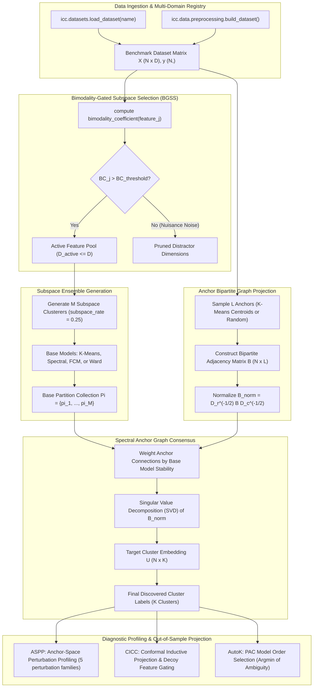

# ICC-Clustering Architecture Review

## 1. System Overview & Core Workflow

The `icc-clustering` package is an algorithmic clustering and consensus framework tailored for **high-dimensional regimes ($D \gg N$)** where distance concentration and spurious passenger variance degrade classical unsupervised clustering methods.

### End-to-End Execution Flow

---

## 2. Comprehensive Module Inventory

### 2.1 Core Engines (`src/icc/`)

#### Module: `src/icc/core.py`
- **Purpose:** Foundational mathematical routines and low-level clustering primitives. Contains Sarle's bimodality coefficient, synthetic signal/noise generators, and transductive base clusterer execution (`run_clusterer`).
- **Key Symbols:**
  - `bimodality_coefficient(x)`: Computes Sarle's bimodality coefficient $BC = \frac{\gamma^2 + 1}{\kappa + \frac{3(n-1)^2}{(n-2)(n-3)}}$.
  - `run_clusterer(X, k, method, seed)`: Dispatches single base clusterer (`kmeans`, `spectral`, `fcm`, `ward`).
  - `pairwise_coassoc(labels)`: Computes pairwise co-association matrix $A_{ij} = \mathbb{I}(\pi(i) = \pi(j))$.
  - `build_dataset(...)`: Synthesizes high-dimensional Gaussians with calibrated distractor noise.
- **Dependencies:** `numpy`, `scipy.stats` (`skew`, `kurtosis`), `scipy.spatial.distance`, `scikit-learn` (`KMeans`, `SpectralClustering`, `AgglomerativeClustering`).
- **Callers / Importers:** `src/icc/consensus/icc.py`, `src/icc/consensus/aspp.py`, `src/icc/data/preprocessing.py`, `tests/unit/test_core.py`, `tests/regression/test_leakage.py`.
- **Active Usage:** **Active Core.** Essential foundation for feature gating and base model execution.
- **Related Tests:** `tests/unit/test_core.py`, `tests/regression/test_leakage.py`.
- **Limitations:** FCM fallback relies on an internal soft-clustering iteration when external libraries are absent.
- **Overlaps:** `src/icc/data/preprocessing.py` previously duplicated `bimodality_coefficient` and `build_dataset`; `preprocessing.py` now cleanly imports and re-exports from `src/icc/core.py`.

---

#### Module: `src/icc/consensus/icc.py`
- **Purpose:** Canonical implementation of Invariant Core Consensus clustering engines:
  - `InvariantCoreConsensusV2` (ICC-v2 / GAC): Full feature-gated bipartite graph ensemble with BGSS, adaptive anchor scaling, and out-of-sample inductive projection.
  - `InvariantCoreConsensus` (ICC-v1): Calibrated anchor-graph consensus clustering baseline.
- **Key Symbols:**
  - `InvariantCoreConsensusV2`: Primary estimator class (`fit`, `predict`, `fit_predict`, `transform`).
  - `GAC`: Algorithm alias matching paper terminology (Gated Anchor Consensus).
  - `InvariantCoreConsensus`: Legacy ICC-v1 engine.
- **Dependencies:** `numpy`, `scipy.linalg`, `scipy.spatial.distance`, `scipy.stats`, `src.icc.core.run_clusterer`, `src.icc.consensus.aspp.AnchorSpacePerturbationProfiler`.
- **Callers / Importers:** `src/icc/consensus/__init__.py`, `src/icc/consensus_v2.py` (shim), `src/icc/benchmarks/runner.py`, `demo.py`, `examples/quickstart.py`, `examples/clinical_cancer_subtyping.py`.
- **Active Usage:** **Active Primary Algorithm.** Central algorithm of the entire repository.
- **Related Tests:** `tests/unit/test_consensus.py`, `tests/unit/test_aspp.py`, `tests/regression/test_anchor_fidelity.py`, `tests/regression/test_scaling_timing.py`.
- **Limitations:** Large feature dimensions ($D > 50,000$) require sufficient memory for BGSS vectorization across samples.

---

#### Module: `src/icc/consensus/aspp.py` (and `src/icc/aspp.py` shim)
- **Purpose:** Anchor-Space Perturbation Profiling (ASPP). Assesses cluster stability against 5 distinct perturbation families without re-running base ensembles, operating in linear $O(N \cdot L)$ anchor space.
- **Key Symbols:**
  - `AnchorSpacePerturbationProfiler`: Profile execution engine.
  - `ASPPConfig`: Dataclass specifying perturbation scales and bootstrap rounds.
  - `ASPP_FAMILIES`: Tuple of perturbation families: `("sampling", "feature", "measurement", "technical", "algorithmic")`.
- **Dependencies:** `numpy`, `scipy.spatial.distance`.
- **Callers / Importers:** `src/icc/consensus/icc.py`, `demo.py`, `tests/unit/test_aspp.py`.
- **Active Usage:** **Active Core.** Integrated directly into `InvariantCoreConsensusV2.fit()` when `profiling=True`.
- **Related Tests:** `tests/unit/test_aspp.py`.

---

#### Module: `src/icc/consensus/autok.py` (and `src/icc/autok.py` shim)
- **Purpose:** Unsupervised cluster number ($K$) discovery on the bipartite anchor graph. Evaluates the Proportion of Ambiguous Clustering (PAC) across candidate $K \in [K_{\min}, K_{\max}]$ without ground truth labels.
- **Key Symbols:**
  - `run_icc_autok(X, k_range, ...)`: Automated model order discovery.
  - `compute_anchor_pac(bipartite_matrix)`: Area under cumulative distribution curve of intermediate consensus matrix.
  - `AutoKResult`: Result dataclass containing `best_k_pac`, `best_k_silhouette`, and label assignments.
- **Dependencies:** `numpy`, `scikit-learn` (`silhouette_score`, `calinski_harabasz_score`, `davies_bouldin_score`), `src/icc/consensus/icc.py`.
- **Callers / Importers:** `src/icc/consensus/__init__.py`, `tests/unit/test_autok.py`.
- **Active Usage:** **Active Core.** Model order determination engine.
- **Related Tests:** `tests/unit/test_autok.py`.

---

### 2.2 Conformal Inductive Consensus Clustering (`src/cicc/`)

#### Package: `src/cicc/` (`conformal.py`, `decoy.py`, `inductive.py`, `memory.py`)
- **Purpose:** Conformal Inductive Consensus Clustering (CICC). Extends transductive consensus clustering to streaming, inductive out-of-sample patient projection with finite-sample statistical validity guarantees and decoy feature gating.
- **Key Classes:**
  - `InductiveConsensusClusterer` (`inductive.py`): Solves out-of-sample projection using calibrated anchor affinities in $O(N_{\text{test}} \cdot L)$ time.
  - `DecoyFeatureGating` (`decoy.py`): Introduces synthetic permuted decoy features to establish an empirical false discovery threshold for feature selection.
  - `ConformalClusterer` (`conformal.py`): Computes nonconformity scores and conformal $p$-value prediction sets guaranteeing marginal coverage $1 - \alpha$.
  - `InductiveConsensusMemory` (`memory.py`): FIFO / reservoir memory bank maintaining anchor stability over streaming batches.
- **Dependencies:** `numpy`, `scipy.linalg`, `scikit-learn` (`KMeans`).
- **Callers / Importers:** `src/icc/consensus/conformal.py` (re-exports into `icc.consensus`), `examples/leukemia_inductive.py`, `examples/realtime_patient_projection.py`, `tests/unit/test_cicc.py`, `tests/unit/test_inductive.py`.
- **Active Usage:** **Active Specialist Extension.**
- **Related Tests:** `tests/unit/test_cicc.py`, `tests/unit/test_inductive.py`.

---

### 2.3 Baseline Clustering Algorithms (`src/icc/baselines/` and `src/icc/algorithms/`)

#### Package: `src/icc/baselines/` (Canonical Implementation)
- **Purpose:** Pluggable baseline clustering methods and benchmark model adapters. Configured dynamically through `configs/baselines.yaml` and static registry dispatch.
- **Submodules:**
  - `classical.py`: K-Means (`run_kmeans`), Ward (`run_ward`), Spectral (`run_spectral`), FCM (`run_fcm`), and `ModelMetadata`.
  - `consensus.py`: Monti Standard Consensus (`run_standard_consensus`), Li et al. (2019) Consensus (`run_li_et_al_2019`), ICC-v1 (`run_icc_v1`), and ICC-v2 (`run_icc_v2`).
  - `anchor.py`: FastMVC (`run_fastmvc`) and FCAG (`run_fcag`).
  - `density.py`: HDBSCAN* (`run_hdbscan`, `evaluate_hdbscan_metrics`) and DBSCAN (`run_dbscan`).
  - `probabilistic.py`: Gaussian Mixture Models (`run_gmm`, `run_gmm_bic`, `run_gmm_icl`).
  - `sparse_kmeans.py`: Witten & Tibshirani $L_1$-penalized Sparse K-Means (`run_sparse_kmeans`).
  - `leiden_snn.py`: Shared Nearest Neighbor (SNN) graph construction and Leiden / Spectral community detection (`run_leiden_snn`, `run_spectral_snn`).
  - `deep.py`: Deep Embedded Clustering (`run_dec`, `run_idec`, `run_contrastive_clustering`, `run_scan`).
  - `cohirf.py`: Consensus Hierarchical Random Forests (`CoHiRF`, `run_cohirf`).
  - `__init__.py`: Dynamic discovery functions `get_model(name)` and `list_models(category)`.
- **Dependencies:** `numpy`, `scipy`, `scikit-learn`, `yaml`. Optional: `torch`, `tensorflow`, `igraph`.
- **Callers / Importers:** `src/icc/benchmarks/benchmark_models.py`, `src/icc/algorithms/` (shims), `demo.py`, `tests/unit/test_algorithms.py`, `tests/regression/test_algorithm_fidelity.py`.
- **Active Usage:** **Active Canonical.** Single source of truth for all baseline clustering execution.

---

### 2.4 Benchmarks & Experiments (`src/icc/benchmarks/` and `src/icc/experiments/`)

#### Package: `src/icc/benchmarks/` (Canonical)
- **Purpose:** Unified experiment orchestration, empirical scaling sweeps, and fidelity benchmarking.
- **Submodules:**
  - `runner.py`: `BenchmarkRunner` orchestrates multi-dataset, multi-algorithm, multi-seed experiments from YAML configs and produces structured JSON outputs. `BenchmarkResult` containers encapsulate runtime and metrics.
  - `benchmark_models.py`: Model loader dispatching into `icc.baselines`.
  - `fidelity.py`: Exact anchor fidelity calculation and sweep routines (`run_fidelity_sweep`).
  - `scaling.py`: Empirical scaling sweeps across varying sample size $N$ and dimension $D$ (`generate_benchmark_synthetic`, `run_scaling_sweep`).
- **Dependencies:** `numpy`, `pyyaml`, `icc.baselines`, `icc.datasets`.
- **Callers / Importers:** `src/icc/__init__.py`, `scripts/run.py`, `src/icc/experiments/` (shims), `tests/integration/test_runner.py`.
- **Active Usage:** **Active Canonical.**

---

### 2.5 Multi-Domain Datasets (`src/icc/datasets/` and `src/icc/data/`)

#### Package: `src/icc/datasets/` (Canonical Multi-Domain Registry)
- **Purpose:** Multi-domain dataset downloading, caching, preprocessing, and loading infrastructure.
- **Supported Datasets (13 enabled across 7 domains):**
  - Genomics ($D \gg N$): `sonar`, `madelon`, `colon`, `srbct`, `cns`, `leukemia`, `prostate`, `ovarian`.
  - Text / NLP: `newsgroups20`, `rcv1`.
  - Image: `yale_b`, `coil20`.
  - Hyperspectral: `indian_pines`, `pavia`.
  - Audio: `isolet`.
  - Single-cell RNA-seq: `zheng68k`, `tabula_muris`.
- **Key Symbols:** `load_dataset(name)`, `list_datasets()`, `get_dataset_info(name)`, `DatasetInfo`.
- **Dependencies:** `numpy`, `scipy.io` (`loadmat`), `scikit-learn` (`StandardScaler`, `LabelEncoder`), `pyyaml`. Optional: `scanpy`, `anndata`.
- **Callers / Importers:** `src/icc/datasets/__init__.py`, `src/icc/data/registry.py` (shim), `src/icc/benchmarks/runner.py`, `scripts/fetch_data.py`, `scripts/prepare_data.py`, `tests/integration/test_datasets.py`.
- **Active Usage:** **Active Canonical.**

#### Package: `src/icc/data/` (Functional Data Utilities)
- **Purpose:** Dynamic cohort discovery and synthetic high-dimensional data generators.
- **Submodules:**
  - `preprocessing.py`: Bimodality coefficient, synthetic signal/noise generation (`make_signal`, `make_noise`, `canonical`), re-exported from `icc.core`.
  - `cohorts.py`: Clinical and biological cohort discovery via NCBI/GEO query APIs.
  - `loaders.py`: Backward-compatibility loader shim.
  - `registry.py`: Backward-compatibility registry shim delegating to `icc.datasets.registry`.
- **Active Usage:** **Active Specialized.** Used by `test_cohort_discovery.py`, `test_pipeline.py`.

---

### 2.6 Evaluation Metrics (`src/icc/evaluation/` and `src/icc/metrics.py`)

#### Package: `src/icc/evaluation/` (Canonical)
- **Purpose:** Clustering evaluation metrics supporting dual execution modes:
  - Scikit-learn backend (when available for maximum performance).
  - Pure NumPy/SciPy fallback (ensuring deterministic evaluation even in minimal Python environments without scikit-learn).
- **Key Functions:**
  - `adjusted_rand_score(labels_true, labels_pred)`: Contingency-table ARI.
  - `normalized_mutual_info_score(labels_true, labels_pred)`: Arithmetic-mean normalized NMI.
  - `adjusted_mutual_info_score(labels_true, labels_pred)`: Expected mutual information adjusted AMI via hypergeometric distribution.
  - `v_measure_score(labels_true, labels_pred)`: Harmonic mean of homogeneity and completeness.
  - `fowlkes_mallows_score(labels_true, labels_pred)`: Geometric mean of precision and recall.
  - `evaluate_all(labels_true, labels_pred)`: Consolidated dictionary of all 5 metrics.
  - `evaluate_all_with_ci(labels_true, labels_pred, n_bootstrap)`: Bootstrap 95% confidence intervals.
- **Callers / Importers:** `src/icc/metrics.py` (shim), `src/icc/benchmarks/runner.py`, `scripts/evaluate.py`, `demo.py`, `tests/unit/test_metrics.py`.
- **Active Usage:** **Active Canonical.**

---

### 2.7 Statistical Testing (`src/icc/stats/`)

#### Module: `src/icc/stats/testing.py`
- **Purpose:** Rigorous statistical hypothesis testing across clustering benchmarks.
- **Key Functions:**
  - `wilcoxon_signed_rank_test(x, y)`: Non-parametric paired comparison.
  - `bonferroni_correction(p_values)`: Family-wise error rate control.
  - `bootstrap_ci(data, n_bootstraps, confidence)`: Empirical bootstrap confidence bounds.
- **Dependencies:** `numpy`, `scipy.stats`.
- **Callers / Importers:** `src/icc/stats/__init__.py`.
- **Active Usage:** **Active Auxiliary.**

---

### 2.8 Diagnostic Utilities (`src/icc/diagnostics.py` and `src/icc/utils/`)

#### Module: `src/icc/diagnostics.py`
- **Purpose:** System profiling, resource inspection, and environment verification.
- **Key Symbols:** `SystemDiagnostics`, `collect_system_info()`.
- **Dependencies:** `platform`, `sys`, `psutil` (optional), `os`.

#### Package: `src/icc/utils/` (`helpers.py`)
- **Purpose:** Shared logging configuration and serialization utilities.
- **Key Functions:** `configure_logging()`, `load_yaml_config(path)`.

---

## 4. Workstream A: Source-Code Overlap Audit & Decision Table

### Systematic Area-by-Area Analysis

#### 1. `src/icc/algorithms/` vs `src/icc/baselines/`
- **Current Responsibilities:**
  - `src/icc/baselines/`: Canonical implementation location for all comparative baseline methods (classical, consensus, deep, anchor, density, probabilistic, sparse_kmeans, leiden_snn). Fully tested in `tests/unit/test_algorithms.py` and `tests/regression/test_algorithm_fidelity.py`.
  - `src/icc/algorithms/`: Backward-compatibility shims re-exporting canonical baseline implementations. Verified by `tests/regression/test_architecture_compatibility.py`.
  - `src/icc/algorithms/base.py`: Defines `BaseClusterer`, `AlgorithmMetadata`, and `validate_clustering_input` (unwired future stubs).
- **Overlap:** Re-export shims mirror canonical baselines.
- **Recommended Action:** **Keep** shims to preserve backward compatibility for external callers (`from icc.algorithms import run_kmeans`); wire `validate_clustering_input` into core algorithms.
- **Breaking-Change Risk:** None (maintains 100% backward compatibility).

#### 2. `src/icc/consensus/` vs Root-Level Consensus Modules (`src/icc/consensus_v2.py`)
- **Current Responsibilities:**
  - `src/icc/consensus/`: Canonical package containing `icc.py` (ICC-v1, ICC-v2), `aspp.py` (ASPP engine), `autok.py` (AutoK), and `conformal.py`.
  - `src/icc/consensus_v2.py`: 25-line shim re-exporting `ICC`, `ICCv1`, `ICCv2`, `GAC`, `InvariantCoreConsensus`, `InvariantCoreConsensusV2` from `icc.consensus.icc`.
- **Overlap:** Full re-export of consensus estimator classes.
- **Recommended Action:** **Keep** `src/icc/consensus_v2.py` as an alias shim; canonical development remains inside `src/icc/consensus/`.
- **Breaking-Change Risk:** None.

#### 3. `src/icc/aspp.py` vs Consensus Package (`src/icc/consensus/aspp.py`)
- **Current Responsibilities:**
  - `src/icc/consensus/aspp.py`: Canonical 409-line ASPP engine executing 5 perturbation operators and computing the Perturbation Stability Index (PSI).
  - `src/icc/aspp.py`: Refactored 18-line backward-compatibility shim re-exporting `AnchorSpacePerturbationProfiler`, `ASPPConfig`, and `ASPP_FAMILIES`.
  - `src/icc/__init__.py`: Points directly to canonical `.consensus.aspp`.
- **Overlap:** Pure re-export shim.
- **Recommended Action:** **Keep** `src/icc/aspp.py` as a lightweight shim.
- **Breaking-Change Risk:** None.

#### 4. `src/icc/autok.py` vs Consensus Package (`src/icc/consensus/autok.py`)
- **Current Responsibilities:**
  - `src/icc/consensus/autok.py`: Canonical AutoK and PAC implementation.
  - `src/icc/autok.py`: 11-line shim re-exporting `AutoKResult`, `compute_anchor_pac`, `run_icc_autok`.
- **Overlap:** Pure re-export shim.
- **Recommended Action:** **Keep** `src/icc/autok.py` as a lightweight shim.
- **Breaking-Change Risk:** None.

#### 5. `src/icc/data/` vs `src/icc/datasets/`
- **Current Responsibilities:**
  - `src/icc/datasets/`: Canonical data loader suite for all 13 benchmark datasets (`registry.py`, `genomics.py`, `scrnaseq.py`, `image.py`, `text.py`, `audio.py`, `spectral.py`).
  - `src/icc/data/`: Contains `cohorts.py` (NCBI GEO downloader), `preprocessing.py` (synthetic data generator & bimodality coefficient), `registry.py` (22-line shim to `datasets.registry`), `loaders.py` (11-line shim).
- **Overlap:** `data/registry.py` and `data/loaders.py` are shims to `datasets.registry`.
- **Recommended Action:** **Consolidate** data loading canonically under `src/icc/datasets/`. Retain `src/icc/data/registry.py` and `loaders.py` as shims. Retain `data/preprocessing.py` and `data/cohorts.py`.
- **Breaking-Change Risk:** Low.

#### 6. `src/icc/metrics.py` vs `src/icc/evaluation/metrics.py`
- **Current Responsibilities:**
  - `src/icc/evaluation/metrics.py`: Canonical dual-backend evaluation metrics module with NumPy fallbacks.
  - `src/icc/metrics.py`: 39-line shim re-exporting all metrics.
- **Overlap:** Pure re-export shim.
- **Recommended Action:** **Keep** `src/icc/metrics.py` as a backward-compatibility shim.
- **Breaking-Change Risk:** None.

#### 7. `src/icc/experiments/` vs `scripts/`
- **Current Responsibilities:**
  - `src/icc/benchmarks/`: Canonical module for benchmark execution (`runner.py`, `benchmark_models.py`, `fidelity.py`, `scaling.py`).
  - `src/icc/experiments/`: 4-file shim directory re-exporting from `src/icc/benchmarks/`.
  - `scripts/`: Top-level CLI scripts (`run.py`, `evaluate.py`, `fetch_data.py`, `prepare_data.py`, `reproduce.py`).
- **Overlap:** `experiments/` shims to `benchmarks/`. `scripts/` invokes `benchmarks.runner`.
- **Recommended Action:** **Keep** `src/icc/experiments/` shims. Standardize CLI documentation on `scripts/run.py` and `icc.benchmarks`.
- **Breaking-Change Risk:** None.

---

### Master Component Overlap & Decision Table

| Component | Current Responsibility | Overlap Analysis | Recommended Action | Breaking-Change Risk |
|---|---|---|---|---|
| `src/icc/baselines/` | Canonical baseline implementations (14 algorithms) | None (Canonical) | **Keep** | None |
| `src/icc/algorithms/` | Backward-compatibility re-exports from `baselines/` | 100% covered by `baselines/` | **Keep** (as shims) | None |
| `src/icc/algorithms/base.py` | Abstract `BaseClusterer`, metadata, and validator | Unwired stubs | **Keep & Wire** (into core `fit_predict`) | None |
| `src/icc/consensus/` | Canonical core consensus algorithms (`icc`, `aspp`, `autok`) | None (Canonical) | **Keep** | None |
| `src/icc/consensus_v2.py` | Re-export shim for `icc.consensus.icc` | Redundant with `consensus/` | **Keep** (as shim) | None |
| `src/icc/consensus/aspp.py` | Canonical 5-family ASPP perturbation engine | None (Canonical) | **Keep** | None |
| `src/icc/aspp.py` | Root re-export shim for `icc.consensus.aspp` | Redundant with `consensus/aspp.py` | **Keep** (18-line shim) | None |
| `src/icc/consensus/autok.py` | Canonical AutoK and PAC calculation engine | None (Canonical) | **Keep** | None |
| `src/icc/autok.py` | Root re-export shim for `icc.consensus.autok` | Redundant with `consensus/autok.py` | **Keep** (11-line shim) | None |
| `src/icc/datasets/` | Canonical 13-benchmark dataset loader and registry | None (Canonical) | **Keep** | None |
| `src/icc/data/registry.py` | Re-export shim for `icc.datasets.registry` | Redundant with `datasets/registry.py` | **Keep** (as shim) | None |
| `src/icc/data/loaders.py` | Re-export shim for `data/registry.py` | Redundant shim-to-shim | **Keep** (as shim) | None |
| `src/icc/data/cohorts.py` | NCBI GEO cohort fetcher & eligibility gates | None (Unique functional data tool) | **Keep** | None |
| `src/icc/data/preprocessing.py`| Bimodality coefficient & synthetic data generators | Semantic collision on `pairwise_coassoc` with `core.py` | **Rename / Disambiguate** (`core.py` helper) | Low |
| `src/icc/evaluation/` | Canonical dual-backend evaluation metrics | None (Canonical) | **Keep** | None |
| `src/icc/metrics.py` | Root re-export shim for `icc.evaluation.metrics` | Redundant with `evaluation/` | **Keep** (as shim) | None |
| `src/icc/benchmarks/` | Canonical benchmark runner and scaling suites | None (Canonical) | **Keep** | None |
| `src/icc/experiments/` | Re-export shims for `icc.benchmarks` | Redundant with `benchmarks/` | **Keep** (as shims) | None |
| `scripts/` | Top-level CLI entry points (`run`, `evaluate`, `fetch`) | Invokes `benchmarks` and `datasets` | **Keep** | None |
