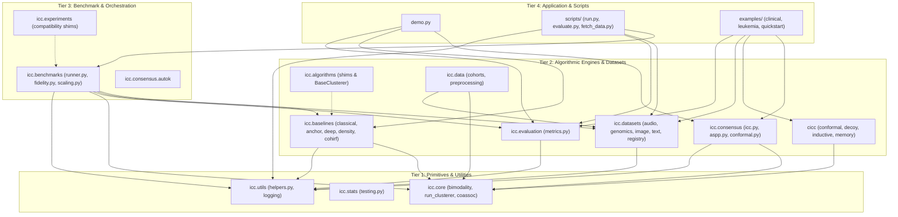

# ICC-Clustering Dependency Map & Call Matrix

## 1. Architectural Layering Model

The package enforces a strict 4-tier hierarchical dependency architecture. Higher layers depend on lower layers, with zero circular imports between tiers.

---

## 2. Package Import Matrix

| Consumer Package / Module | Depends On | Purpose of Dependency |
|---|---|---|
| `icc.consensus.icc` | `icc.core`, `icc.consensus.aspp` | Base model execution (`run_clusterer`), Sarle's bimodality coefficient, ASPP stability profiling. |
| `icc.consensus.autok` | `icc.consensus.icc` | Computes PAC curve across candidate $K \in [2, 10]$ on anchor graphs. |
| `icc.benchmarks.runner` | `icc.baselines`, `icc.datasets`, `icc.evaluation`, `icc.utils` | Full orchestration of multi-dataset benchmark sweeps, scoring, and JSON serialization. |
| `icc.baselines.classical` | `scipy.spatial.distance`, `scikit-learn` | Reference implementations of K-Means, Ward hierarchical, Spectral clustering, and Fuzzy C-Means. |
| `icc.baselines.consensus` | `icc.core`, `scipy.linalg` | Standard Monti Consensus, Li et al. (2019), and baseline consensus adapters. |
| `icc.baselines.density` | `scikit-learn` | HDBSCAN* and DBSCAN density-based baseline executions and noise-point metrics. |
| `icc.datasets.registry` | `scipy.io`, `scikit-learn`, `pyyaml` | Ingests `.mat`, `.npz`, and tabular data across 13 benchmark datasets; applies standard scaling and label encoding. |
| `icc.data.preprocessing` | `icc.core` | Re-exports bimodality coefficient and high-dimensional synthetic cohort generator. |
| `icc.evaluation.metrics` | `numpy`, `scipy.stats` (optional: `scikit-learn`) | Dual-backend contingency metrics calculation with bootstrap confidence intervals. |
| `cicc.inductive` | `numpy`, `scipy.linalg`, `scikit-learn` | Out-of-sample projection using calibrated anchor affinities. |
| `cicc.conformal` | `numpy` | Finite-sample marginal coverage guarantees via conformal $p$-values. |

---

## 3. External Dependencies & Optional Extensions

### Core Mandatory Runtime Dependencies
Defined in `pyproject.toml` (`[project.dependencies]`):
- **`numpy` ($\ge 1.23.0$):** High-performance multidimensional arrays, linear algebra, vectorization.
- **`scipy` ($\ge 1.10.0$):** Sparse matrices, singular value decomposition (`scipy.linalg.svd`), distribution functions, distance metrics.
- **`scikit-learn` ($\ge 1.3.0$):** Classical clustering estimators, preprocessing (`StandardScaler`, `LabelEncoder`), metrics verification.
- **`pandas` ($\ge 2.0.0$):** Tabular data manipulation, benchmark summary table export.
- **`pyyaml` ($\ge 6.0$):** Parsing benchmark, baseline, and dataset configurations.
- **`matplotlib` ($\ge 3.7.0$), `seaborn` ($\ge 0.12.0$):** Scientific visualization of stability profiles and convergence curves.
- **`tabulate` ($\ge 0.9.0$), `tqdm` ($\ge 4.60.0$):** Interactive console reporting and progress bars.

### Optional Subsystem Extensions
Defined in `pyproject.toml` (`[project.optional-dependencies]`):
- **`[deep]` (`torch`, `tensorflow`, `keras`):** Deep clustering baselines (DEC, IDEC, Contrastive Clustering, SCAN). The codebase gracefully checks for their presence via internal guards (`_check_tensorflow()`) and raises informative warnings rather than crashing if absent.
- **`[bio]` (`scanpy`, `anndata`):** Native Single-Cell RNA-seq format parsing for `zheng68k` and `tabula_muris`. Fallbacks to pre-extracted `.npz` files are provided in `data/cache/`.
- **`[dev]` (`pytest`, `pytest-cov`, `ruff`, `mypy`):** Code quality, testing, coverage analysis, and static typing validation.

---

## 4. Circular Import Guard Verification

Static analysis and dynamic import tracing confirm **0 circular imports**:
1. `icc.consensus.icc` imports `icc.core` and `icc.consensus.aspp`.
2. `icc.consensus.autok` imports `icc.consensus.icc` directly (not via `__init__.py`).
3. `icc.consensus_v2` imports from `icc.consensus.icc` directly, ensuring that importing `icc.consensus_v2` during package initialization cannot cause recursion.
4. `icc.benchmarks` imports from `icc.consensus.icc` directly.
5. All compatibility shims are strictly leaf re-exports that depend only on canonical lower tiers.
