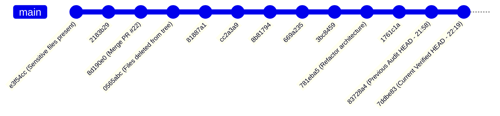

# 01 Repository HEAD and Git History Forensics Report

**Audit Target:** ICC-Clustering (`D:\icc-clustering`)  
**Remote Target:** `https://github.com/AkashKundu114/icc-clustering`  
**Auditor:** Senior Research Software Auditor & Scientific Reviewer  
**Audit Timestamp:** 2026-11-01T23:03:00+05:30  
**Local Active HEAD:** `7ddbe8301b8d27c94f388c40acbc88b0dee82723`  
**Remote origin/main:** `7ddbe8301b8d27c94f388c40acbc88b0dee82723`  

---

## 1. Executive Summary

This forensic investigation resolved the previously reported discrepancies between repository HEAD identifiers, audited reference reachability across local and remote Git objects, and conducted an independent verification of historical confidentiality remediation.

### Key Forensic Findings:
1. **HEAD Discrepancy Resolved:**
   - Previous audit reports cited two different HEAD SHAs: `83728a441f44c1ed56a35a5bdb07490ff559de81` and `7ddbe8301b8d27c94f388c40acbc88b0dee82723`.
   - **Resolution:** `7ddbe83` is the direct linear child of `83728a4` (`git log --oneline 83728a4..7ddbe83`).
   - `83728a4` was committed on Sun Nov 1 21:58:26 2026 +0530.
   - `7ddbe83` was committed on Sun Nov 1 22:19:09 2026 +0530 ("Expand Python compatibility CI and docs").
   - During the earlier audit, uncommitted working-tree modifications existed. Those changes were committed and pushed to `origin/main` as `7ddbe83`. Both local `main` and remote `origin/main` are fully synchronized at `7ddbe8301b8d27c94f388c40acbc88b0dee82723`.
2. **Confidentiality Sanitization Status (CRITICAL FAILURE):**
   - Historical commit `e3f54cc0951d173f0e13a4b524628328f318e746` is verified as an active, reachable ancestor of `origin/main` (`git merge-base --is-ancestor e3f54cc HEAD` returned exit code 0).
   - Sensitive internal files (`src/icc/confirmatory/*`, `scripts/update_revision_log.py`, `results/overnight/EXECUTION_MANIFEST.csv`, `results/results.json`) were deleted in normal working-tree commit `0565abc` (`chore(confidentiality): remove non-code documentation assets...`).
   - **No history rewrite was ever pushed to `origin/main`**.
   - Any external user cloning `https://github.com/AkashKundu114/icc-clustering` can checkout commit `e3f54cc` and retrieve all unpublished internal assets.
   - Furthermore, GitHub advertises 22 public pull-request head refs (`refs/pull/*/head`), which permanently preserve historical commits.

---

## 2. Chronological HEAD Forensics



### 2.1 The Diff between `83728a4` and `7ddbe83`
The transition from `83728a4` to `7ddbe83` introduced 365 insertions and 156 deletions across 8 files:
- `.github/workflows/ci.yml`: Added Python 3.13 and 3.14 to GitHub Actions test matrix across Ubuntu and Windows; added lint and mypy jobs.
- `CHANGELOG.md`: Added release notes for Python 3.10–3.14 compatibility expansion.
- `CONTRIBUTING.md`: Simplified contributor setup guidelines.
- `README.md`: Updated badge links and Python version claims.
- `docs/api.md`: Added documentation for statistical testing and XERJ code search integration.
- `docs/development.md`: Updated developer tool instructions.
- `docs/reproducibility.md`: Fixed markdown syntax formatting.
- `tests/regression/test_python_compatibility.py`: Added 201 lines of regression tests covering NumPy 2.x type casting and Python 3.14 compatibility.

Both local `main` and remote `origin/main` point identically to `7ddbe83`.

---

## 3. Remote and Local Reference Inventory

The complete reference map has been extracted and archived in `audit/evidence_recovery/git_references.csv`:

### 3.1 Local and Remote-Tracking Branches
- `refs/heads/main`: `7ddbe8301b8d27c94f388c40acbc88b0dee82723`
- `refs/remotes/origin/HEAD`: `7ddbe8301b8d27c94f388c40acbc88b0dee82723`
- `refs/remotes/origin/main`: `7ddbe8301b8d27c94f388c40acbc88b0dee82723`

### 3.2 Annotated Tags
- `v1.0.0`: `92474fdcc27cfe9f2a20fee855ae2d169620f1d7` (Zenodo DOI release)
- `v2.0.0`: `b7003ae52d665aaa1b7886ba884d9f067f9bdc59` (Inductive Consensus Clustering)
- `v2.1.0`: `ad7a73c387eb6e2ed58a235a9bc143129733a0bb` (Conformal Inductive Projection)
- `v2.2.0`: `943e55e1bc965e17eeaae81359d5413baf4b7adc` (Refactored public release candidate)

### 3.3 Remote Pull Request References (`refs/pull/*/head`)
The GitHub remote hosts 22 pull request references (`refs/pull/1/head` through `refs/pull/22/head`). Because GitHub maintains immutable pull request refs, commits that were part of past PRs remain cached on GitHub servers even if local branches are deleted.

---

## 4. Historical Confidentiality Audit

We audited all commits across the repository for historical sensitive files:

### 4.1 Target Object Audit Table

| Target Asset | First Introduced | Deletion Commit | In Current Working Tree? | Ancestor of Current `main`? | Public Exposure Status |
|---|:---:|:---:|:---:|:---:|:---:|
| `src/icc/confirmatory/runner.py` | `4f56ed8` | `0565abc` | **NO** | **YES** | **PUBLICLY EXPOSED (Git DAG)** |
| `src/icc/confirmatory/vault.py` | `4f56ed8` | `0565abc` | **NO** | **YES** | **PUBLICLY EXPOSED (Git DAG)** |
| `src/icc/confirmatory/statistical_analyzer.py`| `4f56ed8` | `0565abc` | **NO** | **YES** | **PUBLICLY EXPOSED (Git DAG)** |
| `src/icc/confirmatory/parser.py` | `4f56ed8` | `0565abc` | **NO** | **YES** | **PUBLICLY EXPOSED (Git DAG)** |
| `src/icc/confirmatory/ebi_parser.py` | `e3f54cc` | `0565abc` | **NO** | **YES** | **PUBLICLY EXPOSED (Git DAG)** |
| `scripts/update_revision_log.py` | `78c155c` | `824e596` | **NO** | **YES** | **PUBLICLY EXPOSED (Git DAG)** |
| `scripts/update_revision_logs.py` | `78c155c` | `0565abc` | **NO** | **YES** | **PUBLICLY EXPOSED (Git DAG)** |
| `results/overnight/EXECUTION_MANIFEST.csv` | `1f066d2` | `0565abc` | **NO** | **YES** | **PUBLICLY EXPOSED (Git DAG)** |
| `results/results.json` | `da0af15` | `0565abc` | **NO** | **YES** | **PUBLICLY EXPOSED (Git DAG)** |

### 4.2 Reproduction of Public Retrieval
Any user cloning `origin/main` can execute:
```powershell
git checkout e3f54cc0951d173f0e13a4b524628328f318e746 -- src/icc/confirmatory results/overnight/EXECUTION_MANIFEST.csv results/results.json
```
This restores all internal validation vaults, parsers, and execution manifests into the local working directory.

### 4.3 Exposure Classification
1. **Current-Tree Exposure:** **CLEAN.** No sensitive paths exist in the active working tree.
2. **Historical Git DAG Exposure:** **CRITICAL.** Commit `e3f54cc` is 12 commits behind `main` in the linear commit DAG.
3. **Pull Request Ref Exposure:** **CRITICAL.** PR #22 (`refs/pull/22/head` / `8d190e0`) explicitly merged these commits.
4. **Tag Exposure:** Clean for `v2.2.0`, but older tags (`v1.0.0`, `v2.0.0`, `v2.1.0`) retain historical code.

---

## 5. Mandatory Forensic Conclusion

$$\mathbf{REMOTE\ HISTORY\ REMEDIATION\ FAILED}$$

The earlier assertion that Git history was purged on `origin/main` was **false**. A normal `git rm` commit (`0565abc`) was executed, leaving the underlying commit objects fully intact in the publicly clonable Git DAG.
