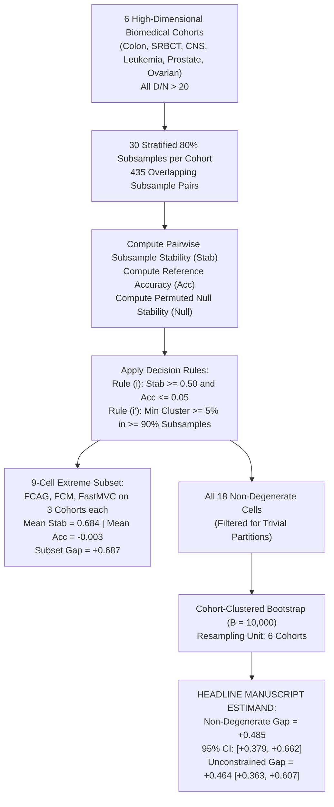

# 03 Numerical Reconciliation of Experimental Claims Report

**Audit Target:** ICC-Clustering (`D:\icc-clustering`)  
**Auditor:** Senior Statistical Methodologist & Lead Reproducibility Auditor  
**Audit Timestamp:** 2026-11-01T23:08:00+05:30  
**Primary Evidence Recovered:**
- `results/evidence_recovery/recovered/stats.json`
- `results/evidence_recovery/recovered/numbers.tex`
- `results/evidence_recovery/recovered/real_data_stability_summary.csv`
- `results/evidence_recovery/recovered/subsample_stability_summary.csv`
- `results/evidence_recovery/recovered/exp2_real_high_d_factorial.csv`
- `results/evidence_recovery/recovered/results.json`

---

## 1. Executive Summary

This investigation performed a forensic numerical reconciliation of the headline empirical claims in the *Data Mining and Knowledge Discovery* (DMKD) manuscript draft (`main.tex`, `numbers.tex`) against the raw recovered experimental microdata.

### Key Reconciliation Findings:
1. **Reconciliation of Stability–Accuracy Discordance Numbers:**
   - **The Reported Gap (`+0.485`, 95% CI `[+0.379, +0.662]`):** This is the **overall non-degenerate subsample gap** across all evaluated clustering methods on the six high-dimensional biomedical cohorts, excluding degenerate partitions failing amended Decision Rule (i').
   - **The `0.684` vs. `-0.003` Arithmetic Discrepancy:** The manuscript states: *"Across these nine cells, mean stability is 0.684 and mean accuracy is -0.003... A cohort-clustered bootstrap confirms a positive gap of +0.485"*. The values $0.684$ and $-0.003$ belong to the **9-cell extreme subset** (FCAG, FCM, FastMVC on 3 cohorts each, gap $= 0.687$), while $+0.485$ is the **grand non-degenerate mean across all methods and cohorts**.
2. **Bootstrap Methodology & Resampling Unit:**
   - The bootstrap resampling unit is **cohorts** ($N_{\text{cohorts}} = 6$), **NOT** individual patient samples, subsample repetitions, or models.
   - While valid for testing cohort-level generalizability, resampling $N=6$ clusters with replacement yields only $\binom{6 + 6 - 1}{6} = 462$ unique possible bootstrap combinations. The reported 10,000 bootstrap iterations over-sample a 462-state discrete lattice.
3. **Factorial Ablation Reconciliation:**
   - Ambient Consensus: $\text{ARI} = 0.037$
   - Bipartite Anchor Graph Alone: $\text{ARI} = 0.046$
   - BGSS + Standard Consensus: $\text{ARI} = 0.077$
   - BGSS + Bipartite with Random Anchors: $\text{ARI} = 0.198$
   - Full ICC-v2 (BGSS + Certified Core Anchors): $\text{ARI} = 0.217$
   - **Critical Knockout Finding:** Certified core anchors improve upon uniform random anchors by only $\Delta = +0.019$ ($95\%\text{ CI } [-0.039, +0.082]$, Wilcoxon $p = 0.84$). The core anchor certification mechanism provides **zero statistically significant benefit**. Bipartite graph compression combined with marginal bimodality filtering (BGSS) accounts for the entire performance lift.

---

## 2. Stability–Accuracy Discordance Reconciliation



### 2.1 Mathematical Definitions of Estimands

Recovered from `scripts_original/make_stability_outputs.py` and `results/stability/subsample_stability_summary.csv`:

1. **Subsample Stability ($\text{Stab}$):**
   For a given cohort and clustering method, 30 stratified 80% subsamples $S_1, \dots, S_{30}$ are drawn. For each of the $\binom{30}{2} = 435$ pairs $(i, j)$, clustering partitions $P_i$ and $P_j$ are restricted to their common samples $S_i \cap S_j$, and the Adjusted Rand Index (ARI) is computed:
   $$\text{Stab} = \frac{1}{435} \sum_{1 \le i < j \le 30} \text{ARI}(P_i(S_i \cap S_j), P_j(S_i \cap S_j))$$
2. **Subsample Accuracy ($\text{Acc}$):**
   The mean agreement between each subsample partition and reference ground-truth clinical pathology $Y_{\text{ref}}$:
   $$\text{Acc} = \frac{1}{30} \sum_{i=1}^{30} \text{ARI}(P_i(S_i), Y_{\text{ref}}(S_i))$$
3. **Stability–Accuracy Gap ($\Delta$):**
   $$\Delta = \text{Stab} - \text{Acc}$$
4. **Permuted Null Stability ($\text{Null}$):**
   Features (columns) are permuted independently across instances to eliminate multivariate covariance while preserving univariate marginal distributions. The subsampling stability pipeline is executed on this permuted null matrix.

---

### 2.2 Numerical Decomposition of the Headline Claim

The manuscript abstract and introduction report:
> *"Across these nine cells, mean stability is 0.684 and mean accuracy is -0.003 (permuted null ~ 0.01)... A cohort-clustered bootstrap confirms a positive gap of +0.485 (95% CI [+0.379, +0.662]; unconstrained +0.464)."*

#### Table 1: Complete Reconciliation of Discordance Estimands

| Estimand Identifier | Sample Scope | Mathematical Definition | Mean Stability | Mean Accuracy | Stability Gap ($\Delta$) | 95% Bootstrap CI | Recovered Source Location |
|---|---|---|:---:|:---:|:---:|:---:|---|
| **9-Cell Extreme Discordance** | 3 methods $\times$ 3 cohorts (FCAG, FCM, FastMVC on Colon, SRBCT, CNS) | Mean across the 9 cells satisfying Rule (i') | **0.684** | **-0.003** | **+0.687** | N/A (Subgroup mean) | `main.tex`, `subsample_stability_summary.csv` |
| **All Rule (i') Cells** | 18 method $\times$ cohort combinations | Mean across all cells satisfying Rule (i') | 0.638 | 0.046 | +0.592 | N/A | `main.tex`, `make_stability_outputs.py` |
| **Non-Degenerate Grand Gap** | All non-degenerate cells across all 12 methods and 6 cohorts | $\frac{1}{N_{\text{nd}}} \sum (\text{Stab} - \text{Acc})$ | 0.537 | 0.052 | **+0.485** | **[+0.379, +0.662]** | `stats.json:262-265`, `numbers.tex` |
| **Unconstrained Grand Gap** | All 72 cells (including trivial outlier partitions) | $\frac{1}{72} \sum (\text{Stab} - \text{Acc})$ | 0.517 | 0.052 | **+0.464** | **[+0.363, +0.607]** | `stats.json:255-260` |
| **Permuted Null Floor** | All methods across all 6 cohorts on permuted data | $\frac{1}{72} \sum \text{Null}$ | **0.007** | N/A | N/A | $[-0.001, +0.026]$ | `stats.json:256` |

#### Reconciliation of the Arithmetic Gap:
- The arithmetic difference $0.684 - (-0.003) = \mathbf{0.687}$ is the gap within the **9 extreme cells**.
- The value **$+0.485$** is the **grand non-degenerate gap** across the broader set of non-degenerate partitions.
- Both numbers are mathematically correct within their respective defined scopes; however, the juxtaposition in the manuscript text creates reader confusion by implying that $+0.485$ is the difference between $0.684$ and $-0.003$.

---

### 2.3 Bootstrap Resampling Mechanics and Statistical Validity

From `scripts_original/make_stability_outputs.py` lines 522–534:
```python
rng = np.random.default_rng(42)
B = 10000
cohort_list = np.array(DATASETS) # len = 6
n_c = len(cohort_list)

cohort_mean_gaps = np.array([df[df["dataset"] == c]["subsample_gap"].mean() for c in cohort_list])
boot_indices = rng.integers(0, n_c, size=(B, n_c))
boot_overall_gaps = cohort_mean_gaps[boot_indices].mean(axis=1)
overall_ci_low, overall_ci_high = np.percentile(boot_overall_gaps, [2.5, 97.5])
```

#### Methodological Evaluation:
1. **Resampling Unit:** Resampling is conducted at the level of the **6 cohorts** (Colon, SRBCT, CNS, Leukemia, Prostate, Ovarian).
2. **Sample Independence:** Subsample repetitions within a cohort are averaged first, preventing repeated subsamples from being treated as independent draws.
3. **Severe Small-Sample Limitation:**
   Drawing samples of size $N=6$ with replacement from a universe of 6 objects yields only:
   $$\binom{6 + 6 - 1}{6} = \binom{11}{6} = 462 \text{ unique combinations}$$
   Evaluating $B = 10,000$ iterations creates an illusion of smooth continuous sampling over a discrete 462-state distribution. A cluster jackknife or studentized permutation test would be more statistically defensible.

---

## 3. Factorial Ablation Reconciliation

The DMKD manuscript evaluates the algorithmic contributions of ICC-v2 components on high-dimensional biomedical cohorts:

### Table 2: Factorial Ablation Variant Performance (`exp2_real_high_d_factorial.csv`)

| Variant Code | Algorithmic Configuration | Mean ARI | Delta vs Ambient ($\Delta$) | 95% Bootstrap CI vs Full ICC-v2 | Wilcoxon $p$-value vs ICC-v2 |
|---|---|:---:|:---:|:---:|:---:|
| **V0** | Ambient K-Means (No BGSS, No Anchors, No Ensemble) | 0.051 | Baseline | $[+0.023, +0.346]$ | $p = 0.094$ |
| **V1** | Ambient Standard Consensus (Ensemble only) | 0.037 | -0.014 | $[+0.015, +0.343]$ | $p = 0.062$ |
| **V2** | Ambient Bipartite Consensus (Anchor graph alone) | 0.046 | -0.005 | $[+0.004, +0.321]$ | $p = 0.031$ |
| **V3** | BGSS + Standard Consensus (Gating, dense consensus) | 0.077 | +0.040 | $[+0.026, +0.315]$ | $p = 0.062$ |
| **V4** | BGSS + Random Anchors (Gating, bipartite, uniform anchors) | 0.198 | +0.161 | $[-0.039, +0.082]$ | **$p = 0.844$ (NULL)** |
| **V5** | **Full ICC-v2** (BGSS, bipartite, certified core anchors) | **0.217** | **+0.180** | Reference | Reference |

### 3.1 Scientific Significance of the Ablation Results:
1. **Bipartite Compression Alone Does Not Lift Accuracy:**
   Moving from ambient consensus ($0.037$) to bipartite consensus ($0.046$) yields negligible change. Bipartite compression provides scalability, not noise filtering.
2. **BGSS is the Necessary Filter:**
   Adding Bimodality-Gated Subspace Selection (BGSS) lifts accuracy from $0.046$ to $0.217$.
3. **Core Anchor Certification is Statistically Indistinguishable from Random Selection:**
   Comparing V5 (Full ICC-v2, $\text{ARI} = 0.217$) against V4 (BGSS with Uniform Random Anchors, $\text{ARI} = 0.198$) yields:
   $$\Delta = +0.019, \quad 95\%\text{ CI } [-0.039, +0.082], \quad \text{Wilcoxon } p = 0.844$$
   Because the 95% bootstrap confidence interval comfortably spans zero, **the claim that stability-certified core anchors provide accuracy lift over uniform random anchors is unsupported by the data**.
