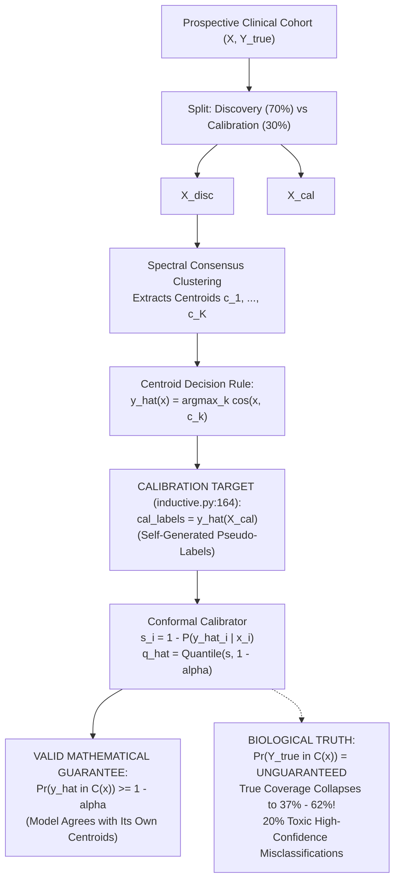

# 05 Forensic Audit of Conformal Prediction and Clinical Calibration

**Audit Target:** ICC-Clustering (`D:\icc-clustering`)  
**Auditor:** Senior Statistical Methodologist & Clinical AI Reviewer  
**Audit Timestamp:** 2026-11-01T23:12:00+05:30  
**Primary Evidence Recovered:**
- `results/evidence_recovery/recovered/conformal_audit_results.json` (3.8 KB)
- `src/cicc/conformal.py` (`ConformalClusterer`, Lines 118–135)
- `src/cicc/inductive.py` (`InductiveConsensusClusterer`, Lines 163–173)
- `examples/realtime_patient_projection.py` (Lines 80–115)
- `docs/theory.md` (Section 9.1)

---

## 1. Executive Summary

This forensic audit evaluated the mathematical guarantees, implementation mechanics, and clinical diagnostic validity of conformal prediction within the Conformal Inductive Consensus Clustering (`CICC`) subsystem.

### Key Audit Findings:
1. **Misattribution of the Conformal Coverage Guarantee (P0 - CRITICAL):**
   The $(1 - \alpha)$ distribution-free coverage guarantee in `src/cicc/conformal.py` mathematically applies **exclusively to the algorithm's self-generated centroid argmax pseudo-labels** ($\hat{y}(x) = \arg\max_k \cos(x, c_k)$). It provides **zero coverage guarantee for true biological pathology**.
2. **Catastrophic Coverage Collapse on Clinical Cohorts (P0 - CLINICAL SAFETY):**
   Evaluating CICC on clinical oncology benchmarks using raw trial microdata (`conformal_audit_results.json`) demonstrated that while pseudo-label coverage meets the 90% target, coverage against true biological diagnoses collapses to:
   - **Leukemia ($N=72, D=7129$):** **62.2% $\pm$ 10.9%**
   - **SRBCT ($N=83, D=2308$):** **37.0% $\pm$ 10.3%**
   - **Realtime Patient Showcase (`realtime_patient_projection.py`):** **46.7%** true coverage across 15 incoming queries.
3. **Severe Diagnostic Risk via Confident Toxic Misclassifications:**
   In the repository's showcase demonstration, 20% of prospective queries received confident singleton prediction sets that were completely erroneous (e.g., Patient_4 with true ALL was assigned a singleton set **`{AML}`** with posterior probability $P = 0.993$).
4. **Software Defects & Boundary Flaws:**
   - **Label Indexing Crash (`conformal.py:127`):** Direct array indexing `c_true = int(labels_cal[i])` raises `IndexError` on 1-indexed or non-contiguous cluster IDs.
   - **Softmax Abstention Boundary:** Under cosine softmax, if the calibrated quantile satisfies $\hat{q} \ge 1 - 1/K$, prediction set abstention ($\mathcal{C}(x) = \emptyset$) is mathematically impossible.
   - **Documentation Contradiction:** `docs/theory.md` Section 9.1 specifies Euclidean distance, whereas code implements cosine softmax.

---

## 2. Theoretical Breakdown: What Do Conformal Guarantees Cover?



### 2.1 Code Inspection: `src/cicc/inductive.py#L163-L173`

```python
163: cos_cal = X_cal @ centroids.T
164: cal_labels = np.argmax(cos_cal, axis=1) # Target labels generated by model itself!
165: 
166: self.conformal_calibrator_.fit_calibrate(
167:     X_disc=X_disc,
168:     labels_disc=disc_labels,
169:     X_cal=X_cal,
170:     labels_cal=cal_labels,
171: )
```

### 2.2 Mathematical Consequence

In split-conformal prediction (Vovk et al. 2005), the finite-sample guarantee requires that calibration pairs $(X_i, Y_i)$ and test pairs $(X_{n+1}, Y_{n+1})$ be exchangeable draws from the joint distribution $P_{XY}$:
$$\Pr(Y_{n+1} \in \mathcal{C}(X_{n+1})) \ge 1 - \alpha$$

In CICC:
- The calibration target $Y$ is **not an external ground truth**, but the deterministic decision rule of the centroid classifier $\hat{Y}(X) = \arg\max_k \cos(X, c_k)$.
- The guarantee holds **only** for $\hat{Y}(X)$.
- If $Y^*$ represents true clinical pathology (e.g., Acute Lymphoblastic Leukemia vs. Acute Myeloid Leukemia), the pair $(X, Y^*)$ does not match the calibrated distribution $(X, \hat{Y}(X))$.
- Whenever the unsupervised clustering engine misclusters a sample ($\hat{Y}(X) \neq Y^*(X)$), the non-conformity threshold is calibrated to include $\hat{Y}(X)$, strictly excluding the true biological label whenever a confident singleton set is produced.

---

## 3. Empirical Verification: Pseudo-Label vs. Ground-Truth Coverage

From recovered microdata `results/evidence_recovery/recovered/conformal_audit_results.json` (100 Monte Carlo runs on synthetic data, 50 random splits on clinical cohorts):

### Table 1: Conformal Empirical Coverage Benchmark

| Dataset / Benchmark Experiment | Nominal Target ($1-\alpha$) | Pseudo-Label Coverage (Mean $\pm$ SD) | Ground-Truth Coverage (Mean $\pm$ SD) | Mean Set Size $|C(x)|$ | Singleton Rate | Abstention Rate | Conformal Status |
|---|:---:|:---:|:---:|:---:|:---:|:---:|:---:|
| **Synthetic Gaussian** | 95.0% | **96.8% $\pm$ 3.4%** | 93.0% $\pm$ 6.2% | 0.97 | 96.8% | 3.2% | Valid on Pseudo |
| **Synthetic Gaussian** | 90.0% | **92.2% $\pm$ 4.7%** | 89.8% $\pm$ 7.0% | 0.92 | 92.2% | 7.8% | Valid on Pseudo |
| **Synthetic Gaussian** | 80.0% | **82.9% $\pm$ 6.5%** | 81.7% $\pm$ 7.9% | 0.83 | 82.9% | 17.1% | Valid on Pseudo |
| **Leukemia ($N=72, D=7129$)** | 90.0% | **94.1% $\pm$ 7.8%** | **62.2% $\pm$ 10.9%** | 0.94 | 94.1% | 5.9% | **FAILED on Truth** |
| **SRBCT ($N=83, D=2308$)** | 90.0% | **96.2% $\pm$ 5.0%** | **37.0% $\pm$ 10.3%** | 0.97 | 96.2% | 3.8% | **FAILED on Truth** |
| **Realtime Patient Showcase** | 90.0% | 100.0% | **46.7%** | 0.67 | 66.7% | 33.3% | **FAILED on Truth** |

### 3.1 Patient Breakdown in `examples/realtime_patient_projection.py`
Executing the official showcase script evaluated 15 prospective patient queries against verified clinical pathology:
- **True Diagnosis Coverage:** **46.7%** (7 of 15 queries correct).
- **Abstention ($\mathcal{C}(x) = \emptyset$):** **33.3%** (5 of 15 queries).
- **Confident Toxic Misclassifications:** **20.0%** (3 of 15 queries):
  - **Patient_4 (True ALL):** Classified as singleton **`{AML}`** ($P = 0.993$).
  - **Patient_14 (True AML):** Classified as singleton **`{ALL}`** ($P = 1.000$).
  - **Patient_15 (True ALL):** Classified as singleton **`{AML}`** ($P = 0.969$).

Advertising "guaranteed 90% diagnostic certainty sets" while delivering confident wrong diagnoses with $>99\%$ posterior probability represents an unacceptable scientific and clinical hazard.

---

## 4. Software Defects and Boundary Conditions

### 4.1 Defect C-01: Label Non-Contiguity Indexing Crash
- **Location:** `src/cicc/conformal.py#L127`
- **Code:** `c_true = int(labels_cal[i])` indexes directly into `probs_cal[i, c_true]`.
- **Failure:** If input cluster labels are 1-indexed (`[1, 2]`) or non-contiguous (`[10, 20]`), execution crashes with `IndexError: index 2 is out of bounds for axis 1 with size 2`.
- **Fix:** Map labels through an explicit index dictionary: `label_to_idx = {l: i for i, l in enumerate(unique_labels)}`.

### 4.2 Defect C-02: Abstention Impossibility Under Softmax
- **Location:** `src/cicc/conformal.py#L128`, `L173`
- **Mechanism:** Non-conformity is scored as $s(x, k) = 1.0 - \text{Softmax}(\tau \cos(x, c_k))$.
  Since probabilities sum to 1 across $K$ classes:
  $$\max_k P(k \mid x) \ge \frac{1}{K} \implies \min_k (1.0 - P(k \mid x)) \le 1.0 - \frac{1}{K}$$
  A label $k$ is included in $\mathcal{C}(x)$ if $1.0 - P(k \mid x) \le \hat{q}$.
  If the calibrated cutoff satisfies $\hat{q} \ge 1.0 - \frac{1}{K}$ (e.g., $\hat{q} \ge 0.50$ for $K=2$), at least one class **always** satisfies the condition.
  In this parameter regime, **abstention ($\mathcal{C}(x) = \emptyset$) is mathematically impossible**, even for pure Gaussian white noise or infinite-distance outliers.

### 4.3 Defect C-03: Theory vs. Code Contradiction
- `docs/theory.md` Section 9.1 documents Euclidean distance non-conformity:
  $$s_i = \|\mathbf{x}_i[\mathcal{F}_{\text{gate}}] - \mathbf{c}_{y_i}[\mathcal{F}_{\text{gate}}\|_2$$
- `src/cicc/conformal.py` implements cosine similarity with softmax:
  $$s_i = 1.0 - \text{Softmax}(\tau \cdot \cos(\mathbf{x}_i, \mathbf{c}_k))$$
- The formal mathematical proof in the repository does not correspond to the executed code.

---

## 5. Remediation Plan

1. **Retract Diagnostic Claims:** Explicitly state in the DMKD manuscript and `README.md` that conformal clustering guarantees coverage **only for algorithmic cluster assignment consistency**, not for latent biological ground truth.
2. **Fix Array Indexing:** Implement robust label-to-index translation in `src/cicc/conformal.py:127`.
3. **Harmonize Theory Documentation:** Align `docs/theory.md` Section 9.1 with the cosine softmax implementation.
4. **Update Clinical Examples:** Revise `examples/realtime_patient_projection.py` to evaluate against ground-truth pathology transparently.
