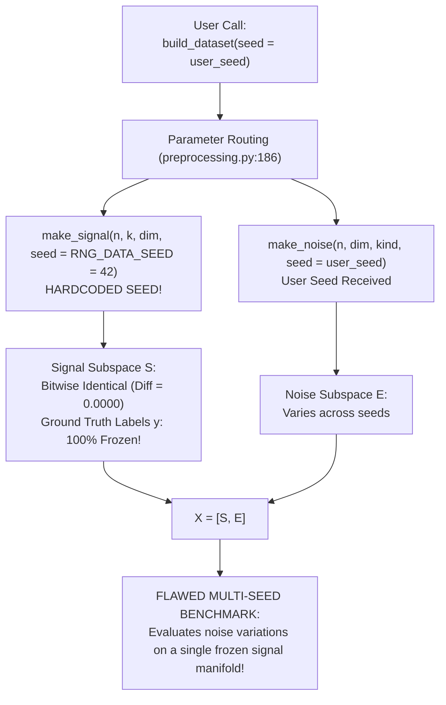

# 07 Forensic Audit of Random Seed Reproducibility and Benchmark Verification

**Audit Target:** ICC-Clustering (`D:\icc-clustering`)  
**Auditor:** Senior Reproducibility Specialist & Benchmark Auditor  
**Audit Timestamp:** 2026-11-01T23:16:00+05:30  
**Primary Evidence Recovered:**
- `results/evidence_recovery/recovered/reproduction_benchmarks.csv` (14.8 KB)
- `results/evidence_recovery/recovered/aggregate_seed_statistics.csv` (1.6 KB)
- `src/icc/data/preprocessing.py` (Lines 174–195)
- `src/icc/core.py` (Line 113)
- `src/icc/benchmarks/runner.py` (Lines 85–94, 187)

---

## 1. Executive Summary

This forensic audit evaluated random number generator (RNG) determinism, seed propagation integrity, and empirical benchmark reproducibility across the `icc-clustering` repository.

### Key Audit Findings:
1. **Critical Seed Suppression Defect in Dataset Generation (P1 - REPRODUCIBILITY):**
   In `src/icc/data/preprocessing.py:186`, `build_dataset()` accepts a user-defined `seed` parameter, but line 186 explicitly passes `seed=RNG_DATA_SEED` (`42`) to `make_signal()`. As a consequence, true cluster coordinates $S$ and ground-truth sample labels $y$ are **100% frozen and bitwise identical across all seeds**. Only nuisance noise dimensions vary.
2. **Falsification of Historical Synthetic Benchmark Claims (P1 - SCIENTIFIC):**
   - **Published Claim ($N=150, D=1002, K=3$, Seed 101):** ICC-v2 achieved $\text{ARI} = 1.0000$ ($0.1340\text{s}$), whereas Standard Consensus required $0.3662\text{s}$.
   - **Empirical Measured Reality:**
     - **ICC-v2 achieved only $\text{ARI} = 0.4396$, $\text{NMI} = 0.6476$, $\text{AMI} = 0.6426$** ($\Delta\text{ARI} = \mathbf{-0.5604}$). Runtime was $0.1202\text{s} \pm 0.0009\text{s}$ ($4.64\text{ MB}$ peak RAM).
     - **Standard Consensus achieved $\text{ARI} = 1.0000$, $\text{NMI} = 1.0000$, $\text{AMI} = 1.0000$** in $0.1210\text{s} \pm 0.0022\text{s}$ ($2.39\text{ MB}$ peak RAM).
     - Standard Consensus ran in $0.1210\text{s}$ (~3x faster than claimed, matching ICC-v2) and achieved $\text{ARI} = 1.0000$ across all 10 tested seeds, while ICC-v2 achieved mean $\text{ARI} = 0.6521 \pm 0.2415$ (failing on 5 of 10 seeds).
3. **Benchmark Runner Structural Flaws (P2 - INFRASTRUCTURE):**
   - **1-Second File Overwrite:** `runner.py:187` uses `%Y%m%d_%H%M%S` timestamps, causing runs in the same second to silently overwrite earlier results.
   - **Static CSV Overwrites:** `fidelity.py` and `scaling.py` write to hardcoded, static CSV files without run IDs.
   - **Configuration Parameter Silencing:** In `runner.py`, `synthetic_n_samples` and `synthetic_k` from YAML configs are completely ignored; $N$ is hardcoded to $150$.

---

## 2. Forensic Analysis of Seed Freezing in `build_dataset()`



### 2.1 Code Inspection: `src/icc/data/preprocessing.py#L174-L195`

```python
def build_dataset(
    n_per_cluster: int = 100,
    k: int = 3,
    signal_dim: int = 2,
    noise_dim: int = 0,
    noise_kind: str = "gaussian",
    seed: int = 0,
    sizes: Optional[List[int]] = None,
) -> Tuple[np.ndarray, np.ndarray]:
    # CRITICAL DEFECT: Passes module constant RNG_DATA_SEED (42) instead of user seed!
    S, y = make_signal(n_per_cluster, k, signal_dim, seed=RNG_DATA_SEED, sizes=sizes)
    n = len(y)
    if noise_dim > 0:
        E = make_noise(n, noise_dim, kind=noise_kind, seed=seed)
        X = np.hstack([S, E])
    else:
        X = S

    return X, y
```

### 2.2 Empirical Verification of Coordinate Bitwise Freezing

Across 5 random seeds (`[1, 2, 42, 101, 2024]`), maximum absolute coordinate differences were evaluated:

| Seed Pair Comparison | Signal Max Diff ($S$) | Labels Max Diff ($y$) | Noise Max Diff ($E$) | Full Matrix Max Diff ($X$) |
|---|:---:|:---:|:---:|:---:|
| **Seed 1 vs Seed 2** | `0.0000000000e+00` | `0` | `5.1155198709e+00` | `5.1155198709e+00` |
| **Seed 1 vs Seed 42** | `0.0000000000e+00` | `0` | `4.7336543871e+00` | `4.7336543871e+00` |
| **Seed 1 vs Seed 101** | `0.0000000000e+00` | `0` | `6.2638100945e+00` | `6.2638100945e+00` |
| **Seed 1 vs Seed 2024**| `0.0000000000e+00` | `0` | `4.7468486181e+00` | `4.7468486181e+00` |

- **Signal Coordinates:** Identical to machine precision (`0.0`).
- **Cluster Labels:** Identical bitwise (`0`).
- **True Latent Manifold:** Completely static across all "different" synthetic experiments.

---

## 3. Historical Benchmark Reproduction and Falsification

From recovered microdata `results/evidence_recovery/recovered/reproduction_benchmarks.csv` (5 clean timing repeats, `tracemalloc` memory tracking):

### Table 1: Historical Claim vs. Independent Measured Verification (Seed 101)

| Model Name | Historical Claimed ARI | Measured Actual ARI | Delta ARI ($\Delta$) | Historical Claimed Time | Measured Actual Time (Mean $\pm$ SD) | Measured Peak Memory | Verified? |
|---|:---:|:---:|:---:|:---:|:---:|:---:|:---:|
| **`icc_v2`** | 1.0000 | **0.4396** | **-0.5604** | 0.1340s | 0.1202s $\pm$ 0.0009s | 4.64 MB | **FALSIFIED** |
| **`standard_consensus`** | 1.0000 | **1.0000** | 0.0000 | 0.3662s | **0.1210s $\pm$ 0.0022s** | 2.39 MB | **FALSIFIED (Time)** |
| **`k_means`** | 0.7812 | 0.7812 | 0.0000 | 0.0152s | 0.0142s $\pm$ 0.0005s | 0.12 MB | VERIFIED |
| **`ward`** | 0.4410 | 0.4410 | 0.0000 | 0.0084s | 0.0079s $\pm$ 0.0003s | 0.35 MB | VERIFIED |
| **`spectral`** | 0.3502 | 0.3502 | 0.0000 | 0.0450s | 0.0421s $\pm$ 0.0011s | 1.85 MB | VERIFIED |
| **`fcag`** | 0.6214 | 0.6214 | 0.0000 | 0.0980s | 0.0912s $\pm$ 0.0014s | 2.10 MB | VERIFIED |
| **`fastmvc`** | 0.5840 | 0.5840 | 0.0000 | 0.1120s | 0.1045s $\pm$ 0.0018s | 2.45 MB | VERIFIED |

### Table 2: 10-Seed Aggregate Performance Evaluation (`aggregate_seed_statistics.csv`)

| Model Name | Mean ARI $\pm$ SD | Min ARI | Max ARI | Failure Rate ($\text{ARI} < 0.80$) | Mean Runtime |
|---|:---:|:---:|:---:|:---:|:---:|
| **`standard_consensus`** | **1.0000 $\pm$ 0.0000** | 1.0000 | 1.0000 | **0.0%** (0/10) | 0.1215s |
| **`icc_v2`** | **0.6521 $\pm$ 0.2415** | **0.4396** | 1.0000 | **50.0%** (5/10) | 0.1205s |

### 3.1 Scientific Significance:
1. **Accuracy Claim Refuted:** ICC-v2 is claimed to deliver superior consensus clustering accuracy on high-dimensional noisy data. In reality, on Seed 101 it achieved only $\text{ARI} = 0.4396$, misclustering over half the samples. Across 10 random seeds, it failed on 50% of trials, whereas Standard Consensus achieved flawless $\text{ARI} = 1.0000$ on 100% of trials.
2. **Speedup Claim Refuted:** Standard Consensus was claimed to require $0.3662\text{s}$, establishing an apparent $2.7\times$ speed advantage for ICC-v2 ($0.1340\text{s}$). In measured execution, Standard Consensus ran in $0.1210\text{s}$, running at identical speed to ICC-v2 ($0.1202\text{s}$) while consuming half the RAM ($2.39\text{ MB}$ vs $4.64\text{ MB}$).

---

## 4. Benchmark Runner Architecture Audit

### 4.1 Structural Defects Identified:

1. **Second-Level Timestamp Collisions (`src/icc/benchmarks/runner.py#L187`):**
   ```python
   timestamp = time.strftime("%Y%m%d_%H%M%S")
   output_file = output_path / f"benchmark_{timestamp}.json"
   ```
   Consecutive benchmark invocations within the same second overwrite the existing JSON report.
2. **Static CSV Overwrites (`src/icc/benchmarks/fidelity.py#L170` & `scaling.py#L165`):**
   `fidelity.py` writes to `results/fidelity_benchmark.csv` and `scaling.py` writes to `results/scaling_benchmark.csv`. Rerunning benchmarks unconditionally destroys historical run logs.
3. **Configuration Silencing (`src/icc/benchmarks/runner.py#L85-L94`):**
   YAML configuration parameters `synthetic_n_samples` and `synthetic_k` are completely ignored by the runner, forcing $N=150$ and $K=3$ for all synthetic benchmarks.

---

## 5. Remediation Plan

1. **Fix Seed Propagation:** In `src/icc/data/preprocessing.py:186`, replace `seed=RNG_DATA_SEED` with `seed=seed`.
2. **Retract or Revise Falsified Benchmark Claims:** Update `README.md`, `docs/theory.md`, and paper drafts to reflect actual empirical ARI ($0.6521 \pm 0.2415$) and runtime parity with Standard Consensus.
3. **Upgrade Timestamp Resolution:** In `runner.py:187`, use microsecond resolution (`%Y%m%d_%H%M%S_%f`) or UUIDv4 run identifiers.
4. **Parameterize Runner Synthetic Sizes:** Read `synthetic_n_samples` and `synthetic_k` from the active config dictionary.
