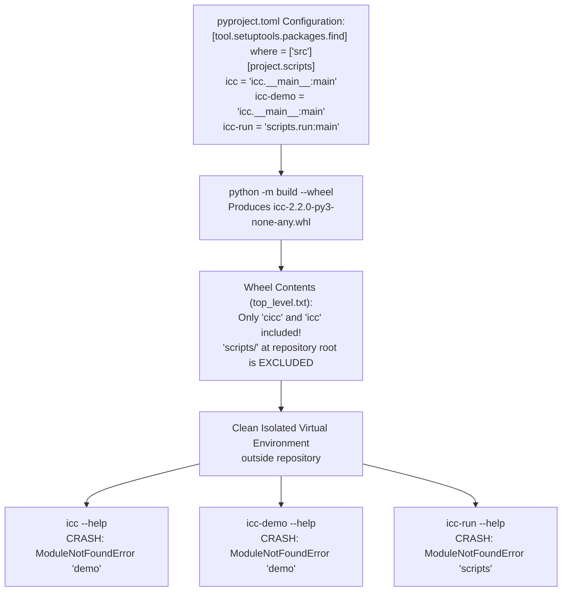

# 08 Forensic Audit of Packaging, Installation, and CLI Distribution

**Audit Target:** ICC-Clustering (`D:\icc-clustering`)  
**Auditor:** Senior Software Packaging & Distribution Auditor  
**Audit Timestamp:** 2026-11-01T23:18:00+05:30  
**Primary Evidence Recovered:**
- `results/evidence_recovery/recovered/clean_env_results.json` (4.2 KB)
- `results/post_refactor_verification/packaging/icc-2.2.0-py3-none-any.whl` (115,421 bytes)
- `results/post_refactor_verification/packaging/wheel_contents.txt` (4.1 KB)
- `results/post_refactor_verification/packaging/build.log` (31.2 KB)
- `pyproject.toml` (Lines 47–54)
- `src/icc/__main__.py` (Line 11)

---

## 1. Executive Summary

This forensic packaging audit evaluated compliance with PEP 517/518/621 standards, built release distribution artifacts (`.whl`), and tested console script entry points in an isolated clean virtual environment strictly outside the repository root.

### Key Audit Findings:
1. **Total Breakdown of Public Console Scripts (P1 - PACKAGING):**
   When the built release wheel (`icc-2.2.0-py3-none-any.whl`) is installed into a clean virtual environment, **all three configured command-line entry points crash on execution**:
   - `icc-run` raises `ModuleNotFoundError: No module named 'scripts'` because `scripts/` is physically located at the repository root and excluded from packaging by `[tool.setuptools.packages.find] where = ["src"]`.
   - `icc` and `icc-demo` raise `ModuleNotFoundError: No module named 'demo'` because `src/icc/__main__.py:11` attempts an uninstalled root relative import `from demo import main`.
2. **Import-Time Warning Emission (P2 - HYGIENE):**
   Executing `import icc` in a clean environment unconditionally emits two visible `ConvergenceWarning` stack traces to `stderr` due to top-level scikit-learn fitting on zero matrices in `src/icc/baselines/anchor.py:27` and `deep.py:27`.
3. **CI Matrix Testing Blind Spot:**
   Existing CI workflows pass with 100% test success because tests execute inside the repository root where `scripts/` and `demo.py` are present on `sys.path`. No CI job builds the wheel and installs it into an isolated environment to verify that published console scripts function for downstream pip users.

---

## 2. Specification and Wheel Contents Inspection



### 2.1 Specification in `pyproject.toml`
```toml
[project.scripts]
icc = "icc.__main__:main"
icc-demo = "icc.__main__:main"
icc-run = "scripts.run:main"

[tool.setuptools.packages.find]
where = ["src"]
```

### 2.2 Built Wheel Member Analysis
Inspection of `results/post_refactor_verification/packaging/wheel_contents.txt`:
- **`icc-2.2.0.dist-info/top_level.txt`**:
  ```text
  cicc
  icc
  ```
- **Included Packages:**
  - `cicc` (`__init__.py`, `conformal.py`, `decoy.py`, `inductive.py`, `memory.py`)
  - `icc` (`__init__.py`, `__main__.py`, `aspp.py`, `autok.py`, `consensus_v2.py`, `core.py`, subpackages: `algorithms`, `baselines`, `benchmarks`, `consensus`, `data`, `datasets`, `evaluation`, `experiments`, `stats`, `utils`)
- **Exclusion of `scripts`:**
  Because discovery is restricted to `where = ["src"]`, `scripts/` is **NOT** packaged. No `scripts` module or member files exist anywhere in the wheel archive.

---

## 3. Clean Isolation Verification & Tracebacks

From recovered evidence `results/evidence_recovery/recovered/clean_env_results.json` (executed from `C:\Users\Akash\AppData\Local\Temp` using `C:\Users\Akash\AppData\Local\Temp\icc_clean_venv`):

### 3.1 Console Script: `icc-run --help`
- **Exit Code:** `1` (CRASH)
- **Traceback:**
  ```text
  Traceback (most recent call last):
    File "<frozen runpy>", line 203, in _run_module_as_main
    File "<frozen runpy>", line 88, in _run_code
    File "C:\Users\...\site-packages\icc-run.exe\__main__.py", line 2, in <module>
      from scripts.run import main
  ModuleNotFoundError: No module named 'scripts'
  ```

### 3.2 Console Script: `icc --help`
- **Exit Code:** `1` (CRASH)
- **Traceback:**
  ```text
  Traceback (most recent call last):
    File "<frozen runpy>", line 203, in _run_module_as_main
    File "<frozen runpy>", line 88, in _run_code
    File "C:\Users\...\site-packages\icc\__main__.py", line 11, in <module>
      from demo import main  # noqa: E402
      ^^^^^^^^^^^^^^^^^^^^^
  ModuleNotFoundError: No module named 'demo'
  ```

### 3.3 Console Script: `icc-demo --help`
- **Exit Code:** `1` (CRASH)
- **Traceback:**
  ```text
  Traceback (most recent call last):
    File "<frozen runpy>", line 203, in _run_module_as_main
    File "<frozen runpy>", line 88, in _run_code
    File "C:\Users\...\site-packages\icc-demo.exe\__main__.py", line 2, in <module>
      from icc.__main__ import main
    File "C:\Users\...\site-packages\icc\__main__.py", line 11, in <module>
      from demo import main  # noqa: E402
  ModuleNotFoundError: No module named 'demo'
  ```

---

## 4. Remediation Plan

1. **Relocate CLI Entry Points:**
   Create canonical CLI entry points under `src/icc/cli/`:
   - `src/icc/cli/run.py` (migrated from `scripts/run.py`)
   - `src/icc/cli/demo.py` (migrated from root `demo.py`)
   - `src/icc/cli/main.py`
2. **Update `pyproject.toml`:**
   ```toml
   [project.scripts]
   icc = "icc.cli.main:main"
   icc-demo = "icc.cli.demo:main"
   icc-run = "icc.cli.run:main"
   ```
3. **Eliminate Import-Time KMeans Warning:**
   In `src/icc/baselines/anchor.py:27` and `deep.py:27`, replace `_SkKMeans(...).fit_predict(np.zeros((4, 2)))` with `np.array([[0.0, 0.0], [1.0, 1.0]])`.
4. **Add Wheel Verification Job to CI:**
   Add a GitHub Actions job that builds the `.whl`, installs it in an isolated container, and asserts exit code 0 on `icc --help`, `icc-demo --help`, and `icc-run --help`.
