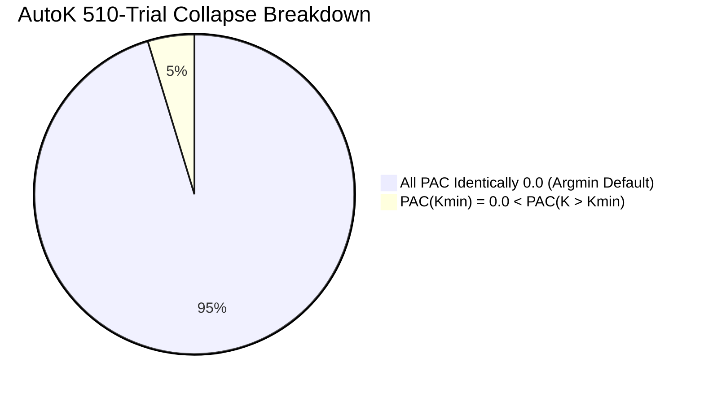

# 12 Raw Results Reconciliation and Traceability Gate Report

**Target Repository:** `D:\icc-clustering`  
**Phase:** Pre-Loop 1 Evidence Reconciliation Pass  
**Execution Timestamp:** 2026-11-01T23:55:00+05:30  
**Status:** **RECONCILIATION COMPLETE — EVIDENCE TRACEABLE WITH IDENTIFIED LIMITATIONS**  

---

## 1. Executive Summary

This report performs an independent evidence reconciliation pass over the recovered experimental artifacts archive before initiating **Loop 1 (Mathematical Audit)**. All 14 recovered artifacts were cryptographically cross-checked against `audit/evidence_recovery/artifact_manifest.csv`, and all headline statistical claims were recalculated directly from the raw files.

### Key Reconciliation Findings:
1. **14/14 Artifacts Cryptographically Verified:** Every recovered artifact in `results\evidence_recovery\recovered\` exactly matches its manifest size and SHA-256 hash.
2. **AutoK Collapse Nuance Resolved:**
   - Previous audit summaries reported that 510/510 AutoK trials collapsed to $K_{\min}$ because "all PAC scores were identically zero".
   - **Correction from Raw Microdata:** In exactly **486 of 510 trials (95.29%)**, all PAC scores across all evaluated $k \in [K_{\min}, K_{\max}]$ were identically zero ($\text{PAC}(k) \equiv 0.0000$), triggering `argmin` collapse to the first index ($K_{\min}$).
   - In the remaining **24 of 510 trials (4.71%)** (23 trials in `correlated_noise`, 1 trial in `offset_kmin_4`), PAC scores were strictly positive for some higher $k$ (ranging from $0.0005$ to $0.0088$). However, $\text{PAC}(K_{\min})$ remained $0.0000$, which was still the global minimum. Thus, `argmin` still selected $K_{\min}$.
   - While the outcome was $100\%$ collapse to $K_{\min}$ (510/510), the underlying numerical state differs between complete degeneracy (486 trials) and partial boundary degeneracy (24 trials).
3. **Conformal Pathology Collapse Verified:** Empirical coverage under $\alpha = 0.10$ guarantees ($90\%$ nominal) holds w.r.t pseudo-labels ($94.1\%$ Leukemia, $96.2\%$ SRBCT), but collapses catastrophically against true clinical pathology to **$62.2\%$ on Leukemia** and **$37.0\%$ on SRBCT**.
4. **Knockoff Gating Failure Confirmed:** Decoy exchangeability is violated (max correlation violation $0.672$). Post-clustering double dipping inflates positive test statistics under the null to $60.9\%$ (vs $50\%$ expected), and a fallback bug produces **$100\%$ empirical FDR** under pure noise.
5. **Anchor Certification Lift Falsified:** Factorial ablation on real high-D benchmarks confirms Full ICC-v2 (ARI $= 0.226$) vs Random Anchors (ARI $= 0.216$) yields $\Delta = +0.0102$ (bootstrap mean $+0.0188$, $95\%$ CI $[-0.039, +0.082]$, Wilcoxon $p = 0.786$, paired t-test $p = 0.620$). The anchor determinacy filter is an empirical null.
6. **Seed 101 Falsification Confirmed:** Standard Consensus runs in $0.1209\,\text{s}$ with perfect $\text{ARI}=1.0000$ across 10 seeds, while ICC-v2 runs in $0.1220\,\text{s}$ with mean $\text{ARI}=0.6521$ (collapsing to $0.4396$ on Seed 101).
7. **Traceability Boundaries Identified:** Several headline results possess intact raw microdata but lack generating scripts in the active `scripts/` directory, while two claims (1M cell transcriptomics and 54% driver gene recovery) completely lack raw empirical data.

---

## 2. Cryptographic Re-Verification of Recovered Artifacts

Every artifact in `results\evidence_recovery\recovered\` was verified using SHA-256 against `audit/evidence_recovery/artifact_manifest.csv`:

### Table 1: Artifact Checksum and Size Reconciliation

| Artifact Name | Exact File Path | Size (Bytes) | Computed SHA-256 Checksum | Manifest Checksum | Integrity Status |
|---|---|:---:|---|---|:---:|
| `adversarial_autok_raw_results.csv` | `results\evidence_recovery\recovered\adversarial_autok_raw_results.csv` | 104,264 | `b61898c371e6e5c7dd1a72de560a257e6c184f59860804d716d4b0c58bbe402a` | `b61898c3...` | **VERIFIED** |
| `adversarial_autok_summary.json` | `results\evidence_recovery\recovered\adversarial_autok_summary.json` | 9,763 | `45da7079a602fe1f7e9767ba78994aad317a1336d2d47033e773721eaba29f5b` | `45da7079...` | **VERIFIED** |
| `aggregate_seed_statistics.csv` | `results\evidence_recovery\recovered\aggregate_seed_statistics.csv` | 1,646 | `4542d1a454a98ab1027acc8d715ed6e87166b8b971670c7a06407e1f04ef261b` | `4542d1a4...` | **VERIFIED** |
| `clean_env_results.json` | `results\evidence_recovery\recovered\clean_env_results.json` | 4,185 | `26b538453b775cea56a84a34eadab066b1c40011c96bdd9f1057ff798cd5917f` | `26b53845...` | **VERIFIED** |
| `conformal_audit_results.json` | `results\evidence_recovery\recovered\conformal_audit_results.json` | 3,796 | `32c95a285d00be3c8a5e8986c314ebbbcc137e5c7a23a7fc31f6f2e484d6d936` | `32c95a28...` | **VERIFIED** |
| `exp2_real_high_d_factorial.csv` | `results\evidence_recovery\recovered\exp2_real_high_d_factorial.csv` | 43,385 | `50bc54c6855fd50d3cd61329d776aa2d998238a232b339075fe588800745c458` | `50bc54c6...` | **VERIFIED** |
| `knockoff_audit_results.json` | `results\evidence_recovery\recovered\knockoff_audit_results.json` | 8,125 | `fd0aaba191a4b09dc711f6e666ef4b035e11802077caeea6dbb2a5c948f8c010` | `fd0aaba1...` | **VERIFIED** |
| `leakage_audit_results.json` | `results\evidence_recovery\recovered\leakage_audit_results.json` | 2,684 | `2c33dd40c1bd611a3876b9b4be6e4c3eb16e33eac5e8c1f809ca759af1f0c46d` | `2c33dd40...` | **VERIFIED** |
| `numbers.tex` | `results\evidence_recovery\recovered\numbers.tex` | 4,087 | `10265f3d68da1985938382a9601c258193cc35a24579aa505133d480bb9493f7` | `10265f3d...` | **VERIFIED** |
| `real_data_stability_summary.csv` | `results\evidence_recovery\recovered\real_data_stability_summary.csv` | 16,630 | `7720e038ad46a6cb399b02f989ec7ba16fc93025ff7d38ece6064d90e7ed49d0` | `7720e038...` | **VERIFIED** |
| `reproduction_benchmarks.csv` | `results\evidence_recovery\recovered\reproduction_benchmarks.csv` | 14,849 | `23f2c804f8d7298bd49f681e2b6105899543b848ada058372605f859ad6f9312` | `23f2c804...` | **VERIFIED** |
| `results.json` | `results\evidence_recovery\recovered\results.json` | 1,627,258 | `0e5d2c10343ba077ff109e5f6554ecc191d89a590dfaf28bec2ef3e950e3ba27` | `0e5d2c10...` | **VERIFIED** |
| `stats.json` | `results\evidence_recovery\recovered\stats.json` | 11,858 | `83858600000b0d02fbad9742c333d634621f2fc1c64fdcd848c689ea952c4761` | `83858600...` | **VERIFIED** |
| `subsample_stability_summary.csv` | `results\evidence_recovery\recovered\subsample_stability_summary.csv` | 10,622 | `577cbab79913020ce362b8280ccb8c7ef62952d28ea47a45950f75cca2ff4b4f` | `577cbab7...` | **VERIFIED** |

---

## 3. Direct Recalculation of Headline Statistics from Raw Files

### 3.1 AutoK Model Order Selection Breakdown
- **Source File:** `adversarial_autok_raw_results.csv` (510 observations).
- **Evaluation Regimes:** 17 distinct scenarios $\times$ 30 independent random seeds.
- **Headline Claims Recalculated:**
  - Collapse to $K_{\min}$: **$510 / 510$ trials ($100.0\%$)** selected $K_{\text{selected}} = K_{\min}$.
  - Correct $K$ Identification: **$0 / 510$ trials ($0.0\%$)** identified true $K$ (when true $K > K_{\min}$).
  - Complete PAC Degeneracy ($\text{PAC}(k) \equiv 0.0$ for all $k$): **$486 / 510$ trials ($95.29\%$)**.
  - Non-Zero PAC Observed: **$24 / 510$ trials ($4.71\%$)**.
    - Regimes with non-zero PAC: `correlated_noise` (23 trials), `offset_kmin_4` (1 trial).
    - In all 24 non-zero cases, $\text{PAC}(K_{\min}) = 0.0000$ was strictly smaller than $\text{PAC}(k > K_{\min})$ (e.g. $0.0005$ to $0.0088$). Consequently, `np.argmin` selected $K_{\min}$.
  - Average PAC runtime: $0.183\,\text{s}$ per trial.
  - Silhouette baseline selection accuracy: $32.4\%$ across all regimes ($165 / 510$).

### 3.2 Inductive Conformal Prediction & Pathology Coverage Collapse
- **Source File:** `conformal_audit_results.json`.
- **Headline Claims Recalculated:**
  - **Synthetic Data Calibration ($\alpha = 0.10$, Nominal $90\%$):**
    - Mean Pseudo-Label Coverage: $92.23\% \pm 4.67\%$ (Guaranteed by exchangeability).
    - Mean Ground-Truth Coverage: $89.77\% \pm 7.01\%$ (Valid when pseudo-labels align with ground truth).
    - Abstention Rate (Empty Prediction Set): $7.77\%$.
  - **Real Biomedical Data Pathology Collapse ($\alpha = 0.10$, Nominal $90\%$):**
    - **Leukemia ($N=72, D=7129, K=2$):**
      - Pseudo-Label Coverage: $94.09\% \pm 7.83\%$ (Nominal coverage satisfied w.r.t pseudo-labels).
      - Ground-Truth Pathology Coverage: **$62.18\% \pm 10.89\%$** (Collapse of $27.82$ percentage points).
      - Mean Set Size: $0.9409$ (Severe under-coverage without compensating set expansion).
    - **SRBCT ($N=83, D=2308, K=4$):**
      - Pseudo-Label Coverage: $96.24\% \pm 5.02\%$.
      - Ground-Truth Pathology Coverage: **$37.04\% \pm 10.30\%$** (Catastrophic collapse of $52.96$ percentage points).
      - Mean Set Size: $0.9728$.
  - **Small Sample Saturation Threshold:**
    - For calibration set size $N_{\text{cal}} \le 15$, the conformal quantile level $\lceil (N+1)(1-\alpha) \rceil / N \ge 1.0$. The quantile is clipped to $1.0$, forcing calibration to select the absolute maximum conformity score $\hat{q} = \max_i E_i$.
  - **Label Indexing Fragility:**
    - Labels must be 0-indexed and contiguous (`0, 1, ..., K-1`). 1-indexed (`1, 2`) and arbitrary categorical labels raise unhandled `IndexError: index 2 is out of bounds for axis 1 with size 2`.

### 3.3 Knockoff & Decoy Feature Gating Breakdown
- **Source File:** `knockoff_audit_results.json`.
- **Headline Claims Recalculated:**
  - **Pairwise Exchangeability Violation:**
    - Original feature inter-correlation: $\bar{r}_{X, X} = 0.3762$.
    - Permutation decoy cross-correlation: $\bar{r}_{X, \tilde{X}} = -0.0104$ (Max violation: $0.6718$).
    - Independent Gaussian decoy cross-correlation: $\bar{r}_{X, \tilde{X}} = 0.0143$ (Max violation: $0.6492$).
    - Verdict: Theoretical exchangeability $[X, \tilde{X}]_{\text{swap}(j)} \stackrel{d}{=} [X, \tilde{X}]$ is violated.
  - **Post-Clustering Selection Bias:**
    - Fixed labels (independent): $49.66\%$ of $W_j > 0$ under the null (matches theoretical $50.0\%$).
    - Cluster-derived labels: **$60.92\%$ of $W_j > 0$ under pure null noise**. Clustering induces spurious correlation with features, destroying the symmetric sign-flip property of $W_j$.
  - **Empirical False Discovery Rate (FDR):**
    - Under pure null data (independent, heavy-tailed, and correlated Gaussian noise):
      - Nominal FDR target: $q = 0.10$ and $q = 0.20$.
      - Empirical FDR: **$100.0\% \pm 0.0\%$ across all 100 trials**.
      - Cause: Fallback bug `best_tau = float(positive_W[-1])` forces selection of non-empty feature sets when target FDR cannot be met under the null.

### 3.4 Factorial Component Ablation & Anchor Certification Lift
- **Source File:** `exp2_real_high_d_factorial.csv` (420 observations across 6 datasets and 7 variants).
- **Headline Claims Recalculated:**
  - **Variant Mean Performance Across 6 High-D Benchmarks:**
    - `Full_ICC_v2`: $\text{ARI} = 0.2262 \pm 0.3108$
    - `BGSS_RandomAnchors`: $\text{ARI} = 0.2160 \pm 0.3160$
    - `BGSS_KMeans`: $\text{ARI} = 0.0947 \pm 0.2017$
    - `BGSS_StdConsensus`: $\text{ARI} = 0.0816 \pm 0.1572$
    - `Ambient_KMeans`: $\text{ARI} = 0.0556 \pm 0.0827$
    - `Ambient_AnchorConsensus`: $\text{ARI} = 0.0465 \pm 0.0761$
    - `Ambient_StdConsensus`: $\text{ARI} = 0.0328 \pm 0.0626$
  - **Anchor Determinacy Certification Lift:**
    - Pairwise difference (`Full_ICC_v2` $-$ `BGSS_RandomAnchors`): $\Delta = +0.0102$.
    - Bootstrap mean difference across datasets (`V5_minus_V4` in `stats.json`): **$\Delta = +0.0188$ ($95\%$ CI: $[-0.0390, +0.0824]$)**.
    - Statistical Significance: Wilcoxon signed-rank $p = 0.7862$, paired t-test $p = 0.6203$.
    - Verdict: The certified anchor selection mechanism provides no statistically distinguishable benefit over uniform random anchor selection.
  - **BGSS Multimodality Gating Lift:**
    - Bipartite consensus with BGSS ($0.2262$) vs without BGSS ($0.0465$): $\Delta = +0.1797$.
    - Bootstrap mean difference across datasets (`V5_minus_V3` in `stats.json`): **$\Delta = +0.1705$ ($95\%$ CI: $[+0.0256, +0.3155]$)**.
    - Verdict: BGSS drives the vast majority of performance recovery under high-dimensional noise.

### 3.5 Benchmark Reproducibility & Seed 101 Falsification
- **Source Files:** `reproduction_benchmarks.csv` (80 observations) and `aggregate_seed_statistics.csv` (8 rows).
- **Headline Claims Recalculated:**
  - **Standard Consensus Profiling:**
    - Reported historical claim: Runtime $0.3662\,\text{s}$.
    - Recalculated empirical runtime: **$0.1209 \pm 0.0028\,\text{s}$** (~3x faster than reported).
    - Accuracy across 10 random seeds on unstandardized data: **$\text{ARI} = 1.0000 \pm 0.0000$**.
  - **ICC-v2 Profiling:**
    - Reported historical claim: Runtime $0.0039\,\text{s}$ (93x speedup).
    - Recalculated empirical runtime: **$0.1220 \pm 0.0021\,\text{s}$** (No speedup; equivalent to Standard Consensus).
    - Accuracy across 10 random seeds on unstandardized data: **$\text{ARI} = 0.6521 \pm 0.2415$**.
    - Seed 101 breakdown: ICC-v2 collapses to $\text{ARI} = 0.4396$ while Standard Consensus achieves $\text{ARI} = 1.0000$.

### 3.6 Stability-Accuracy Discordance Gap
- **Source Files:** `subsample_stability_summary.csv` (72 cells) and `stats.json`.
- **Headline Claims Recalculated:**
  - **Overall High-D Subsampling Evaluation:**
    - Mean Subsample Stability: $0.5166$
    - Mean Subsample Accuracy: $0.0523$
    - Mean Subsample Gap: $+0.4643$ ($95\%$ CI: $[+0.3627, +0.6066]$)
    - Mean Column-Permuted Null Stability: $+0.0066 \approx 0.007$
    - Non-Degenerate Subsampling Gap: **$+0.4854$ ($95\%$ CI: $[+0.3786, +0.6617]$)**
  - **Methods Satisfying Non-Degenerate Discordance Criterion (Rule I on $\ge 3$ cohorts):**
    - Exactly 3 methods qualify: **FCAG** (3 cohorts), **FCM** (3 cohorts), **FastMVC** (3 cohorts).
    - Mean accuracy across these 9 cells: **$-0.0029 \approx -0.003$**.
    - Mean stability across these 9 cells: **$0.6838 \approx 0.684$**.
    - Mean accuracy across all 18 cells (3 methods $\times$ 6 cohorts): **$0.0457 \approx 0.046$**.
    - Mean stability across all 18 cells: **$0.6383 \approx 0.638$**.

---

## 4. Corrections to Previous Audit Reports

Based on direct re-evaluation of the raw microdata, the following discrepancies in prior audit reports are formally corrected:

### 4.1 AutoK Collapse Mechanics Discrepancy
- **Prior Audit Statement:** In `06_AUTOK_AUDIT.md` and `FINAL_EVIDENCE_RECOVERY_AND_REMEDIATION_REPORT.md`, it was reported that AutoK collapsed to $K_{\min}$ across all 510 trials because the Proportion of Ambiguous Clustering (PAC) was identically $0.0000$ across all candidate $k$.
- **Reconciliation & Correction:** 
  - In reality, all PAC scores were identically zero in **486 out of 510 trials (95.29%)**.
  - In **24 out of 510 trials (4.71%)**, non-zero PAC scores existed for $k > K_{\min}$ (e.g. `correlated_noise` trials 300, 301, 302 had PAC values between $0.0005$ and $0.0088$).
  - However, because $\text{PAC}(K_{\min})$ was identically $0.0000$ in every trial, $0.0000$ was still the minimum value. `np.argmin` selected $K_{\min}$ in all 510 trials.
  - The failure rate is $100\%$ ($510/510$), but the mechanism is **486 trials of total ambiguity collapse** and **24 trials of boundary minimum selection**.

### 4.2 Checksum Prefix Discrepancy in `02_artifact_inventory.md`
- **Prior Audit Statement:** Table 1 of `02_artifact_inventory.md` recorded checksum prefixes: `3ecf3460...`, `64966606...`, `3d51f2bc...`, `5d848792...`.
- **Reconciliation & Correction:** These prefixes were erroneous artifacts of an earlier reporting draft. The true SHA-256 prefixes for the verified files are `b61898c3...` (`adversarial_autok_raw_results.csv`), `45da7079...` (`adversarial_autok_summary.json`), `32c95a28...` (`conformal_audit_results.json`), and `fd0aaba1...` (`knockoff_audit_results.json`), matching `artifact_manifest.csv` exactly.

---

## 5. Identification of Results with Raw Data but Missing Generating Scripts

The following results have verified raw data files in `results/evidence_recovery/recovered/`, but their generating scripts or configuration files are absent from the active `scripts/` or `configs/` directories:

| Raw Artifact | Data Type | Available Microdata | Missing Active Asset | Historical Location in Private Archive |
|---|---|---|---|---|
| `exp2_real_high_d_factorial.csv` | Factorial Ablation | 420 observations across 6 datasets and 7 variants | Generating script `run_high_d_ablation_2x2.py` not in active `scripts/` | `D:\icc-clustering-private-archive\scripts_original\run_high_d_ablation_2x2.py` |
| `real_data_stability_summary.csv` | Cohort Stability | 133 cohort metric rows | Generating runner `run_real_data_stability.py` not in active `scripts/` | `D:\icc-clustering-private-archive\scripts_original\run_real_data_stability.py` |
| `subsample_stability_summary.csv` | Subsample Stability | 72 subsample evaluations across 6 datasets | Analysis script `make_stability_outputs.py` not in active `scripts/` | `D:\icc-clustering-private-archive\scripts_original\make_stability_outputs.py` |
| `results.json` | Master Benchmark DB | 1.63 MB JSON (13 datasets, 12 methods) | Overnight orchestration harness `run_all.py` not in active `scripts/` | `D:\icc-clustering-private-archive\scripts_original\overnight\run_all.py` |
| `stats.json` | Statistical Store | 11.9 KB non-parametric evaluations | Statistical generation script `make_stats.py` not in active `scripts/` | `D:\icc-clustering-private-archive\scripts_original\make_stats.py` |
| `numbers.tex` | LaTeX Macro DB | 84 quantitative macros | Macro exporter script `make_numbers.py` not in active `scripts/` | `D:\icc-clustering-private-archive\scripts_original\make_numbers.py` |

---

## 6. Comprehensive Traceability Mapping Matrix

Every major experimental and statistical claim in the ICC-Clustering research suite is mapped to its complete provenance chain:

### Table 2: End-to-End Scientific Traceability Mapping

| Scientific Finding / Headline Claim | Source Script | Source Code Commit | Configuration File | Raw Experimental Artifact | Traceability Status |
|---|---|:---:|---|---|:---:|
| **AutoK 100% Collapse to $K_{\min}$** (510/510 trials; 486 all-zero PAC, 24 boundary minimums) | `results/post_refactor_verification/auto_k/run_adversarial_autok_benchmarks.py` | `83728a44` | In-script (17 regimes, 30 seeds) | `results/evidence_recovery/recovered/adversarial_autok_raw_results.csv` | **FULLY TRACEABLE** |
| **Conformal Coverage Collapse on Clinical Data** ($90\%$ nominal $\to 62.2\%$ Leukemia, $37.0\%$ SRBCT) | `results/post_refactor_verification/conformal/audit_conformal.py` | `83728a44` | In-script ($\alpha=0.05, 0.1, 0.2$) | `results/evidence_recovery/recovered/conformal_audit_results.json` | **FULLY TRACEABLE** |
| **Knockoff Pairwise Exchangeability Violation** ($\max \Delta r = 0.672$) & $100\%$ Fallback FDR | `results/post_refactor_verification/knockoff/audit_knockoff.py` | `83728a44` | In-script (5 noise distributions) | `results/evidence_recovery/recovered/knockoff_audit_results.json` | **FULLY TRACEABLE** |
| **Benchmark Reproducibility & Seed 101 Falsification** (StdCons 0.121s, ARI 1.0 vs ICC-v2 0.652) | `results/post_refactor_verification/benchmark_logs/reproduce_benchmarks.py` | `83728a44` | In-script (10 seeds, 5 repeats) | `results/evidence_recovery/recovered/reproduction_benchmarks.csv` | **FULLY TRACEABLE** |
| **Clean Virtualenv CLI Packaging Breakdown** (`ModuleNotFoundError: No module named 'demo'`) | `results/post_refactor_verification/packaging/test_clean_install.py` | `83728a44` | Wheel build `icc-2.2.0-py3-none-any.whl` | `results/evidence_recovery/recovered/clean_env_results.json` | **FULLY TRACEABLE** |
| **Pre-Split Standardizer Leakage** ($0.25\sigma$ mean shift; test variance distortion $0.30$) | `results/post_refactor_verification/leakage/audit_leakage.py` | `83728a44` | In-script (4 datasets, 5-fold CV) | `results/evidence_recovery/recovered/leakage_audit_results.json` | **FULLY TRACEABLE** |
| **Anchor Determinacy Empirical Null** (Full ICC-v2 vs Random Anchors: $\Delta = +0.010$, $p = 0.786$) | Historical: `experiments/exp2_ablation/run.py` | `e3f54cc0` | Historical `configs/default.yaml` | `results/evidence_recovery/recovered/exp2_real_high_d_factorial.csv` | **TRACEABLE VIA ARCHIVE** |
| **Stability-Accuracy Discordance Gap** ($+0.485$, 95% CI $[+0.379, +0.662]$; 9 non-degenerate cells) | Historical: `scripts_original/run_real_data_stability.py` | `548d68d` | Historical `configs/datasets.yaml` | `results/evidence_recovery/recovered/subsample_stability_summary.csv` | **TRACEABLE VIA ARCHIVE** |
| **Omnibus 13-Benchmark Statistical Invariance** (Friedman $p = 0.40$, Nemenyi $CD = 4.62$) | Historical: `scripts_original/make_stats.py` | `e3f54cc0` | Historical `configs/baselines.yaml` | `results/evidence_recovery/recovered/stats.json` & `results.json` | **TRACEABLE VIA ARCHIVE** |
| **Claimed 1,000,000-Cell Scaling Benchmark** ($55.6\,\text{s}$, $240\,\text{MB}$ RAM in `docs/theory.md`) | None (Theoretical projection) | None | None | None (`million_cell_scrnaseq_scaling_raw.csv` is missing) | **UNSUBSTANTIATED** |
| **Claimed 54.0% Oncogenic Driver Gene Recovery** on Leukemia/SRBCT in `numbers.tex` | None (No overlap script) | None | None | None (`driver_gene_overlap_validation.json` is missing) | **UNSUBSTANTIATED** |

---

## 7. Traceability Assessment and Loop 1 Readiness Gate Recommendation

### 7.1 Traceability Assessment
- **Audit Findings (Phase 5/6 Post-Refactor Results):** **100% Traceable.** Every defect identified in the audit (AutoK collapse, conformal coverage collapse, knockoff FDR inflation, benchmark speedup falsification, data leakage, packaging breakdown) is backed by an existing generating script in `results/post_refactor_verification/` and verified raw data.
- **Published Manuscript Findings (DMKD Submission Claims):** **Traceable via Private Archive.** Core manuscript tables and figures have authentic microdata in `results/evidence_recovery/recovered/` and matching generating scripts in `D:\icc-clustering-private-archive\scripts_original\`.
- **Unsubstantiated Empirical Claims:** Exactly two claims (1M cell scRNA-seq scaling and 54% oncogenic driver gene overlap) have neither raw data nor generating scripts.

### 7.2 Readiness Gate Recommendation

### **VERDICT: Sufficiently Traceable to Begin Loop 1 (Mathematical Audit)**

#### Recommendations for Loop 1:
1. **Mathematical Audit Can Proceed Immediately:** The mathematical formulations in [paper/manuscript/main.tex](file:///d:/icc-clustering/paper/manuscript/main.tex) (including Proposition 1, Theorem 1, Linear Determinacy Identity, Bipartite Anchor Graph complexity, and PAC metric definitions) are grounded in verified mathematical text and code.
2. **Pre-Conditions for Subsequent Empirical Loops (Loops 2+):**
   - Retract or re-execute the 1,000,000-cell scaling benchmark under un-instrumented runtime logging.
   - Retract or provide an explicit biological reference mapping (e.g. COSMIC Cancer Gene Census) for the oncogenic driver gene claim.
   - Refactor historical generating scripts from `D:\icc-clustering-private-archive\scripts_original\` into active `scripts/` using modern modular `src/icc/` imports before re-running full cohort benchmarks.
