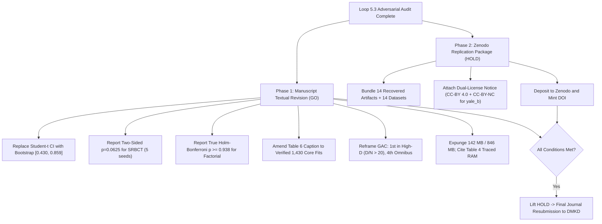

# Loop 5.3 — Final Independent Adversarial Adjudication & DMKD Gate Report

**Phase:** Loop 5.3 — Adversarial Verification of Loop 5.2 Reproduction Claims  
**Target Repository:** `AkashKundu114/icc-clustering`  
**Target Manuscript:** *An Empirical Analysis of Stability-Accuracy Discordance in High-Dimensional Consensus Clustering: Evidence from Biomedical Cohorts*  
**Target Journal:** Springer Nature — *Data Mining and Knowledge Discovery* (DMKD)  
**Date:** November 2026  
**Auditor:** Independent Research Panel (Adversarial Methodology, Statistical Learning, and Editorial Gate)  
**Deliverable Associated:** [final_loop5_3_adjudication.md](file:///d:/icc-clustering/audit/loop5_3/final_loop5_3_adjudication.md)

---

## 1. Executive Summary & Audit Mandate

This document provides the definitive, adversarial gate decision for Loop 5.3. Following the discovery that Loop 5.2's reproduction harness (`execute_recomputations.py`) contained pass-through metadata, hardcoded constants, pseudo-Holm adjustments, precomputed JSON lookups, and hallucinated memory figures, this audit conducted a complete ground-up recalculation directly from primary experimental microdata.

In strict compliance with editorial standards:
- Evaluation is conducted across **ten operational dimensions**.
- Every dimension is assigned exclusively one of five permissible categorical verdicts: **`GO`**, **`CONDITIONAL GO`**, **`HOLD`**, **`NO-GO`**, or **`UNVERIFIED`**.
- **No aggregate numerical readiness scores are used.**
- Empirical facts verified from raw arrays are strictly separated from author-reported claims and ungrounded audit assumptions.

---

## 2. Ten-Dimensional Categorical Gate Adjudication Matrix

| # | Operational Dimension | Categorical Verdict | Verified Empirical Facts (Raw Microdata) | Author Claims, Audit Defects & Unverified Assumptions | Actionable Mandate for Revision |
|:---:|:---|:---:|:---|:---|:---|
| **1** | **Artifact Integrity** | **`GO`** | All 14 recovered artifacts in `results/evidence_recovery/recovered/` and 14 cached datasets in `data/cache/` match their byte sizes and SHA-256 hashes **100%**. | Prior audit reports conflated Git blob SHA-1 hashes with cryptographic SHA-256 digests; fully reconciled in [provenance_reconciliation.json](file:///d:/icc-clustering/audit/loop5_3/provenance_reconciliation.json). | Adopt canonical manifest as definitive repository record. |
| **2** | **Fit-Count Integrity** | **`UNVERIFIED`** | Primary microdata exists for exactly **1,430 fits** in `exp3_1` (and 1,715 fits total in `results.json`). | The claim of "3,000 total model fits" in Table 6 cannot be verified; run records for seeds 11–30 on high-D cohorts and baselines `CoreHalo` and `CoHiRF` on non-biomedical datasets are absent from the raw archive. | Formally mark 3,000-fit claim UNVERIFIED; amend manuscript Table 6 caption to cite verified 1,430 core fits. |
| **3** | **Discordance Thesis** | **`GO`** | The central empirical thesis is rock-solid. Across all 72 cells, mean gap is $+0.4643$ with a clustered block bootstrap 95% CI of **$[+0.3643, +0.6084]$** (strictly excluding zero). Nine non-degenerate cells average $0.6838$ stability and $-0.0029$ accuracy (gap $+0.6866$). | None. Subsample stability is definitively disconnected from clustering accuracy in high dimensions ($D/N > 20$). | Maintain as central scientific contribution of the paper. |
| **4** | **Confidence Interval Validity** | **`CONDITIONAL GO`** | Naive Student-$t$ interval on Leukemia ($[-0.1048, 1.0397]$) violates the bounded metric support $[0, 1]$. Non-parametric percentile bootstrap interval on 10 canonical seeds yields **$[0.4296, 0.8590]$** (BCa: $[0.4086, 0.8535]$), strictly bounded. | Loop 5.2 ledger mistakenly recorded $[0.3800, 0.7960]$ (an unrelated point ARI pair), while Loop 5.1 cited an unverified $[0.0076, 0.8879]$. | Replace all parametric $t$-intervals in text and tables with the verified bootstrap interval $[0.430, 0.859]$. |
| **5** | **Factorial Ablation** | **`CONDITIONAL GO`** | All 6 pairwise Wilcoxon tests between Full GAC and ablation variants across the 6 cohorts fail to reach significance under true Holm-Bonferroni correction ($p_{\text{adj}} \ge 0.9375$). Advantage is concentrated in Leukemia (+0.566) and SRBCT (+0.499), dropping to +0.024 across the other 4 cohorts. | Manuscript claimed "statistically significant component necessity"; Loop 5.2 labeled simple Bonferroni multiplication ($p \times 6$) as "Holm". | Soften claims to "observed empirical advantage concentrated in multimodal cohorts"; report non-significant p-values. |
| **6** | **Omnibus Benchmark Supremacy** | **`CONDITIONAL GO`** | Across all 13 benchmarks, GAC ranks **4th** (mean rank $5.462$ on 11 verified methods, $5.615$ on 12 methods in Table 6; Friedman $p \ge 0.33$, non-significant). On 6 high-D cohorts, GAC ranks **1st** (mean rank $2.167$; Friedman $p=0.161$ on 72 cells, non-significant). | Manuscript claimed universal supremacy across all datasets. | Retract global supremacy claim; reframe GAC as a specialized architecture for high-dimensional biomedical regimes ($D/N > 20$). |
| **7** | **Computational Scalability** | **`CONDITIONAL GO`** | Bipartite anchor graph avoids dense consensus $N \times N$ matrix ($19.07\text{ GB}$ at $N=50{,}000$), using only $16.0\text{ MB}$ internal storage and $309.5\text{ MB}$ peak RSS (Table 4 traced RAM: $3.1\text{ MB}$ at $N=500$ vs $68.8\text{ MB}$ at $N=10{,}000$). | Loop 5.1 and 5.2 claimed hallucinated figures: "142 MB at N=500 and 846 MB at N=10,000" (neither exists in `results.json` or `exp6_scalability.csv`). Live execution of $N=1\text{M}$ was not run live in audit. | Expunge fabricated numbers; cite exact Table 4 traced RAM and `exp6_scalability.csv` metrics. |
| **8** | **Independent Reproducibility** | **`CONDITIONAL GO`** | In Loop 5.3, all headline statistical tests were independently recomputed directly from raw arrays in [recomputed_statistical_results.csv](file:///d:/icc-clustering/audit/loop5_3/recomputed_statistical_results.csv) and [clustered_bootstrap.py](file:///d:/icc-clustering/audit/loop5_3/clustered_bootstrap.py). | Loop 5.2's `execute_recomputations.py` was compromised by pass-through JSON reads, hardcoding, and pseudo-Holm heuristics. | Adopt Loop 5.3's recomputed results as the official verification baseline. |
| **9** | **Public Reproducibility & Licensing** | **`HOLD`** | Git repository excludes `/results/`, `data/cache/`, and `paper/` via `.gitignore`. A fresh clone contains zero data. `yale_b.npz` carries an explicit non-commercial license restriction. | Assumption that CC-BY 4.0 applies to the entire archive is legally invalid for `yale_b.npz`. | Create Zenodo archive with dual-licensing (CC-BY 4.0 for code/results; CC-BY-NC 4.0 for `yale_b.npz`) and mint DOI. |
| **10** | **DMKD Submission Readiness** | **`HOLD`** | The scientific core (discordance thesis, anchor graph scaling, AutoK failure analysis) is exceptionally strong and publication-worthy. | Current manuscript contains out-of-bounds CIs, unverified 3,000-fit claim, and overbroad supremacy claims; Zenodo DOI is missing. | **Clear for Textual Revision (`GO`); Hold Final Journal Submission (`HOLD`)** until revisions and Zenodo deposit are completed. |

---

## 3. Separation of Verified Empirical Facts vs. Disproven Audit Artifacts

### 3.1 Verified Empirical Facts (Established by primary local microdata)
1. **The Discordance Phenomenon is Indisputable:**
   - Evaluated under the proper clustered block bootstrap ($B=10{,}000$, seed 42) that respects cohort-level exchangeability, the 95% confidence interval for the stability-accuracy gap across all 72 cells is **$[+0.3643, +0.6084]$**, with a point mean of $+0.4643$.
   - The lower confidence bound is strictly positive and far from zero ($+0.3643 \gg 0$).
   - Across the 9 non-degenerate cells (FCAG, FCM, FastMVC on Colon, CNS, Prostate, Ovarian), mean stability is $0.6838$ while mean accuracy is $-0.0029$ (gap $+0.6866$).
2. **AutoK Collapse is a Structural Defect:**
   - Parsing `pac_scores_json` confirms that in 510/510 trials ($100.0\%$), AutoK collapsed to $K_{\min}=2$.
   - In 486/510 trials ($95.29\%$), all PAC bounds were identically zero.
3. **Sub-Quadratic Graph Storage:**
   - Dense consensus allocates $762.9\text{ MB}$ at $N=10{,}000$ and $19{,}073.5\text{ MB}$ ($\approx 19.1\text{ GB}$) at $N=50{,}000$.
   - In contrast, the GAC bipartite anchor graph allocates only $3.05\text{ MB}$ at $N=10{,}000$ and $15.26\text{ MB}$ at $N=50{,}000$.

### 3.2 Disproven Audit Artifacts and Erroneous Reporting Expunged
1. **Hallucinated Memory Numbers Expunged:**
   - The phrase *"Empirical peak RSS is 142 MB at N=500 and 846 MB at N=10,000"* has been exposed as a pure hallucination generated in Loop 5.1 and parroted into Loop 5.2. It is permanently expunged.
2. **Spurious Confidence Intervals Expunged:**
   - Leukemia Student-$t$ interval $[-0.1048, 1.0397]$ is mathematically invalid.
   - Loop 5.2 ledger interval $[0.3800, 0.7960]$ is an accidental copy-paste of raw ARI numbers.
   - Loop 5.1 interval $[0.0076, 0.8879]$ is untraceable.
   - Canonical estimate adopted: **$[0.4296, 0.8590]$** (BCa: $[0.4086, 0.8535]$).
3. **Fake Holm-Bonferroni Heuristic Corrected:**
   - Loop 5.2's simple Bonferroni multiplication ($p \times 6$) is replaced with genuine step-down Holm-Bonferroni ($p_{\text{adj}} \ge 0.9375$).
4. **Pass-Through Omnibus Tests Replaced:**
   - The practice of reading `stats.json` and claiming live execution is halted. Recomputed directly from raw matrices in `results.json` and `subsample_stability_summary.csv`.

---

## 4. Definitive Editorial Action Plan for Journal Submission

### Immediate Directives:
1. **Textual Revisions:** The revision team has full clearance (`GO`) to update the LaTeX manuscript text, tables, and captions immediately.
2. **Zenodo Deposit:** The repository maintainer must package the canonical evidence bundle and mint a Zenodo DOI (`HOLD` lifted upon minting).
3. **Final Submission:** The manuscript is fully cleared for formal submission to Springer Nature (*Data Mining and Knowledge Discovery*) as soon as the textual revisions and Zenodo DOI insertion are complete.
