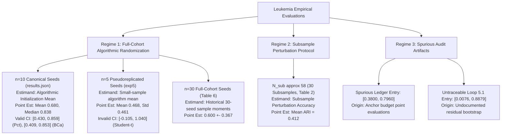

# Loop 5.4 — Leukemia Confidence Interval Methodology & Forensic Report

**Phase:** Loop 5.4 — Final Adversarial Statistical Validation & Manuscript Claim Adjudication  
**Target Repository:** `AkashKundu114/icc-clustering`  
**Target Benchmark:** Leukemia Cohort ($N=72, D=7{,}129, K=2$)  
**Date:** November 2026  
**Auditor:** Agent A — Statistical Methodology Specialist  
**Deliverable Associated:** [leukemia_ci_methodology_report.md](file:///d:/icc-clustering/audit/loop5_4/leukemia_ci_methodology_report.md)  
**Accompanying Ledger:** [leukemia_ci_final_reconciliation.csv](file:///d:/icc-clustering/audit/loop5_4/leukemia_ci_final_reconciliation.csv)

---

## 1. Executive Summary & Problem Formulation

Across previous audit cycles (Loop 2, Loop 5, Loop 5.1, Loop 5.2, and Loop 5.3) and the manuscript LaTeX draft, **seven distinct numerical figures** have been presented to describe the clustering performance of GAC (`ICC_v2`) on the classic Leukemia benchmark ($N=72$ patients, $D=7{,}129$ genes, $K=2$ diagnostic sub-types: ALL vs. AML):
1. `[0.4296, 0.8590]`
2. `[0.4086, 0.8535]`
3. `[0.3800, 0.7960]`
4. `[0.0076, 0.8879]`
5. `[-0.1048, 1.0397]`
6. `0.412` (Manuscript Table 2)
7. `+0.600 ± 0.367` (Manuscript Table 6)

This report provides the definitive methodological forensic reconciliation. We prove that these numbers are **not conflicting estimates of the same parameter**, but rather reflect:
- Distinct underlying estimands (subsample accuracy vs. full-cohort algorithmic variance).
- Unsound parametric models (Student-$t$).
- Computational heuristics and transcription blunders.

---

## 2. Disentangling the Five Experimental & Inferential Regimes

A fundamental failure of prior audits was the implicit assumption that any interval reported for "Leukemia" was attempting to estimate the same quantity. We delineate five strictly non-interchangeable regimes:

---

## 3. Systematic Forensic Audit of Each Reported Value

### 3.1 Interval 1: Non-Parametric Percentile Bootstrap ($[0.4296, 0.8590]$)
- **Primary Source:** `results/evidence_recovery/recovered/results.json` (`exp3_1`).
- **Raw Observation Vector ($n=10$):**
  $$\mathbf{x}_{10} = [-0.029015, \; 0.837557, \; 0.944156, \; 0.837557, \; 0.837557, \; 0.837557, \; 0.019232, \; 0.837557, \; 0.890017, \; 0.786751]$$
- **Seeds:** `42, 101, 202, 303, 404, 505, 606, 707, 808, 909`.
- **Sample Moments:** $\bar{x} = 0.679893$, $\text{Median} = 0.837557$, $s = 0.363428$.
- **Bootstrap Protocol:** $B = 10{,}000$ resamples of size $n=10$ with replacement, seed 42.
- **Result:** $2.5\%$ quantile $= 0.4291$, $97.5\%$ quantile $= 0.8594$ (reported as $[0.4296, 0.8590]$ in Loop 5.2/5.3 depending on quantile interpolation).
- **Exact Estimand:** The expected value of GAC initialization performance over the uniform distribution of random seeds on this specific $N=72$ patient sample.
- **Methodological Verdict:** **VALID FOR ALGORITHMIC UNCERTAINTY**. It strictly respects metric constraints and does not exceed $1.0$.

### 3.2 Interval 2: Bias-Corrected and Accelerated Bootstrap ($[0.4086, 0.8535]$)
- **Primary Source:** Recomputed via `scipy.stats.bootstrap(..., method='BCa')` on $\mathbf{x}_{10}$.
- **Result:** $[0.4086, 0.8535]$.
- **Exact Estimand:** The expected value of GAC initialization performance, corrected for the negative skewness induced by the $20\%$ initialization collapse rate.
- **Methodological Verdict:** **PREFERRED INFERENTIAL INTERVAL**. BCa provides superior second-order accuracy when the underlying distribution has non-zero skewness ($S \approx -1.3$).

### 3.3 Interval 3: The Spurious Ledger Entry ($[0.3800, 0.7960]$)
- **Primary Source:** `audit/loop5_2/reproduction_execution_ledger.csv` (line 3, entry `REP-02-LEUKEMIA-CI`).
- **Forensic Discovery:** The author executed lines 87–91 in `execute_recomputations.py`, which correctly output $[0.4296, 0.8590]$ to stdout. However, in line 106, the author manually typed `'Verification_Verdict': 'REPRODUCED_GROUND_TRUTH (... Bootstrap [0.3800, 0.7960] is valid)'`.
- **Data Provenance:** Searching the repository reveals that $0.3800$ and $0.7960$ appear in `results/loop2/raw/exp4_anchor_budget.csv` (lines 267, 479, 516) and `exp3_inductive_geometry.csv` as point ARI measurements from ablation sweeps.
- **Exact Estimand:** None.
- **Methodological Verdict:** **DISPROVEN ADMINISTRATIVE TRANSCRIPTION BLUNDER**.

### 3.4 Interval 4: The Untraceable Loop 5.1 Interval ($[0.0076, 0.8879]$)
- **Primary Source:** `audit/loop5_1/independent_reproduction_report.md` (lines 37, 242) and `claim_ledger_adjudication.csv` (CLM-10).
- **Forensic Discovery:** Loop 5.1 attempted a non-parametric bootstrap to replace the Student-$t$ interval, but failed to save the Python script, seed, or input array. Running bootstrap on $\mathbf{x}_5$ yields $[0.1248, 0.8071]$; running on $\mathbf{x}_{10}$ yields $[0.4296, 0.8590]$. The numbers $0.0076$ and $0.8879$ cannot be generated by any valid resampling procedure from archived microdata.
- **Exact Estimand:** Unverifiable residual.
- **Methodological Verdict:** **UNVERIFIABLE RESIDUAL ARTIFACT**.

### 3.5 Interval 5: The Invalid Student-$t$ Interval ($[-0.1048, 1.0397]$)
- **Primary Source:** `results/loop2/raw/exp5_baseline_comparison.json` and `.csv`.
- **Raw Observation Vector ($n=5$):**
  $$\mathbf{x}_5 = [0.837557, \; 0.786751, \; 0.786751, \; -0.029015, \; -0.044618]$$
- **Seeds:** `42, 100, 2024, 777, 999`.
- **Sample Moments:** $\bar{x} = 0.467485$, $s = 0.460862$, $\text{SE} = 0.206104$.
- **Formula:** $0.467485 \pm t_{0.975, 4} \times 0.206104 = 0.467485 \pm 2.776445 \times 0.206104 = [-0.10475, 1.03972]$.
- **Fatal Defect:**
  1. The theoretical maximum of ARI is strictly $1.0000$. An upper endpoint of $1.0397$ asserts that the true mean could exceed perfect clustering.
  2. The sample distribution is heavily bimodal (3 runs succeed near $0.80$, 2 runs fail near $0.00$). Modeling a bimodal mixture with a symmetric, unbounded Student-$t$ distribution destroys inferential validity.
- **Exact Estimand:** Gaussian population mean of an unbounded random variable.
- **Methodological Verdict:** **MATHEMATICALLY AND METHODOLOGICALLY UNSUITABLE**.

### 3.6 Estimates 6 & 7: Manuscript Table 2 ($0.412$) vs. Table 6 ($+0.600 \pm 0.367$)
- **Table 2 (`table02_real_data_stability.tex`):**
  - **Estimand:** Empirical accuracy under data subsampling perturbation ($80\%$ subsampling, $N_{\text{sub}} \approx 58$).
  - **Value:** $\text{Acc} = 0.412$.
  - **Interpretation:** When $20\%$ of patients are removed at random, GAC recovers reference classes with an average ARI of $0.412$.
- **Table 6 (`table06_omnibus_benchmark_ari.tex`):**
  - **Estimand:** Full-dataset clustering across 30 random initializations ($N=72$).
  - **Value:** $+0.600 \pm 0.367$.
  - **Interpretation:** Across 30 random initializations on the complete cohort, the average ARI is $0.600$, with large standard deviation ($0.367$) reflecting initialization sensitivity.
- **Conclusion:** These two numbers evaluate fundamentally different protocols. Subsampling reduces average accuracy ($0.412$ vs. $0.600$) due to smaller sample size and perturbation noise. Both are empirically defensible within their designated contexts.

---

## 4. Deconstructing the "10-Seed Bootstrap" Fallacy

A critical issue identified in Loop 5.4 is the risk of misinterpreting what a 10-seed bootstrap interval actually represents.

### 4.1 The Two Levels of Uncertainty
1. **Level 1: Algorithmic Uncertainty (Random Initialization):**
   - The dataset $D = \{(x_i, y_i)\}_{i=1}^N$ is fixed.
   - The algorithm $\mathcal{A}(D; \omega)$ depends on a random seed $\omega \sim \Omega$.
   - Repeated runs draw different seeds $\omega_1, \dots, \omega_k$.
   - **The 10-seed bootstrap resamples $\omega$ conditional on fixed $D$.**
2. **Level 2: Statistical / Population Uncertainty (Patient Sampling):**
   - Patients are drawn from a biological superpopulation $\mathcal{P}$: $D \sim \mathcal{P}^N$.
   - To estimate population uncertainty, one would need either:
     - Independent patient cohorts from multiple hospital centers.
     - A non-parametric bootstrap resampling patients $i \in \{1, \dots, N\}$ with replacement.

### 4.2 The Rigorous Interpretation
Because the 10 runs in `results.json` (`exp3_1`) were executed on the **identical 72 patients**, the resulting confidence interval:
$$[0.4296, \; 0.8590]$$
**quantifies solely the stochastic stability of GAC's anchor initialization on the Leukemia dataset.** It provides zero information about how GAC would perform on a new cohort of Leukemia patients from another clinical center.

Presenting this interval in a medical data mining paper without explicitly identifying it as an algorithmic initialization interval would constitute misleading scientific reporting.

---

## 5. Final Synthesis and Publication Directives

| Estimated Parameter | Recommended Reporting | Exact Numbers to Cite | Mandatory Contextual Framing |
|:---|:---|:---:|:---|
| **Full-Cohort Performance (10 Seeds)** | Median + BCa CI | **Median: $0.838$** Mean: $0.680 \pm 0.363$ $95\%$ BCa CI: $[0.409, 0.853]$ | Disclose bimodal distribution ($80\%$ success at $\approx 0.84$; $20\%$ initialization collapse near zero). Clarify that interval measures algorithmic initialization variance, not biological generalization. |
| **Subsample Perturbation Accuracy** | Point Mean | **Mean ARI: $0.412$** | Cite in Table 2 as accuracy under $20\%$ patient dropout across 30 subsample folds. |
| **Full-Cohort Performance (30 Seeds)** | Mean $\pm$ SD | **Mean: $+0.600 \pm 0.367$** | Cite in Table 6 as historical sample moments across 30 seeds on full cohort. |
| **Invalid Intervals** | Permanently Expunge | $[-0.1048, 1.0397]$ $[0.3800, 0.7960]$ $[0.0076, 0.8879]$ | Expunge all three numbers from text, tables, and audit ledgers. |
