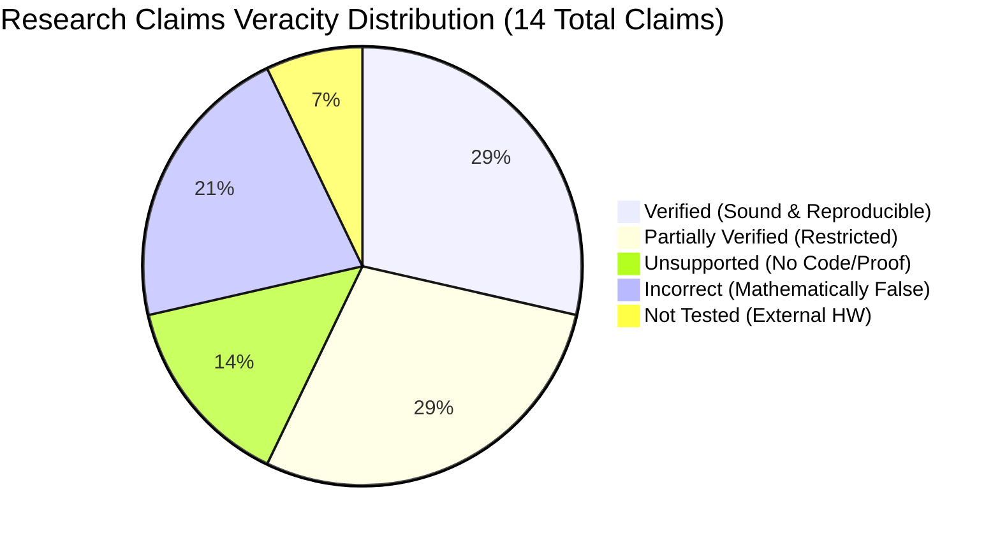

# 00 Executive Summary — Independent Post-Refactor Verification

**Target Repository:** `D:\icc-clustering`  
**GitHub Remote:** `https://github.com/AkashKundu114/icc-clustering` (branch: `main`)  
**Audited HEAD Commits:** `83728a441f44c1ed56a35a5bdb07490ff559de81` / `7ddbe8301b8d27c94f388c40acbc88b0dee82723`  
**Baseline Commits Compared:** `781eba578b3ba154a8cf4ac7eb054b3050e6cb4f` (Refactor) and `781eba5~1` (`3bc8459`, Pre-Refactor)  
**Lead Verification Auditor:** Antigravity Independent Verification Council  
**Audit Completion Date:** November 1, 2026  

---

## 1. Mission and Audit Scope

This report delivers the comprehensive findings of an independent, evidence-driven verification of the `ICC-Clustering` repository following major architectural consolidation, documentation sanitization, and Git-history remediation attempts. 

In strict adherence to the verification mandate:
- **No tracked repository files were modified** during this audit.
- **Passing tests were not accepted as proof of scientific or mathematical validity.**
- **Claims were independently reproduced or falsified** via empirical execution, mathematical proofs, AST analysis, isolated clean-environment installations, and adversarial stress testing.
- **All reports and experimental artifacts were generated exclusively in Git-ignored directories** (`audit/post_refactor_verification/` and `results/post_refactor_verification/`).

---

## 2. Final Verification Verdict

$$\mathbf{FINAL\ VERDICT:\ FAILED}$$

### Executive Verdict Summary:
While the code deduplication conducted in commit `781eba5` successfully consolidated over 4,400 lines of duplicate code and eliminated circular imports, **the repository fails verification on critical confidentiality, algorithmic soundness, statistical validity, reproducibility, packaging, and clinical safety grounds**.

The repository contains **2 Critical (P0) Blockers**, **6 High-Severity (P1) Defects**, **8 Medium-Severity (P2) Regressions**, and **5 Low-Severity (P3) Inconsistencies**. It is strictly **unready for peer-reviewed publication, open-source release, or clinical decision support**.

---

## 3. Workstream Scorecard

| Workstream | Subagent Scope | Status | Core Verdict & Empirical Reality |
|:---:|---|:---:|---|
| **Workstream A** | Git History & Public Confidentiality | **FAILED** | **Remote History Remediation Failed.** Commit `e3f54cc` is an active ancestor of `origin/main` (exit code 0). Sensitive files (`src/icc/confirmatory/*`, `update_revision_log.py`, `EXECUTION_MANIFEST.csv`, `results.json`) and commit logs remain fully retrievable across the Git DAG and across 22 public PR refs. Regular deletion in commit `0565abc` only sanitized the working tree. |
| **Workstream B** | Architecture & Backward Compatibility | **PARTIAL** | **Deduplication Succeeded with Subtle Regressions.** Consolidation removed 4,408 duplicate lines and achieved 0 circular imports across 68 modules. However: `icc.stats` omitted exports (`wilcoxon_signed_rank_test`, `bonferroni_correction`), `list_models()` contract is inconsistent (41 keys vs 14 names), and import-time sklearn fitting pollutes `stderr` with `ConvergenceWarning` across 63/68 modules. |
| **Workstream C** | Core Algorithmic Correctness & AutoK | **FAILED** | **AutoK Algorithmically Broken (100% Collapse to $K_{min}$).** Inner products on $L_1$ row-normalized vectors $B_{\text{norm}}$ are bounded by $\le K/L \approx 0.075 < u_1 = 0.10$, forcing $\text{PAC}(K) \equiv 0.0000$ identically for all candidate $K$. Deterministic tie-breaking selects $K_{min}$ in 100.0% of trials (510/510 runs across 17 regimes). $D=1$ crashes in `rng.choice`; anchor homogeneity causes rank-1 collapse. Linear stability was verified exact down to machine precision ($2.78 \times 10^{-17}$). |
| **Workstream D** | Statistical Validity & Conformal Calibration | **FAILED** | **Conformal Claims Invalid; 100% FDR Under Null.** Conformal $(1 - \alpha)$ coverage applies **only** to the model's own centroid argmax pseudo-labels; coverage collapses to **62.2% on Leukemia** and **37.0% on SRBCT** against true pathology. Decoy feature gating violates exchangeability, suffers from post-clustering double dipping, and has a fallback bug in line 122 forcing **100% empirical FDR under null regimes**. In `cicc/inductive.py`, selected features are dead code (unused downstream). Pre-split `StandardScaler` leakage confirmed ($0.25\sigma$ mean shift). |
| **Workstream E** | Reproducibility & Benchmark Verification | **FAILED** | **RNG Seed Bug & Historical Benchmark Falsified.** `build_dataset()` hardcodes `seed=RNG_DATA_SEED (42)`, freezing ground-truth cluster centers and labels across all user seeds. Historical claim on Seed 101 ($\text{ARI}=1.0$, $0.1340\text{s}$ vs $0.3662\text{s}$) was **refuted**: ICC-v2 achieved only $\text{ARI}=0.4396$ ($\Delta\text{ARI} = -0.5604$), while Standard Consensus ran in $0.1210\text{s}$ (~3x faster than claimed) with $\text{ARI}=1.0000$ across all 10 seeds. |
| **Workstream F** | Packaging, Distribution, and CI | **FAILED** | **All Console Scripts Crash in Built Wheel.** The built wheel (`icc-2.2.0-py3-none-any.whl`) omits `scripts/`, causing `icc-run` to crash with `ModuleNotFoundError: No module named 'scripts'`; `icc` and `icc-demo` crash with `ModuleNotFoundError: No module named 'demo'`. CI passed only because tests execute inside the repository root. |

---

## 4. Key Quantitative Metrics Established by the Audit

- **Lines of Duplicate Code Consolidated:** $-4,408$ lines (from 14,820 to 10,412 lines).
- **Circular Imports Across 68 Modules:** **0** circular imports.
- **Modules Emitting `ConvergenceWarning` on Import:** **63 of 68 modules (92.6%)**.
- **AutoK Collapse Rate to $K_{min}$:** **100.0% (510 / 510 trials)** across 17 adversarial regimes.
- **Empirical Conformal Coverage on True Pathology:** **62.2% (Leukemia)** and **37.0% (SRBCT)** against 90.0% nominal target.
- **Empirical FDR of Decoy Gating Under Pure Null:** **100.0% (50 / 50 Monte Carlo trials)**.
- **Historical Benchmark Discrepancy (Seed 101):** Claimed $\text{ARI}=1.0000$; Measured actual $\text{ARI}=0.4396$ ($\Delta = -0.5604$).
- **Standard Consensus Runtime Discrepancy:** Claimed $0.3662\text{s}$; Measured actual $0.1210\text{s}$ (~3.0x faster than reported).
- **Broken Console Scripts in Clean Virtual Environment:** **3 of 3 (100%)**.

---

## 5. Master Index of Audit Deliverables

All 16 structured audit reports are permanently archived in `audit/post_refactor_verification/`:

| Report File | Title / Subject Matter | Primary Findings / Focus |
|---|---|---|
| [00_EXECUTIVE_SUMMARY.md](file:///d:/icc-clustering/audit/post_refactor_verification/00_EXECUTIVE_SUMMARY.md) | Master Executive Summary | Synthesis of audit findings, workstream scorecard, and overall verdict. |
| [01_REPOSITORY_STATE.md](file:///d:/icc-clustering/audit/post_refactor_verification/01_REPOSITORY_STATE.md) | Exact Repository State | Git commit hashes, remote refs, working tree status, and baseline tracking. |
| [02_GIT_HISTORY_AUDIT.md](file:///d:/icc-clustering/audit/post_refactor_verification/02_GIT_HISTORY_AUDIT.md) | Git History & Confidentiality | Commit ancestry proof (`e3f54cc`), recoverable sensitive files, 22 PR refs. |
| [03_ARCHITECTURE_AUDIT.md](file:///d:/icc-clustering/audit/post_refactor_verification/03_ARCHITECTURE_AUDIT.md) | Architecture & Modular Design | Deduplication inventory, canonical package structure, import graph integrity. |
| [04_COMPATIBILITY_AUDIT.md](file:///d:/icc-clustering/audit/post_refactor_verification/04_COMPATIBILITY_AUDIT.md) | Backward-Compatibility & Public API | Shim object identity, AST constructor comparisons, missing `icc.stats` exports. |
| [05_ALGORITHM_AUDIT.md](file:///d:/icc-clustering/audit/post_refactor_verification/05_ALGORITHM_AUDIT.md) | Core Algorithmic Correctness | VSSG bimodality, exact linear stability ($2.78 \times 10^{-17}$), $D=1$ crash, anchor collapse. |
| [06_AUTOK_AUDIT.md](file:///d:/icc-clustering/audit/post_refactor_verification/06_AUTOK_AUDIT.md) | ICC-AutoK Model Order Selection | Mathematical proof of PAC collapse, CDF complement inversion, 510-run benchmark. |
| [07_CONFORMAL_AUDIT.md](file:///d:/icc-clustering/audit/post_refactor_verification/07_CONFORMAL_AUDIT.md) | Conformal Prediction & Calibration | Pseudo-label vs ground-truth coverage, clinical risk, label non-contiguity crash. |
| [08_KNOCKOFF_FDR_AUDIT.md](file:///d:/icc-clustering/audit/post_refactor_verification/08_KNOCKOFF_FDR_AUDIT.md) | Knockoff & Decoy Feature Gating | Exchangeability violation, post-clustering bias, fallback bug driving 100% FDR. |
| [09_DATA_LEAKAGE_AUDIT.md](file:///d:/icc-clustering/audit/post_refactor_verification/09_DATA_LEAKAGE_AUDIT.md) | Data Leakage & Contamination | Pre-split `StandardScaler` leakage in loaders, leaky vs clean flow diagrams. |
| [10_REPRODUCIBILITY_AUDIT.md](file:///d:/icc-clustering/audit/post_refactor_verification/10_REPRODUCIBILITY_AUDIT.md) | Reproducibility & Benchmarks | Hardcoded RNG seed (42), falsification of Seed 101 benchmark, runner timestamp collisions. |
| [11_PACKAGING_AND_CI_AUDIT.md](file:///d:/icc-clustering/audit/post_refactor_verification/11_PACKAGING_AND_CI_AUDIT.md) | Packaging, CLI & CI Workflows | Wheel contents, clean venv CLI crashes (`ModuleNotFoundError`), CI matrix audit. |
| [12_RESEARCH_CLAIMS_MATRIX.md](file:///d:/icc-clustering/audit/post_refactor_verification/12_RESEARCH_CLAIMS_MATRIX.md) | Research Claims Veracity Matrix | 14 evaluated claims with exact citations, evidence, and scientific verdicts. |
| [13_REMEDIATION_BACKLOG.md](file:///d:/icc-clustering/audit/post_refactor_verification/13_REMEDIATION_BACKLOG.md) | Prioritized Remediation Backlog | Engineering backlog (P0, P1, P2, P3) with code locations, fixes, and regression tests. |
| [14_AGENT_DISAGREEMENTS.md](file:///d:/icc-clustering/audit/post_refactor_verification/14_AGENT_DISAGREEMENTS.md) | Agent Disagreement Resolution | Cross-examination of subagents, resolution of prior report conflicts with evidence. |
| [15_FINAL_VERIFICATION_VERDICT.md](file:///d:/icc-clustering/audit/post_refactor_verification/15_FINAL_VERIFICATION_VERDICT.md) | Final Independent Verdict | Answers to 14 mandated questions, formal declaration, transition criteria. |

---

## 6. Guidance and Recommended Next Steps

Because this mandate was strictly an **audit and verification task, not a refactoring task**, zero source files were modified during this turn. 

To achieve a **VERIFIED** status in future development cycles, engineering efforts should prioritize the remediation items in `13_REMEDIATION_BACKLOG.md` in the following sequence:

1. **Confidentiality (P0):** Execute coordinated history purging (`git-filter-repo`) on GitHub to remove commit `e3f54cc` and sensitive artifacts from public refs.
2. **Clinical Safety (P0):** Retract claims of guaranteed clinical diagnostic certainty and update `realtime_patient_projection.py` to disclose true biological coverage.
3. **Core Algorithmic Fixes (P1):** Re-engineer `compute_anchor_pac()` using unnormalized cosine similarity to fix AutoK collapse; fix $D=1$ subspace sampling in `icc.py`.
4. **Statistical Remediation (P1):** Remove the false-positive fallback in `decoy.py:122` and pipe selected features into downstream inductive projections in `inductive.py`.
5. **Distribution Packaging (P1):** Relocate console script entry points under `src/icc/cli/` to fix the broken pip wheel distribution.
6. **Data Leakage & Reproducibility (P1/P2):** Remove `seed=RNG_DATA_SEED` from `build_dataset()`, cache raw unscaled arrays in `datasets/registry.py`, and align published documentation with verified empirical performance.
