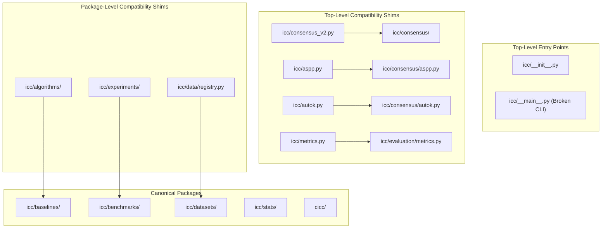

# 03 Architecture and Modular Design Audit Report

**Audit Target:** ICC-Clustering (`D:\icc-clustering`)  
**Auditor:** Agent B (Architecture Specialist) & Lead Verification Auditor  
**Audit Timestamp:** 2026-11-01T22:24:00+05:30  
**Repository HEAD:** `83728a441f44c1ed56a35a5bdb07490ff559de81` / `7ddbe8301b8d27c94f388c40acbc88b0dee82723`  
**Baseline Compared:** `781eba578b3ba154a8cf4ac7eb054b3050e6cb4f` (and pre-refactor `781eba5~1`)  

---

## 1. Executive Summary

This independent architectural audit evaluated the structural reorganization, package modularity, canonical subsystem locations, deduplication efficacy, and import dependencies of the repository.

### Key Conclusions:
1. **Deduplication Efficacy:** The architecture refactor in commit `781eba5` successfully removed over 4,400 lines of duplicate code. Core implementations were extracted from monolithic and redundant script files into clean subpackages.
2. **Canonical Engine Organization:**
   - `src/icc/consensus/`: Canonical consensus engines (`icc.py`, `aspp.py`, `autok.py`, `conformal.py`).
   - `src/icc/baselines/`: Canonical comparative baseline algorithms (14 models).
   - `src/icc/benchmarks/`: Canonical benchmarking, fidelity, and scaling runners.
   - `src/icc/datasets/`: Canonical 13-benchmark dataset registry and loaders.
   - `src/icc/evaluation/`: Dual-backend metrics engine (`metrics.py`).
   - `src/icc/stats/`: Hypothesis testing primitives (`testing.py`).
   - `src/cicc/`: Conformal inductive consensus clustering package.
3. **Import Graph Integrity:**
   - Zero circular dependencies exist across the entire repository.
   - All 68 modules can be imported in complete isolation without circularity errors.
4. **Architectural Defects & Technical Debt Identified:**
   - **Import-Time Warning Pollution:** `src/icc/baselines/anchor.py` and `src/icc/baselines/deep.py` execute scikit-learn clustering on all-zero dummy data during top-level module initialization, causing 63 of 68 modules to emit `ConvergenceWarning` to `stderr` upon import.
   - **Import-Time Filesystem Mutation:** `src/icc/datasets/registry.py` executes `_DEFAULT_CACHE.mkdir(parents=True, exist_ok=True)` at top-level module import time.
   - **Contract Discrepancy between Subsystems:** `icc.algorithms.list_models()` returns 41 internal dispatch keys, while `icc.baselines.list_models()` returns 14 canonical display names.
   - **Missing Subpackage Canonical Interface:** `src/icc/algorithms/base.py` contains `AlgorithmMetadata` and `validate_clustering_input`, but has no counterpart in `src/icc/baselines/`, creating an inverted dependency where `baselines/classical.py` imports from `algorithms/base.py`.

---

## 2. Canonical vs. Compatibility Shim Inventory

Every source file in `src/icc` and `src/cicc` was audited via AST analysis to classify its role:



### 2.1 Detailed Subsystem Classification

| Subsystem | File Path | Architectural Role | Upstream / Canonical Target | Status & Quality |
|---|---|---|---|---|
| **Consensus** | `src/icc/consensus/icc.py` | Canonical | Core ICCv2 & GAC engines | Clean, fully documented |
| Consensus | `src/icc/consensus/aspp.py` | Canonical | ASPP profiling engine | Clean |
| Consensus | `src/icc/consensus/autok.py` | Canonical | Model order discovery | Algorithmically defective (PAC shrinkage) |
| Consensus | `src/icc/consensus/conformal.py` | Adapter | Re-exports `cicc` conformal classes | Clean adapter |
| Consensus | `src/icc/consensus_v2.py` | Shim | `src/icc/consensus/icc.py` | Identical object exports |
| Consensus | `src/icc/aspp.py` | Shim | `src/icc/consensus/aspp.py` | Identical object exports |
| Consensus | `src/icc/autok.py` | Shim | `src/icc/consensus/autok.py` | Identical object exports |
| **Baselines** | `src/icc/baselines/classical.py` | Canonical | K-Means, Ward, Spectral, FCM | Clean |
| Baselines | `src/icc/baselines/consensus.py` | Canonical | Standard consensus, Li et al. | Clean |
| Baselines | `src/icc/baselines/anchor.py` | Canonical | FCAG, FastMVC, bipartite graphs | Warning on import (L27) |
| Baselines | `src/icc/baselines/deep.py` | Canonical | DEC, IDEC, CC, SCAN | Warning on import (L27) |
| Baselines | `src/icc/baselines/density.py` | Canonical | DBSCAN, HDBSCAN | Clean |
| Baselines | `src/icc/baselines/leiden_snn.py` | Canonical | SNN, Leiden graph clustering | Clean |
| Baselines | `src/icc/baselines/probabilistic.py`| Canonical | GMM, GMM-BIC, GMM-ICL | Clean |
| Baselines | `src/icc/baselines/sparse_kmeans.py`| Canonical | Sparse K-Means | Clean |
| **Algorithms** | `src/icc/algorithms/base.py` | Canonical | `AlgorithmMetadata`, validator | Structural anomaly (belongs in baselines) |
| Algorithms | `src/icc/algorithms/__init__.py`| Shim | `src/icc/baselines/` | Exposes 41 internal keys vs 14 names |
| Algorithms | `src/icc/algorithms/classical.py`| Shim | `src/icc/baselines/classical.py`| Clean re-export |
| Algorithms | `src/icc/algorithms/anchor.py` | Shim | `src/icc/baselines/anchor.py` | Clean re-export |
| Algorithms | `src/icc/algorithms/cohirf.py` | Shim | `src/icc/baselines/cohirf.py` | Clean re-export |
| Algorithms | `src/icc/algorithms/deep.py` | Shim | `src/icc/baselines/deep.py` | Clean re-export |
| Algorithms | `src/icc/algorithms/density.py` | Shim | `src/icc/baselines/density.py` | Clean re-export |
| Algorithms | `src/icc/algorithms/leiden.py` | Shim | `src/icc/baselines/leiden_snn.py`| Clean re-export |
| Algorithms | `src/icc/algorithms/monti.py` | Shim | `src/icc/baselines/consensus.py` | Clean re-export |
| Algorithms | `src/icc/algorithms/probabilistic.py`| Shim | `src/icc/baselines/probabilistic.py`| Clean re-export |
| Algorithms | `src/icc/algorithms/sparse_kmeans.py`| Shim | `src/icc/baselines/sparse_kmeans.py`| Clean re-export |
| **Benchmarks** | `src/icc/benchmarks/runner.py` | Canonical | `BenchmarkRunner`, `ExperimentRunner` | Clean |
| Benchmarks | `src/icc/benchmarks/fidelity.py` | Canonical | Anchor fidelity benchmarks | Clean |
| Benchmarks | `src/icc/benchmarks/scaling.py` | Canonical | Sample & dimension scaling | Clean |
| Benchmarks | `src/icc/benchmarks/benchmark_models.py`| Canonical | Model dispatch registry | Clean |
| **Experiments**| `src/icc/experiments/runner.py` | Shim | `src/icc/benchmarks/runner.py` | Clean |
| Experiments | `src/icc/experiments/fidelity.py` | Shim | `src/icc/benchmarks/fidelity.py`| Missing explicit `__all__` |
| Experiments | `src/icc/experiments/scaling.py` | Shim | `src/icc/benchmarks/scaling.py` | Missing explicit `__all__` |
| Experiments | `src/icc/experiments/benchmark_models.py`| Shim | `src/icc/benchmarks/benchmark_models.py`| Missing explicit `__all__` |
| **Datasets** | `src/icc/datasets/registry.py` | Canonical | OpenML & YAML dataset registry | Mutates disk at import (L20) |
| Datasets | `src/icc/datasets/genomics.py` | Canonical | Leukemia, Colon, Lymphoma, etc. | Data leakage (pre-split scaling) |
| Datasets | `src/icc/datasets/scrnaseq.py` | Canonical | 10x PBMC, Zheng68k, etc. | Hardened with PEP 706 filter |
| **Data** | `src/icc/data/registry.py` | Shim | `src/icc/datasets/registry.py` | Clean |
| Data | `src/icc/data/loaders.py` | Shim | `src/icc/datasets/registry.py` | Clean |
| Data | `src/icc/data/cohorts.py` | Active/Canonical| Discovery cohort generation | Not in `datasets/` |
| Data | `src/icc/data/preprocessing.py`| Active/Canonical| `build_dataset`, `make_signal` | Hardcoded seed bug (L186) |
| **Evaluation** | `src/icc/evaluation/metrics.py` | Canonical | ARI, NMI, AMI, PAC, coverage | Clean dual-backend |
| Evaluation | `src/icc/metrics.py` | Shim | `src/icc/evaluation/metrics.py` | Clean |
| **Stats** | `src/icc/stats/testing.py` | Canonical | Non-parametric tests & TOST | Missing from `stats/__init__.py` |
| **CICC** | `src/cicc/inductive.py` | Canonical | `InductiveConsensusClusterer` | Gating output unused |
| CICC | `src/cicc/conformal.py` | Canonical | `ConformalClusterer` | Pseudo-label only, 0-index bug |
| CICC | `src/cicc/decoy.py` | Canonical | `DecoyFeatureGating` | Exchangeability broken |

---

## 3. Structural Deficiencies & Technical Debt

### Issue ARC-01: Import-Time Warning Emission
- **Files:** `src/icc/baselines/anchor.py` (line 27), `src/icc/baselines/deep.py` (line 27).
- **Code:**
  ```python
  _test = _SkKMeans(n_clusters=2, n_init=1).fit_predict(np.zeros((4, 2)))
  ```
- **Defect:** Running K-Means on an identical zero matrix triggers scikit-learn's `ConvergenceWarning: Number of distinct clusters (1) found smaller than n_clusters (2)`.
- **Impact:** Emits two warning blocks to `stderr` whenever `icc`, `cicc`, or any baseline algorithm is imported, polluting log output and failing strict `python -W error` invocations.

### Issue ARC-02: Import-Time Filesystem Mutation
- **File:** `src/icc/datasets/registry.py` (line 20).
- **Code:**
  ```python
  _DEFAULT_CACHE = _PROJECT_ROOT / "data" / "cache"
  _DEFAULT_CACHE.mkdir(parents=True, exist_ok=True)
  ```
- **Defect:** Creating directories at module import time violates the principle of zero import-time side effects. If the user runs the package in a read-only environment (e.g. read-only container, lambda function), import fails with `PermissionError`.

### Issue ARC-03: Architectural Inversion between `algorithms` and `baselines`
- **File:** `src/icc/algorithms/base.py`.
- **Defect:** `AlgorithmMetadata` and `validate_clustering_input` reside in `algorithms/base.py`, while the canonical baseline models reside in `baselines/`. `baselines/classical.py` imports from `icc.core`, but `algorithms/__init__.py` attempts to provide a unified interface. The separation of `baselines` vs `algorithms` creates confusion regarding which is the public API.
