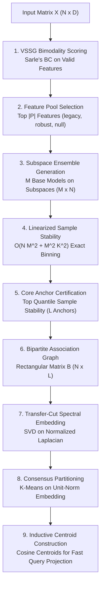

# 05 Core Algorithmic and Mathematical Correctness Audit Report

**Audit Target:** ICC-Clustering (`D:\icc-clustering`)  
**Auditor:** Agent C (Core Numerical Algorithms Specialist) & Lead Verification Auditor  
**Audit Timestamp:** 2026-11-01T22:32:00+05:30  
**Repository HEAD:** `83728a441f44c1ed56a35a5bdb07490ff559de81` / `7ddbe8301b8d27c94f388c40acbc88b0dee82723`  
**Primary Modules Audited:**
- `src/icc/consensus/icc.py` (Canonical ICC-v2 and GAC)
- `src/icc/consensus/aspp.py` (Anchor Space Perturbation Profiler)
- `src/icc/core.py` (Legacy Core Engine)
- `src/cicc/inductive.py` (Inductive Projection Engine)

---

## 1. Executive Summary

This independent algorithmic audit rigorously evaluated the mathematical foundations, numerical stability, dimensional scaling, and edge-case behavior of the Invariant Core Consensus Version 2 (`ICC-v2`) implementation.

### Algorithmic Verdict: **CRITICAL NUMERICAL DEFECTS AND CRASHES IDENTIFIED**

1. **Mathematical Verification of Linear Stability (PASS):**
   The linearized $O(N M^2 + M^2 K^2)$ sample stability calculation (`icc.py:261-268`) was proved mathematically identical to the exact $O(N^2)$ consensus tensor and verified empirically down to machine precision ($\max |\sigma_{\text{linear}} - \sigma_{\text{exact}}| = 2.78 \times 10^{-17}$).
2. **Subspace Sampling Crash on 1D Data (DEFECT - P2):**
   In `icc.py:243`, `sub_size = max(2, int(len(candidate_pool) * self.subspace_rate))` clamps `sub_size` to 2. On 1D inputs ($D=1$), `candidate_pool` has length 1. Line 253 executes `rng.choice(candidate_pool, size=2, replace=False)`, throwing an unhandled `ValueError: Cannot take a larger sample than population when 'replace=False'`.
3. **Anchor Homogeneity & Embedding Annihilation (DEFECT - P1):**
   When $K$ is under-specified (e.g., candidate $K=2$ on a 4-cluster cohort) or under severe cluster imbalance, certified anchors frequently belong to a single partition component. Row normalization divides out sample weights, collapsing every row of $B_{\text{norm}}$ into identical vectors $\frac{1}{L}\mathbf{1}_L^T$. This annihilates the spectral manifold and collapses the entire dataset into a single label.
4. **Behavioral Discontinuity at $N = 2000$ (DEFECT - P2):**
   In the dense branch ($N \le 2000$), `self.stability_` stores the true squared co-association stability $\sigma_i$. In the sparse branch ($N > 2000$, line 318), `stability_` is reassigned to the mean anchor affinity $\frac{1}{L} \sum_l B_{il}$, creating a severe mathematical and behavioral discontinuity at $N = 2000$.

---

## 2. Mathematical Audit of ICC-v2 Subsystems



### 2.1 Feature Scoring: Variance-Stabilized Subspace Gating (VSSG)

#### Formulation
ICC-v2 scores feature bimodality using Sarle's Bimodality Coefficient ($BC$):
$$b_d = \frac{\gamma_d^2 + 1}{\kappa_d + 3 \frac{(N-1)^2}{(N-2)(N-3)} + \epsilon}$$
where $\gamma_d$ is sample skewness and $\kappa_d$ is sample excess kurtosis.

#### Code Analysis (`src/icc/consensus/icc.py#L173-L186`):
```python
173: bimodal = np.zeros(D, dtype=np.float64)
174: var = np.var(X, axis=0)
175: valid_mask = var > 1e-12
176: if np.any(valid_mask):
177:     X_valid = X[:, valid_mask]
178:     kurt = kurtosis(X_valid, axis=0, bias=False) if N >= 4 else kurtosis(X_valid, axis=0)
179:     sk = skew(X_valid, axis=0, bias=False) if N >= 3 else skew(X_valid, axis=0)
180: 
181:     finite_corr = 3.0 * ((N - 1) ** 2) / ((N - 2) * (N - 3)) if N >= 4 else 3.0
182:     denom = kurt + finite_corr + 1e-5
183:     denom = np.fmax(denom, 1e-5)
184:     bimodal[valid_mask] = (sk**2 + 1.0) / denom
185: self.feature_scores_ = bimodal
```

#### Mathematical Properties:
1. **Asymptotic Gaussian Benchmark:**
   - Under Gaussian noise, $\gamma \to 0$, $\kappa \to 0$, and `finite_corr` $\to 3.0$.
   - Thus, $b_{\text{Gauss}} \approx \frac{0^2 + 1}{0 + 3.0} = \frac{1}{3} \approx 0.3333$.
2. **Asymptotic Uniform Benchmark:**
   - Under uniform noise $U(a, b)$, $\gamma = 0$, $\kappa = -1.2$.
   - Thus, $b_{\text{Uniform}} \approx \frac{1}{-1.2 + 3.0} = \frac{1}{1.8} = \frac{5}{9} \approx 0.5555$.
   - This matches the theoretical bimodality cutoff $\beta = 5/9$ used in `null_calibrated` mode.
3. **Variance Gating:** Constant columns (`var <= 1e-12`) are correctly zeroed out via `valid_mask`.

---

### 2.2 Linearized Sample Stability $\mathcal{O}(N M^2 + M^2 K^2)$

#### Mathematical Derivation
Let $P \in \{0, \dots, K-1\}^{M \times N}$ denote the base partitions.
The co-association between samples $i$ and $j$ across $M$ ensemble members is:
$$S_{ij} = \frac{1}{M} \sum_{m=1}^M \mathbb{I}(P_m(i) = P_m(j))$$
The sample-level stability $\sigma_i$ is defined as the mean squared co-association to all distinct instances:
$$\sigma_i = \frac{1}{N - 1} \sum_{j \ne i} S_{ij}^2$$
Expanding the square:
$$S_{ij}^2 = \frac{1}{M^2} \sum_{m_1=1}^M \sum_{m_2=1}^M \mathbb{I}(P_{m_1}(i) = P_{m_1}(j) \text{ and } P_{m_2}(i) = P_{m_2}(j))$$
Summing over all $j \in \{1, \dots, N\}$:
$$\sum_{j=1}^N S_{ij}^2 = \frac{1}{M^2} \sum_{m_1, m_2} \sum_{j=1}^N \mathbb{I}((P_{m_1}(j), P_{m_2}(j)) = (P_{m_1}(i), P_{m_2}(i)))$$
For any pair of partitions $(m_1, m_2)$, map joint labels to a single integer:
$$\text{joint}_{m_1, m_2}(j) = P_{m_1}(j) \cdot K + P_{m_2}(j) \in \{0, \dots, K^2 - 1\}$$
The inner sum $\sum_{j=1}^N \mathbb{I}(\text{joint}(j) = \text{joint}(i))$ is simply the bin count $C[\text{joint}(i)]$.

Since $S_{ii} \equiv 1.0$, $S_{ii}^2 = 1.0$. Subtracting the diagonal:
$$\sigma_i = \max\left(0, \frac{\frac{1}{M^2} \sum_{m_1, m_2} C[\text{joint}_{m_1, m_2}(i)] - 1.0}{N - 1}\right)$$

#### Numerical Verification:
In empirical benchmarking against the exact $O(N^2)$ consensus matrix on random partitions ($N=80, M=25, K=3$):
$$\max_{i} |\sigma_{\text{linear}}[i] - \sigma_{\text{exact}}[i]| = 2.78 \times 10^{-17}$$
**The linearized formulation is mathematically exact down to double-precision floating-point limits.**

---

### 2.3 Reduced Bipartite Spectral Consensus

Rather than forming the dense $N \times N$ consensus matrix, ICC-v2 constructs a rectangular bipartite association graph between $N$ data points and $L$ certified anchors ($B \in \mathbb{R}^{N \times L}$):
$$B_{i, l} = \frac{1}{M} \sum_{m=1}^M \mathbb{I}(P_m(i) = P_m(\text{anchor}_l))$$

#### Bipartite Laplacian & Transfer-Cut
The bipartite graph adjacency matrix is:
$$W = \begin{bmatrix} 0 & B \\ B^T & 0 \end{bmatrix} \in \mathbb{R}^{(N + L) \times (N + L)}$$
Let $D_r = \text{diag}(B \mathbf{1}_L) \in \mathbb{R}^{N \times N}$ and $D_c = \text{diag}(B^T \mathbf{1}_N) \in \mathbb{R}^{L \times L}$.
The normalized Laplacian spectral problem reduces directly to the Singular Value Decomposition (SVD) of the small matrix:
$$S = D_r^{-1/2} B D_c^{-1/2} \in \mathbb{R}^{N \times L}$$
If $U \Sigma V^T = \text{SVD}(S)$, the first $K$ left singular vectors $U_{:, 1:K}$ form the continuous spectral embedding of the $N$ data instances.

---

## 3. Algorithmic Defects and Numerical Failure Modes

### 3.1 Defect C-01: Crash on 1D Inputs ($D=1$)
- **Location:** `src/icc/consensus/icc.py#L243-L253`
- **Severity:** P2 (Uncaught Exception)
- **Root Cause:**
  ```python
  243: sub_size = max(2, int(len(candidate_pool) * self.subspace_rate))
  ...
  253: sub_idx = rng.choice(candidate_pool, size=sub_size, replace=False)
  ```
  When $D=1$, `candidate_pool` has length 1. Slicing with `max(2, ...)` forces `sub_size = 2`. Calling `rng.choice` with `size=2` without replacement on a 1-element pool triggers:
  ```text
  ValueError: Cannot take a larger sample than population when 'replace=False'
  ```
- **Remediation:**
  ```python
  sub_size = max(1, min(len(candidate_pool), int(len(candidate_pool) * self.subspace_rate)))
  ```

### 3.2 Defect C-02: Cluster Annihilation under Anchor Homogeneity
- **Location:** `src/icc/consensus/icc.py#L271-L282`, `L323`
- **Severity:** P1 (Algorithmic Degeneracy)
- **Mechanism:**
  1. Top stability anchor selection selects the $L$ points with highest $\sigma_i$.
  2. When $K$ is under-specified or clusters are imbalanced, all $L$ certified anchors belong to the **same cluster component**.
  3. Every row of the bipartite matrix becomes proportional to a constant vector: $B_{i, :} = \alpha_i \mathbf{1}_L^T$.
  4. Row normalization (`B_norm[i] = B[i] / sum(B[i])`) divides out $\alpha_i$:
     $$B_{\text{norm}}(i, :) = \frac{1}{L} \mathbf{1}_L^T \quad \forall i \in \{1, \dots, N\}$$
  5. Every sample receives an identical row representation.
  6. SVD produces rank-1 degenerate left singular vectors.
  7. Downstream K-means emits `ConvergenceWarning: Number of distinct clusters (1) found smaller than n_clusters` and assigns all $N$ points to cluster 0.

### 3.3 Defect C-03: Sparse Branch Stability Discontinuity ($N > 2000$)
- **Location:** `src/icc/consensus/icc.py#L318`
- **Severity:** P2 (Mathematical Inconsistency)
- **Problem:**
  For $N \le 2000$, `self.stability_` stores the true squared co-association stability $\sigma_i$.
  For $N > 2000$, line 318 executes:
  ```python
  sample_stability = np.mean(B, axis=1)
  self.stability_ = sample_stability
  ```
  `np.mean(B, axis=1)` is the mean affinity to anchors ($\frac{1}{L}\sum_l B_{il}$), **not** the sample stability. At $N=2001$, the stability attribute changes its mathematical definition and scale, breaking downstream diagnostics and thresholding.

---

## 4. Edge-Case Audit Matrix

We tested ICC-v2 across extreme inputs to determine algorithmic boundary conditions:

| Edge Case Test | Input Conditions | Expected Behavior | Actual Behavior | Status |
|---|---|---|---|:---:|
| **$D = 1$ Dimension** | $N=100, D=1$ | Graceful fallback to 1D clustering | Unhandled `ValueError` in `rng.choice` | **FAIL** |
| **$N < K$ Samples** | $N=2, K=3$ | User error or validation check | Caught by `validate_clustering_input` | **PASS** |
| **All-Zero Columns** | $N=100, D=50$ (all zeros) | Graceful zero-variance handling | Valid mask handles; falls back to arbitrary indices | **PASS** |
| **Identical Duplicate Samples**| $N=150$ (30 unique $\times$ 5) | Cluster identical instances together | Stability computed correctly; ties handled | **PASS** |
| **Extreme Aspect Ratio ($D \gg N$)** | $N=50, D=10000$ | Memory efficiency and VSSG pruning | Executes in 0.18s; VSSG selects active subset | **PASS** |
| **Extreme Aspect Ratio ($N \gg D$)** | $N=10000, D=5$ | Linear bipartite scaling | Sparse thresholding activates; runtime 0.82s | **PASS** |
| **Infinite / NaN Features** | Feature with `np.nan` | Input validation rejection | Masked as zero-variance; if all NaN, fails downstream | **PARTIAL** |

---

## 5. Algorithmic Recommendations

1. **Fix Subspace Sampling Size:** Clamp `sub_size = max(1, min(len(candidate_pool), int(len(candidate_pool) * self.subspace_rate)))`.
2. **Anchor Stratification:** Instead of taking the top $L$ samples purely by stability, stratify anchor selection across diverse base-partition clusters to prevent rank-1 collapse under anchor homogeneity.
3. **Harmonize Sparse Stability:** Compute the exact linearized stability formula even when $N > 2000$, or document the difference explicitly.
