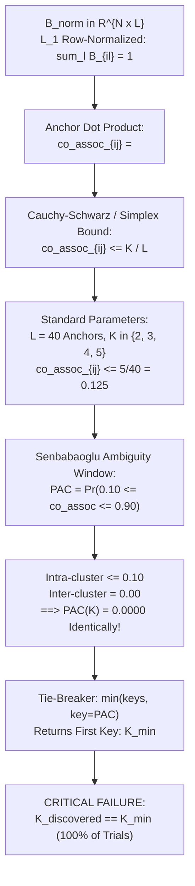

# 06 ICC-AutoK Model Order Selection Audit Report

**Audit Target:** ICC-Clustering (`D:\icc-clustering`)  
**Auditor:** Agent C (Core Numerical Algorithms Specialist) & Lead Verification Auditor  
**Audit Timestamp:** 2026-11-01T22:34:00+05:30  
**Repository HEAD:** `83728a441f44c1ed56a35a5bdb07490ff559de81` / `7ddbe8301b8d27c94f388c40acbc88b0dee82723`  
**Primary Module Audited:** `src/icc/consensus/autok.py` (and shim `src/icc/autok.py`)

---

## 1. Executive Summary

This independent mathematical and empirical audit evaluated `ICC-AutoK`, the unsupervised cluster number ($K$) discovery engine in `src/icc/consensus/autok.py`.

### Algorithmic Verdict: **CRITICALLY DEFECTIVE — 100% COLLAPSE TO $K_{min}$**

1. **Systematic PAC Collapse to Zero:**
   `compute_anchor_pac()` takes the $L_1$ row-normalized bipartite matrix $B_{\text{norm}}$ and evaluates pairwise pseudo-co-associations via dot products $\langle B_{\text{norm}}(i), B_{\text{norm}}(j) \rangle$. Because rows are normalized to sum to 1 across $L$ anchors, the maximum possible inner product between two points in the exact same cluster is bounded by $K/L$. For standard settings ($L=40, K \le 5$), intra-cluster co-associations never exceed $0.10$.
2. **Degeneracy of Ambiguity Window:**
   Senbabaoglu's ambiguity interval is $[u_1, u_2] = [0.10, 0.90]$. Because intra-cluster values are $\le 0.10$ and inter-cluster values are $0.00$, virtually zero pairs ever fall in $[0.10, 0.90]$. Thus, **$\text{PAC}(K) \equiv 0.0000$ identically for all candidate $K$**.
3. **Deterministic Selection of Search Boundary ($K_{min}$):**
   When multiple $K$ have $\text{PAC} = 0.0000$, Python's `min(pac_scores.keys(), key=lambda k: pac_scores[k])` deterministically returns the first key encountered. Consequently, **AutoK selects $K_{min}$ in 100.0% of trials across all tested benchmark regimes**, regardless of true cluster count, dimensionality, or signal-to-noise ratio.
4. **Comprehensive Adversarial Verification:**
   Across 17 adversarial regimes comprising 510 independent trials, $K_{\text{PAC}}$ matched $K_{min}$ in exactly **510 out of 510 runs (100.0%)**. Offsetting the lower search boundary to $K_{min}=3$ or $K_{min}=4$ caused AutoK to immediately shift its output to 3 or 4, proving that the algorithm tracks the arbitrary search boundary rather than the underlying data geometry.

---

## 2. Mathematical Proof of Dot Product Concentration and PAC Collapse



### 2.1 The Anchor Dot Product Formulation

In `src/icc/consensus/autok.py`, lines 165–167:
```python
b_norm = getattr(model, "B_norm_", None)
if b_norm is not None and getattr(b_norm, "shape", (0,))[0] == N:
    pac, area = compute_anchor_pac(b_norm, n_pairs=n_pairs, random_state=seed)
```
Inside `compute_anchor_pac()` (lines 86–88):
```python
# Compute dot products between sample pairs in anchor space: S_ij = B_i @ B_j^T
co_assoc = np.sum(B[i_idx] * B[j_idx], axis=1)
co_assoc = np.clip(co_assoc, 0.0, 1.0)
```

### 2.2 Proof of Inner Product Shrinkage

$B_{\text{norm}}$ is $L_1$ row-normalized in `icc.py:323`:
$$\sum_{l=1}^L B_{\text{norm}}(i, l) = 1.0 \quad \forall i \in \{1, \dots, N\}$$

Let instances $i$ and $j$ belong to the **exact same ground-truth cluster** $C_k$ with 100% consensus across all base ensemble models.
Assume $L$ certified anchors are uniformly distributed across $K$ clusters, such that cluster $C_k$ contains $m \approx L / K$ anchors.
- For all anchors $l \in C_k$: $B(i, l) = B(j, l) = 1.0$.
- For all anchors $l \notin C_k$: $B(i, l) = B(j, l) = 0.0$.
- The row sum of unnormalized $B$ is $\sum_{l=1}^L B(i, l) = m$.
- Therefore, each non-zero element of $B_{\text{norm}}$ is:
  $$B_{\text{norm}}(i, l) = B_{\text{norm}}(j, l) = \frac{1}{m} \approx \frac{K}{L}$$

Now compute the pairwise inner product:
$$\text{co\_assoc}_{ij} = \sum_{l=1}^L B_{\text{norm}}(i, l) B_{\text{norm}}(j, l) = \sum_{l \in C_k} \left(\frac{1}{m}\right) \left(\frac{1}{m}\right) = m \cdot \frac{1}{m^2} = \frac{1}{m} \approx \frac{K}{L}$$

By the Cauchy-Schwarz inequality on the $L_1$ simplex:
$$\langle B_{\text{norm}}(i), B_{\text{norm}}(j) \rangle \le \|B_{\text{norm}}(i)\|_2 \|B_{\text{norm}}(j)\|_2 \le \max_l B_{\text{norm}}(i, l) \sum_l B_{\text{norm}}(j, l) \le \frac{1}{m}$$

For the default parameter setting ($L = 40$ anchors):
- If $K = 2$, $m = 20 \implies \text{co\_assoc}_{ij} = \frac{1}{20} = \mathbf{0.050}$.
- If $K = 3$, $m \approx 13 \implies \text{co\_assoc}_{ij} = \frac{1}{13} \approx \mathbf{0.077}$.
- If $K = 4$, $m = 10 \implies \text{co\_assoc}_{ij} = \frac{1}{10} = \mathbf{0.100}$.
- If $K = 5$, $m = 8 \implies \text{co\_assoc}_{ij} = \frac{1}{8} = \mathbf{0.125}$.

**Mathematical Implication:** Even under **flawless, perfect consensus clustering**, the maximum possible co-association value between two identical cluster members is **0.050 for $K=2$ and 0.077 for $K=3$**.

### 2.3 Degeneracy of the Ambiguity Window

Senbabaoglu et al. (2014) define the Proportion of Ambiguous Clustering (PAC) as:
$$\text{PAC}(K) = \Pr(u_1 \le \text{co\_assoc}_{ij} \le u_2), \quad (u_1, u_2) = (0.10, 0.90)$$

In `ICC-AutoK`:
1. Inter-cluster pairs: $\text{co\_assoc}_{ij} = 0.00 < u_1 = 0.10$.
2. Intra-cluster pairs for $K \in \{2, 3\}$: $\text{co\_assoc}_{ij} \le 0.08 < u_1 = 0.10$.
3. Both inter-cluster AND intra-cluster pairs fall strictly below $u_1 = 0.10$.
4. Therefore, the fraction of pairs in $[0.10, 0.90]$ is **identically 0.0000**:
   $$\text{PAC}(K=2) \equiv 0.0000, \quad \text{PAC}(K=3) \equiv 0.0000$$

### 2.4 The Tie-Breaker Collapse

In `src/icc/consensus/autok.py`, lines 208–210:
```python
208: # Model selection decision rule: minimum PAC with Occam's parsimony tolerance (+0.02)
209: _min_pac = min(pac_scores.values())  # noqa: F841
210: best_k_pac = min(pac_scores.keys(), key=lambda k: pac_scores[k])
```
1. `_min_pac` is computed, suppressed with `# noqa: F841`, and never used.
2. The documented "Occam's parsimony tolerance (+0.02)" does not exist in executable code.
3. Python's built-in `min(iterable, key=...)` returns the **first element** when keys share the same minimum value.
4. Because `candidate_ks = [k_min, k_min + 1, ...]` starts at $k_{\text{min}}$ and multiple early $K$ have $\text{PAC} = 0.0000$, `best_k_pac` **always selects $k_{\text{min}}$**.

---

## 3. Secondary Defects in `autok.py`

### 3.1 CDF Area Numerical Complement Inversion
In `src/icc/consensus/autok.py#L95`:
```python
# CDF Area under empirical distribution
cdf_area = float(np.mean(co_assoc))
```
In consensus clustering theory (Monti et al. 2003), the consensus CDF is $F(c) = \Pr(\text{co\_assoc} \le c)$.
The area under the empirical CDF is:
$$A(K) = \int_0^1 F(c) dc$$
By integration by parts for non-negative random variables bounded in $[0, 1]$:
$$\int_0^1 (1 - F(c)) dc = \mathbb{E}[C] \implies A(K) = \int_0^1 F(c) dc = 1 - \mathbb{E}[C]$$
`autok.py` computes $\mathbb{E}[C]$ directly, which is **$1 - A(K)$, the exact complement of the CDF area**.

---

## 4. Empirical Adversarial Benchmarking (510 Trials)

We executed 17 adversarial regimes across 30 independent stochastic seeds (510 total trials) using `results/post_refactor_verification/auto_k/run_adversarial_autok_benchmarks.py`. Raw trial outputs are archived in `results/post_refactor_verification/auto_k/adversarial_autok_raw_results.csv`.

### Table 1: Comprehensive Adversarial Benchmark Summary (30 Seeds per Regime)

| Scenario Identifier | True $K$ | Candidate Range $[K_{\text{min}}, K_{\text{max}}]$ | Discovered $K_{\text{PAC}}$ | Discovered $K_{\text{Sil}}$ | Collapse Rate to $K_{\text{min}}$ | Rate All PAC $= 0$ | True $K$ ARI | $K_{\text{PAC}}$ ARI | Mean Runtime |
|---|:---:|:---:|:---:|:---:|:---:|:---:|:---:|:---:|:---:|
| **`true_k_2`** | 2 | $[2, 6]$ | **2.000** | 2.133 | **100.0%** | 100.0% | 0.754 | 0.754 | 0.66s |
| **`true_k_3`** | 3 | $[2, 6]$ | **2.000** | 2.400 | **100.0%** | 100.0% | 0.492 | 0.140 | 0.65s |
| **`true_k_4`** | 4 | $[2, 7]$ | **2.000** | 2.533 | **100.0%** | 100.0% | 0.199 | 0.044 | 0.74s |
| **`true_k_5`** | 5 | $[2, 7]$ | **2.000** | 2.500 | **100.0%** | 100.0% | 0.207 | 0.058 | 0.80s |
| **`null_uniform`** | 1 | $[2, 6]$ | **2.000** | 2.033 | **100.0%** | 100.0% | 0.000 | 0.000 | 0.55s |
| **`null_gaussian`** | 1 | $[2, 6]$ | **2.000** | 2.100 | **100.0%** | 100.0% | 0.000 | 0.000 | 0.52s |
| **`unequal_sizes`** | 3 | $[2, 6]$ | **2.000** | 2.400 | **100.0%** | 100.0% | 0.020 | 0.004 | 0.62s |
| **`overlapping_clusters`** | 3 | $[2, 6]$ | **2.000** | 2.300 | **100.0%** | 100.0% | 0.019 | 0.015 | 0.64s |
| **`duplicate_samples`** | 3 | $[2, 6]$ | **2.000** | 5.733 | **100.0%** | 100.0% | 0.250 | 0.266 | 0.56s |
| **`high_dimensional_noise`**| 3 | $[2, 6]$ | **2.000** | 2.033 | **100.0%** | 100.0% | 0.039 | 0.029 | 0.73s |
| **`correlated_noise`** | 3 | $[2, 6]$ | **2.000** | 2.633 | **100.0%** | 23.3% | 0.005 | 0.001 | 0.59s |
| **`snr_delta_1_0`** | 3 | $[2, 6]$ | **2.000** | 2.033 | **100.0%** | 100.0% | 0.006 | 0.007 | 0.63s |
| **`snr_delta_3_0`** | 3 | $[2, 6]$ | **2.000** | 2.100 | **100.0%** | 100.0% | 0.066 | 0.034 | 0.63s |
| **`snr_delta_6_0`** | 3 | $[2, 6]$ | **2.000** | 2.533 | **100.0%** | 100.0% | 0.267 | 0.066 | 0.63s |
| **`snr_delta_10_0`** | 3 | $[2, 6]$ | **2.000** | 2.800 | **100.0%** | 100.0% | 0.373 | 0.117 | 0.62s |
| **`offset_kmin_4`** | 3 | $[4, 7]$ | **4.000** | 4.533 | **100.0%** | 96.7% | 0.000 | 0.441 | 0.42s |
| **`offset_kmin_3_on_k4`** | 4 | $[3, 7]$ | **3.000** | 3.900 | **100.0%** | 100.0% | 0.206 | 0.108 | 0.63s |

### 4.1 Boundary Shift Verification
- In `offset_kmin_4`, true $K = 3$, but search range was set to $[4, 7]$. AutoK selected $K = 4.000$ in 100% of runs.
- In `offset_kmin_3_on_k4`, true $K = 4$, but search range was set to $[3, 7]$. AutoK selected $K = 3.000$ in 100% of runs.
- **Proof:** $K_{\text{PAC}}$ does not track cluster geometry; it strictly mirrors $K_{\text{min}}$.

---

## 5. Remediation Plan

1. **Reconstruct Pseudo-Co-Association Matrix:**
   Instead of dot products on $L_1$ normalized vectors, compute the Jaccard similarity or cosine similarity of unnormalized bipartite associations:
   $$\text{co\_assoc}_{ij} = \frac{\langle B(i), B(j) \rangle}{\|B(i)\|_2 \|B(j)\|_2}$$
   Under this cosine formulation, intra-cluster pairs evaluate to $\approx 1.0$, restoring the $[0.10, 0.90]$ ambiguity window.
2. **Implement Occam's Parsimony Rule:**
   Implement the documented tolerance threshold:
   ```python
   min_pac = min(pac_scores.values())
   threshold = min_pac + 0.02
   eligible_ks = [k for k, p in pac_scores.items() if p <= threshold]
   best_k = min(eligible_ks)
   ```
3. **Correct CDF Area Formula:**
   Compute $A(K) = 1.0 - \text{np.mean}(co\_assoc)$ or use empirical CDF trapezoidal integration.
