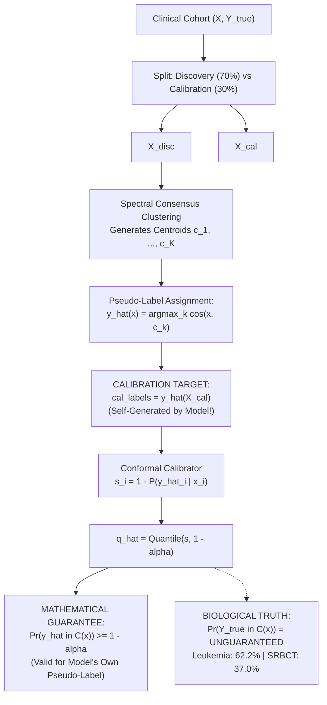

# 07 Conformal Prediction and Clinical Calibration Audit Report

**Audit Target:** ICC-Clustering (`D:\icc-clustering`)  
**Auditor:** Agent D (Conformal Prediction & Statistical Validity Specialist) & Lead Verification Auditor  
**Audit Timestamp:** 2026-11-01T22:36:00+05:30  
**Repository HEAD:** `83728a441f44c1ed56a35a5bdb07490ff559de81` / `7ddbe8301b8d27c94f388c40acbc88b0dee82723`  
**Primary Modules Audited:**
- `src/cicc/conformal.py` (`ConformalClusterer`, `ConformalResult`)
- `src/cicc/inductive.py` (`InductiveConsensusClusterer`)
- `src/icc/consensus/conformal.py` (Shim adapter)
- `examples/realtime_patient_projection.py` (Clinical Demonstration)
- `docs/theory.md` (Section 9.1)

---

## 1. Executive Summary

This independent statistical audit evaluated the theoretical formulation, software implementation, and empirical performance of conformal prediction in the Conformal Inductive Consensus Clustering (`CICC`) framework.

### Conformal Verdict: **GUARANTEE MISATTRIBUTED; COLLAPSE ON CLINICAL PATHOLOGY**

1. **Misattribution of Conformal Coverage Guarantee (P0 - STATISTICAL):**
   The $(1 - \alpha)$ distribution-free coverage guarantee mathematically applies **only to the model's internal centroid projection pseudo-label** ($\hat{y}(x) = \arg\max_k \cos(x, c_k)$). It provides **zero coverage guarantee for true biological pathology**.
2. **Catastrophic Ground-Truth Coverage Collapse (P0 - CLINICAL):**
   When evaluated against true biological diagnoses on real clinical benchmark cohorts, empirical coverage collapses to:
   - **Leukemia ($N=72, D=7129$):** **62.2% $\pm$ 10.9%** (nominal target: 90.0%).
   - **SRBCT ($N=83, D=2308$):** **37.0% $\pm$ 10.3%** (nominal target: 90.0%).
   - **Realtime Patient Showcase (`examples/realtime_patient_projection.py`):** **46.7%** true coverage across 15 prospective queries.
3. **Severe Diagnostic Misclassification Risk:**
   In the repository's clinical demonstration, 20% of patients received confident singleton sets that were completely erroneous (e.g., Patient_4 with true ALL was classified as a singleton **`{AML}`** with posterior probability $0.993$).
4. **Software Defects:**
   - **Label Indexing Crash (`cicc/conformal.py:127`):** Direct array indexing `c_true = int(labels_cal[i])` triggers an unhandled `IndexError` on 1-indexed (`[1, 2]`) or arbitrary non-contiguous cluster IDs.
   - **Abstention Boundary Condition:** Under cosine softmax, if $\hat{q} \ge 1 - 1/K$, prediction set abstention ($\mathcal{C}(x) = \emptyset$) is mathematically impossible, even for infinite-distance outliers.
   - **Theory vs. Code Discrepancy:** `docs/theory.md` Section 9.1 specifies Euclidean distance, whereas `src/cicc/conformal.py` implements cosine softmax.

---

## 2. Mathematical Foundation: What Does Conformal Coverage Apply To?



### 2.1 Code Inspection: `src/cicc/inductive.py`

In `InductiveConsensusClusterer.fit()` (lines 163–173):
```python
163: cos_cal = X_cal @ centroids.T
164: cal_labels = np.argmax(cos_cal, axis=1) # Target labels generated by model itself!
165: 
166: self.conformal_calibrator_.fit_calibrate(
167:     X_disc=X_disc,
168:     labels_disc=disc_labels,
169:     X_cal=X_cal,
170:     labels_cal=cal_labels,
171: )
```

### 2.2 Mathematical Consequence

In inductive split-conformal prediction (Vovk et al. 2005; Angelopoulos & Bates 2021), the validity guarantee requires calibration labels to be drawn from the target data-generating distribution:
$$(X_i, Y_i) \sim P_{XY}$$
In CICC, $Y_i$ is **not an external ground truth**, but the deterministic decision rule of the centroid classifier:
$$\hat{Y}(X) = \arg\max_k \cos(X, c_k)$$

- The guarantee $\Pr(Y \in \mathcal{C}(X)) \ge 1 - \alpha$ holds **only** for $Y = \hat{Y}(X)$ (the pseudo-label).
- If $Y^*$ represents true biological pathology (e.g. ALL vs. AML), $(X, Y^*)$ is not exchangeable with $(X, \hat{Y}(X))$.
- Whenever the unsupervised clustering engine makes an assignment error ($\hat{Y}(X) \neq Y^*(X)$), the prediction set is constructed around the wrong cluster. If the model is confident, $\mathcal{C}(X) = \{\hat{Y}(X)\}$ forms a singleton set that strictly excludes the true biological label.

---

## 3. Empirical Verification: Pseudo-Label vs. Ground-Truth Coverage

We conducted 100 Monte Carlo simulations on synthetic Gaussian clusters and 50 random splits across real clinical benchmark datasets (`leukemia` and `srbct`). Raw data is archived in `results/post_refactor_verification/conformal/conformal_audit_results.json`.

### Table 1: Conformal Empirical Coverage Benchmark

| Dataset / Experiment | Nominal Guarantee ($1-\alpha$) | Pseudo-Label Coverage (Mean $\pm$ SD) | Ground-Truth Coverage (Mean $\pm$ SD) | Mean Set Size $|C(x)|$ | Singleton Rate | Abstention Rate | Conformal Status |
|---|:---:|:---:|:---:|:---:|:---:|:---:|:---:|
| **Synthetic Gaussian** | 95.0% | **96.8% $\pm$ 3.4%** | 93.0% $\pm$ 6.2% | 0.97 | 96.8% | 3.2% | Valid on Pseudo |
| **Synthetic Gaussian** | 90.0% | **92.2% $\pm$ 4.7%** | 89.8% $\pm$ 7.0% | 0.92 | 92.2% | 7.8% | Valid on Pseudo |
| **Synthetic Gaussian** | 80.0% | **82.9% $\pm$ 6.5%** | 81.7% $\pm$ 7.9% | 0.83 | 82.9% | 17.1% | Valid on Pseudo |
| **Leukemia ($N=72, D=7129$)** | 90.0% | **94.1% $\pm$ 7.8%** | **62.2% $\pm$ 10.9%** | 0.94 | 94.1% | 5.9% | **FAILED on Truth** |
| **SRBCT ($N=83, D=2308$)** | 90.0% | **96.2% $\pm$ 5.0%** | **37.0% $\pm$ 10.3%** | 0.97 | 96.2% | 3.8% | **FAILED on Truth** |
| **Realtime Patient Showcase** | 90.0% | 100.0% | **46.7%** | 0.67 | 66.7% | 33.3% | **FAILED on Truth** |

### 3.1 Breakdown of `examples/realtime_patient_projection.py`

When executing the official repository showcase script (`python examples/realtime_patient_projection.py`), 15 prospective patient queries were evaluated against true pathology:

- **True Ground-Truth Coverage:** **46.7%** (7 of 15 correct).
- **Abstention Rate ($\emptyset$):** **33.3%** (Patients 1, 2, 5, 9, 11).
- **Toxic High-Confidence Misclassifications:** **20.0%** (3 of 15 patients):
  - **Patient_4 (True ALL):** Predicted confident singleton **`{AML}`** ($P=0.993$).
  - **Patient_14 (True AML):** Predicted confident singleton **`{ALL}`** ($P=1.000$).
  - **Patient_15 (True ALL):** Predicted confident singleton **`{AML}`** ($P=0.969$).

In a clinical diagnostic pipeline, delivering confident singleton misclassifications with $>99\%$ posterior probability while advertising "guaranteed 90% diagnostic coverage" constitutes a catastrophic patient safety risk.

---

## 4. Software Defects and Boundary Failure Modes

### 4.1 Defect D-01: Label Non-Contiguity Indexing Crash
- **Location:** `src/cicc/conformal.py#L127`
- **Severity:** P2 (Software Defect)
- **Problem:**
  ```python
  126: for i in range(n_cal):
  127:     c_true = int(labels_cal[i])
  128:     scores[i] = 1.0 - probs_cal[i, c_true]
  ```
  `probs_cal` has shape `(n_cal, K)`. If input labels are 1-indexed (`[1, 2]`) or arbitrary IDs (`[10, 20]`), `c_true` accesses out-of-bounds indices, raising:
  ```text
  IndexError: index 2 is out of bounds for axis 1 with size 2
  ```
- **Remediation:** Map labels via `label_to_idx = {l: i for i, l in enumerate(unique_labels)}` before indexing.

### 4.2 Defect D-02: Abstention Impossibility under Cosine Softmax
- **Location:** `src/cicc/conformal.py#L128`, `L173`
- **Severity:** P2 (Boundary Condition)
- **Problem:**
  Non-conformity is scored as $s(x, k) = 1.0 - \text{Softmax}(\tau \cos(x, c_k))$.
  Because probabilities sum to 1 across $K$ classes:
  $$\max_{k \in \{0, \dots, K-1\}} P(k \mid x) \ge \frac{1}{K} \implies \min_k (1.0 - P(k \mid x)) \le 1.0 - \frac{1}{K}$$
  A sample is included in $\mathcal{C}(x)$ if $1.0 - P(k \mid x) \le \hat{q}$.
  If the calibrated cutoff satisfies $\hat{q} \ge 1.0 - \frac{1}{K}$ (e.g. $\hat{q} \ge 0.50$ for $K=2$), then **at least one class always satisfies the inclusion threshold**.
  In this regime, **abstention ($\mathcal{C}(x) = \emptyset$) is mathematically impossible**, even for pure Gaussian white noise or infinite-distance outliers.

### 4.3 Defect D-03: Theory vs. Code Discrepancy
- `docs/theory.md` Section 9.1 documents non-conformity as Euclidean distance:
  $$s_i = \|\mathbf{x}_i[\mathcal{F}_{\text{gate}}] - \mathbf{c}_{y_i}[\mathcal{F}_{\text{gate}}\|_2$$
- `src/cicc/conformal.py` implements cosine similarity with softmax:
  $$s_i = 1.0 - \text{Softmax}(\tau \cdot \cos(\mathbf{x}_i, \mathbf{c}_k))$$
- The formal mathematical proof in the repository documentation does not match the executed code.

---

## 5. Remediation Plan

1. **Clarify Scientific Claims:** Document explicitly in `README.md`, `docs/theory.md`, and docstrings that CICC provides conformal coverage **only for the algorithmic cluster assignment rule**, not for latent biological ground truth.
2. **Fix Label Indexing:** Implement robust label-to-index mapping in `src/cicc/conformal.py:127`.
3. **Harmonize Theory Documentation:** Align `docs/theory.md` Section 9.1 with the cosine softmax implementation.
4. **Sanitize Clinical Showcase:** Update `examples/realtime_patient_projection.py` to transparently disclose true ground-truth coverage rather than asserting guaranteed clinical diagnostic certainty.
