# 08 Knockoff and Target-Decoy FDR Feature Gating Audit Report

**Audit Target:** ICC-Clustering (`D:\icc-clustering`)  
**Auditor:** Agent D (Statistical Validity & Multiple Testing Specialist) & Lead Verification Auditor  
**Audit Timestamp:** 2026-11-01T22:38:00+05:30  
**Repository HEAD:** `83728a441f44c1ed56a35a5bdb07490ff559de81` / `7ddbe8301b8d27c94f388c40acbc88b0dee82723`  
**Primary Modules Audited:**
- `src/cicc/decoy.py` (`DecoyFeatureGating`)
- `src/cicc/inductive.py` (`InductiveConsensusClusterer`)
- `docs/theory.md` (Section 9.2)

---

## 1. Executive Summary

This independent statistical audit evaluated the theoretical rigor, mathematical validity, and software implementation of the target-decoy and knockoff feature gating engine in `src/cicc/decoy.py`.

### FDR Gating Verdict: **CRITICALLY DEFECTIVE — 100% EMPIRICAL FDR UNDER NULL REGIMES**

1. **Exchangeability Axiom Violation (P1 - MATHEMATICAL):**
   The Gaussian knockoff generator in `src/cicc/decoy.py:86` samples decoys independently from $\mathcal{N}(\mu, \Sigma)$ rather than the required conditional Model-X distribution. Consequently, $\text{Cov}(X_j, \tilde{X}_k) = 0$, violating pairwise exchangeability with an empirical covariance distortion of **0.672**.
2. **Post-Clustering Double-Dipping Bias (P1 - STATISTICAL):**
   Labels are derived from $X$ via spectral clustering *before* feature selection. This data reuse biases real feature saliencies upwards, causing the null coin-flip property to fail: $\Pr(W_j > 0) = \mathbf{60.9\%}$ under pure noise.
3. **Catastrophic Fallback Bug Driving 100% FDR (P1 - SOFTWARE):**
   In `src/cicc/decoy.py:122`, when the empirical FDR threshold cannot be satisfied, the algorithm executes:
   ```python
   best_tau = float(positive_W[-1])
   ```
   Instead of returning the empty set ($\emptyset$) as required by Knockoff theory, this forces the selection of false positive noise features, driving empirical FDR to **100.0% under pure null and correlated noise regimes**.
4. **Dead Code in Inductive Consensus Pipeline (P1 - ARCHITECTURAL):**
   In `src/cicc/inductive.py:147-179`, decoy feature gating is executed and stored in `self.selected_features_`, but **all subsequent steps (calibration labels, centroids, conformal calibrator, and out-of-sample projections) use the full $D$-dimensional feature space**. The selected feature subset is completely ignored.

---

## 2. Theory of Model-X Knockoffs vs. `cicc.decoy`

```mermaid
flowchart TD
    subgraph "Model-X Knockoff Theory (Candès et al. 2018)"
        XReal["Real Features X"] --> CondKnock["Conditional Knockoff Generator\nX_tilde | X ~ N(X - X Sigma^{-1} diag(s), 2 diag(s) - ...)\nPairwise Exchangeability PRESERVED"]
        CondKnock --> SymStat["Antisymmetric Statistics W_j\nNull Coin-Flip: Pr(W_j > 0) <= 0.50"]
        SymStat --> SafeTau["Knockoff+ Threshold tau\nIf unachievable: Return Empty Set"]
    end

    subgraph "src/cicc/decoy.py Implementation"
        XCode["Real Features X"] --> IndepMVN["rng.multivariate_normal(mu, cov)\nINDEPENDENT DRAW: Cov(X, X_decoy) == 0\nExchangeability VIOLATED"]
        IndepMVN --> DoubleDip["Post-Clustering Double-Dipping:\nLabels y derived from X BEFORE selection\nNull Bias: Pr(W_j > 0) == 60.9%!"]
        DoubleDip --> FallbackBug["Fallback Bug (Line 122):\nbest_tau = positive_W[-1]\nFORCES selection of false discoveries!"]
        FallbackBug --> CrashFDR["EMPIRICAL FDR = 100.0% (Under Null)"]
    end
```



### 2.1 Theoretical Requirements of Knockoffs

Under the Model-X Knockoff framework (Barber & Candès 2015; Candès et al. 2018), synthetic knockoff features $\tilde{X}$ must satisfy two mandatory properties:

1. **Pairwise Exchangeability:**
   $$[X, \tilde{X}]_{\text{swap}(S)} \stackrel{d}{=} [X, \tilde{X}] \quad \forall S \subset \{1, \dots, D\}$$
   For Gaussian distributions $\mathcal{N}(\mu, \Sigma)$, this requires:
   $$\text{Cov}([X, \tilde{X}]) = \begin{bmatrix} \Sigma & \Sigma - \text{diag}(s) \\ \Sigma - \text{diag}(s) & \Sigma \end{bmatrix}, \quad \text{diag}(s) \succeq 0, \quad 2\Sigma - \text{diag}(s) \succeq 0$$
   The knockoffs must be sampled from the conditional distribution $\tilde{X} \mid X$.

2. **Antisymmetry of Feature Statistics:**
   The feature statistic $W_j = f_j([X, \tilde{X}])$ must satisfy the sign-flip property under the null:
   $$\Pr(W_j > 0 \mid |W_j|) = \Pr(W_j < 0 \mid |W_j|) \le 0.50$$

---

## 3. Analysis of Implementation Defects in `src/cicc/decoy.py`

### 3.1 Defect K-01: Zero Cross-Covariance
Lines 84–89 of `src/cicc/decoy.py`:
```python
84: elif self.method == "gaussian_knockoff":
85:     mu = np.mean(X, axis=0)
86:     cov = np.cov(X, rowvar=False) + 1e-6 * np.eye(D)
87:     X_decoy = rng.multivariate_normal(mu, cov, size=N)
```
- $X_{\text{decoy}}$ is sampled **independently** from $\mathcal{N}(\mu, \Sigma)$.
- Consequently, $\text{Cov}(X_j, X_{\text{decoy}, k}) = 0$. But $\text{Cov}(X_j, X_k) = \Sigma_{jk}$.
- When column $j$ is swapped, the covariance structure abruptly collapses, violating exchangeability.
- In our empirical measurements on correlated Gaussian features ($\rho = 0.50$), the mean real off-diagonal correlation was $+0.376$, whereas the decoy cross-correlation was $+0.014$, yielding an exchangeability violation of **0.672**.

### 3.2 Defect K-02: Post-Clustering Selection Bias (Double-Dipping)
- In `InductiveConsensusClusterer.fit()` (`src/cicc/inductive.py#L148`), labels are learned from $X_{\text{disc}}$ via spectral clustering.
- Then, $X_{\text{disc}}$ and `disc_labels` are passed into `self.decoy_gating_.fit(X_disc, disc_labels)`.
- Real feature saliencies $S_{\text{real}}[j]$ are computed on the very partition optimized on $X$.
- Decoy features $X_{\text{decoy}}$ are generated independently after clustering and have zero association with `disc_labels`.
- **Measured Empirical Bias:** Under pure Gaussian noise with no true clusters:
  - Fixed independent labels: $\Pr(W_j > 0) = 49.7\% \approx 50.0\%$.
  - Clustered labels on noise: $\Pr(W_j > 0) = \mathbf{60.9\%}$.
  - The null symmetry condition is violated.

### 3.3 Defect K-03: The Fallback Bug
Lines 122–128 of `src/cicc/decoy.py`:
```python
122: if best_tau is None:
123:     # If target FDR cannot be met, fall back to the most conservative threshold
124:     best_tau = float(positive_W[-1])
125:     n_neg = np.sum(self.W_ <= -best_tau)
126:     n_pos = np.sum(self.W_ >= best_tau)
127:     best_fdr = float((1.0 + float(n_neg)) / max(1.0, float(n_pos)))
```
- In Knockoff+ theory, if no threshold $\tau > 0$ satisfies $\frac{1 + \#\{W \le -\tau\}}{\#\{W \ge \tau\} \vee 1} \le q$, the algorithm **must return the empty set $\emptyset$**.
- Setting `best_tau = float(positive_W[-1])` selects the single largest positive statistic and declares it a discovery.
- Under pure null data, this guarantees at least one false positive on 100% of runs.

---

## 4. Empirical FDR Simulation Results (50 Trials per Regime)

We executed 50 Monte Carlo simulations per regime ($N=100, D=200$) across 6 noise distributions using `results/post_refactor_verification/knockoff/test_knockoff_simulation.py`. Raw results are archived in `results/post_refactor_verification/knockoff/knockoff_audit_results.json`.

### Table 1: Empirical FDR and Discovery Power Across Noise Regimes

| Noise Regime | Method | Nominal $q$ | Empirical FDR (Mean $\pm$ SD) | FDR Controlled? | Mean Discoveries | Fallback Rate | Status |
|---|---|:---:|:---:|:---:|:---:|:---:|:---:|
| **Independent Gaussian Null** | Permutation | 0.10 | **1.000 $\pm$ 0.000** | **NO** | 3.24 | 88.0% | **FAILED** |
| **Independent Gaussian Null** | Gaussian Knockoff | 0.10 | **1.000 $\pm$ 0.000** | **NO** | 1.00 | 100.0% | **FAILED** |
| **Correlated Gaussian Null ($\rho=0.6$)** | Permutation | 0.10 | **1.000 $\pm$ 0.000** | **NO** | 200.00 | 0.0% | **FAILED** |
| **Correlated Gaussian Null ($\rho=0.6$)** | Gaussian Knockoff | 0.10 | **1.000 $\pm$ 0.000** | **NO** | 200.00 | 0.0% | **FAILED** |
| **Heavy-Tailed Null (Student-$t$, df=3)**| Permutation | 0.10 | **1.000 $\pm$ 0.000** | **NO** | 1.88 | 94.0% | **FAILED** |
| **Heavy-Tailed Null (Student-$t$, df=3)**| Gaussian Knockoff | 0.10 | **1.000 $\pm$ 0.000** | **NO** | 3.10 | 86.0% | **FAILED** |
| **Block-Correlated Null (blocks of 20)**| Permutation | 0.10 | **1.000 $\pm$ 0.000** | **NO** | 164.28 | 0.0% | **FAILED** |
| **Block-Correlated Null (blocks of 20)**| Gaussian Knockoff | 0.10 | **1.000 $\pm$ 0.000** | **NO** | 157.34 | 0.0% | **FAILED** |
| **Mixed Signal + Null ($D_{\text{sig}}=20$)**| Permutation | 0.10 | 0.088 $\pm$ 0.084 | YES | 21.96 | 0.0% | Valid on Mixed |
| **Mixed Signal + Null ($D_{\text{sig}}=20$)**| Gaussian Knockoff | 0.10 | 0.096 $\pm$ 0.094 | YES | 22.20 | 0.0% | Valid on Mixed |
| **All-Null 100-Trial Test** | Permutation | 0.10 | **1.000 $\pm$ 0.000** | **NO** | 1.85 | 100.0% | **FAILED** |

### 4.1 Key Findings:
1. **Total Breakdown Under Pure Null:** In every pure-null regime (independent, heavy-tailed, or all-null), **empirical FDR is exactly 100.0%**.
2. **Catastrophic Failure Under Correlation:** Under correlated Gaussian and block-correlated nulls, the algorithm selects **100% of all features** ($200 / 200$) because the cluster partition aligns with the latent correlation factor, which independent/permuted decoys do not mirror.

---

## 5. Architectural Defect: Dead Code in `src/cicc/inductive.py`

In `InductiveConsensusClusterer.fit()` (`src/cicc/inductive.py#L147-L179`):
```python
147: if self.enable_gating:
148:     self.decoy_gating_.fit(X_disc, disc_labels)
149:     self.selected_features_ = self.decoy_gating_.selected_indices_
150: else:
151:     self.selected_features_ = np.arange(D)
152: 
153: # Step 5: Compute Centroids (USES ALL D DIMENSIONS!)
154: centroids = np.zeros((self.k, D), dtype=np.float64)
155: for c in range(self.k):
156:     mask = (disc_labels == c)
157:     if np.any(mask):
158:         # Row-normalized unit vectors
159:         norms = np.linalg.norm(X_disc[mask], axis=1, keepdims=True)
160:         ...
163: cos_cal = X_cal @ centroids.T
```
- `self.selected_features_` is computed at line 149 and **never referenced again**.
- Centroids are computed across all $D$ dimensions.
- Calibrator is fitted on all $D$ dimensions.
- Out-of-sample projection (`predict`, line 191) projects across all $D$ dimensions.
- **The entire decoy feature selection subsystem is dead code.**

---

## 6. Remediation Plan

1. **Remove False Positive Fallback:** Replace line 122 with:
   ```python
   if best_tau is None:
       self.tau_ = float("inf")
       self.selected_indices_ = np.array([], dtype=int)
       self.estimated_fdr_ = 0.0
       return self
   ```
2. **Implement Second-Order Model-X Knockoffs:** Sample knockoffs from the conditional distribution $\tilde{X} \mid X$ satisfying $2\Sigma - \text{diag}(s) \succeq 0$.
3. **Connect Gated Features to Downstream Pipeline:** Slice $X_{\text{disc}}[:, \text{self.selected\_features\_}]$ before computing centroids, calibrator, and projections.
