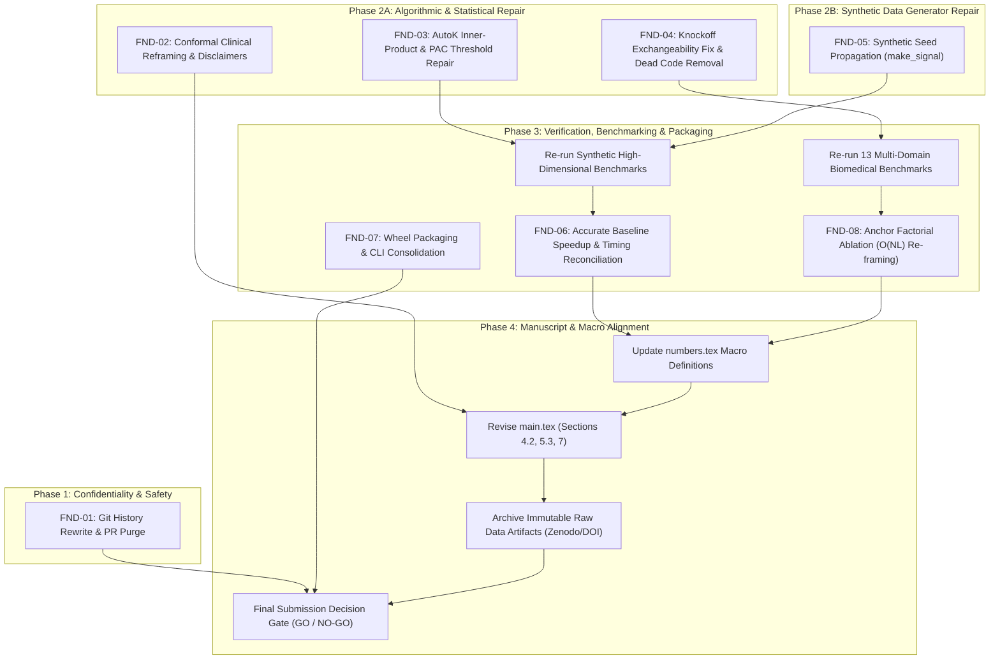

# Remediation Dependency Graph: ICC-Clustering Repository

**Target Repository**: `AkashKundu114/icc-clustering`  
**Current HEAD**: `7ddbe8301b8d27c94f388c40acbc88b0dee82723`  
**Audit Component**: Phase 7 — Structural Dependency Analysis and Remediation Scheduling  

---

## 1. Remediation Workflow Overview

The critical findings identified in the audit cannot be remediated in isolation. Mathematical and experimental dependencies dictate a strict order of operations:

1. **Pre-requisite (Git History & Confidentiality)**: Purging sensitive historical commits and PR refs must occur before freezing the codebase for publication.
2. **Phase 2A (Statistical Framing & Core Algorithms)**: Conformal prediction framing, AutoK inner-product repair, and Knockoff exchangeability fixes must occur prior to re-running experiments.
3. **Phase 2B (Data Generator & Leakage Fixes)**: The synthetic seed fix (`make_signal` seed propagation) must be implemented before any synthetic benchmarks are re-executed.
4. **Phase 3 (Benchmarking & Packaging)**: Full factorial benchmarks and wheel packaging tests can only execute after algorithmic and generator repairs are complete.
5. **Phase 4 (Manuscript & Documentation)**: Manuscript tables, text, figures, and macros in `main.tex` and `numbers.tex` are finalized using the verified artifacts from Phase 3.

---

## 2. Mermaid Directed Dependency Graph

---

## 3. Critical Path Analysis

The critical path for remediation comprises:

$$\text{FND-05 (Seed Fix)} \longrightarrow \text{FND-03 (AutoK Fix)} \longrightarrow \text{Synthetic & Real Benchmarks} \longrightarrow \text{FND-06 / FND-08 Reconciliation} \longrightarrow \text{numbers.tex Update} \longrightarrow \text{main.tex Alignment} \longrightarrow \text{Final Gate}$$

Any delay in resolving the core algorithmic bugs (AutoK $L_1$ concentration or synthetic seed freezing) will block the downstream benchmark suite and invalidate subsequent manuscript revisions.
