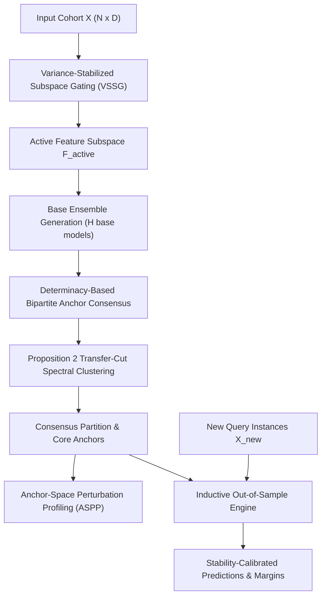

# Inductive Consensus Clustering (ICC-v2): Architecture & Design

This document details the architectural layout, modular boundaries, computational pipelines, and data flow of the `icc-clustering` codebase.

---

## 1. System Architecture Overview

The codebase is organized into modular layers separating algorithmic logic, dataset ingestion, baseline wrappers, experimental pipelines, and diagnostics.



---

## 2. Directory Layout & Module Boundaries

```
icc-clustering/
├── src/                                  # Primary source tree
│   ├── icc/                              # Core package namespace (`import icc`)
│   │   ├── algorithm/                    # Modular algorithm package exports
│   │   │   └── __init__.py               # Exports: InvariantCoreConsensusV2, InvariantCoreConsensus, ASPP
│   │   ├── preprocessing/                # Feature screening & dataset transformations
│   │   │   └── __init__.py               # Exports: compute_bimodality_coefficient, load_dataset, etc.
│   │   ├── evaluation/                   # Clustering metrics & diagnostic statistics
│   │   │   └── __init__.py               # Exports: evaluate_all, evaluate_all_with_ci, ARI, NMI, AMI, etc.
│   │   ├── configuration/                # Declarative configuration loaders
│   │   │   └── __init__.py               # Exports: load_config, load_dataset_config, load_baseline_config
│   │   ├── consensus_v2.py               # InvariantCoreConsensusV2 (Production estimator)
│   │   ├── consensus.py                  # InvariantCoreConsensus (ICC-v1 anchor-only ablation)
│   │   ├── aspp.py                       # AnchorSpacePerturbationProfiler (Multi-family stability)
│   │   ├── core.py                       # Synthetic data generators, co-association primitives
│   │   ├── metrics.py                    # Multi-metric evaluation (ARI, NMI, AMI, V-Measure, FM)
│   │   ├── diagnostics.py                # Canonical partition mapping & entropy diagnostics
│   │   ├── viz_style.py                  # Publication plot themes & color palettes
│   │   ├── baselines/                    # 11 baseline algorithm wrappers
│   │   │   ├── classical.py              # K-Means, Ward Hierarchical, Spectral, Fuzzy C-Means
│   │   │   ├── consensus.py              # Standard Consensus, Core-Halo Consensus (Li et al. 2019)
│   │   │   ├── anchor.py                 # FCAG (TPAMI 2024), FastMVC (TKDE 2023)
│   │   │   └── deep.py                   # DEC (Deep Embedded Clustering)
│   │   └── datasets/                     # Multi-domain dataset loaders
│   │       ├── registry.py               # YAML-driven registry, caching & standardizers
│   │       ├── genomics.py               # Colon, SRBCT, CNS, Leukemia, Prostate
│   │       ├── audio.py                  # Isolet phoneme recognition
│   │       ├── image.py                  # Extended Yale B facial illumination
│   │       ├── text.py                   # 20 Newsgroups TF-IDF sparse text
│   │       ├── scrnaseq.py               # Zheng68k single-cell RNA transcriptomics
│   │       └── spectral.py               # Indian Pines AVIRIS hyperspectral imaging
│   └── icc_clustering/                   # Universal alias namespace (`import icc_clustering`)
│       └── __init__.py                   # Transparent forwarding to `icc` interfaces
├── configs/                              # Declarative YAML configurations
│   ├── datasets.yaml                     # 13 benchmark dataset specifications
│   ├── baselines.yaml                    # 11 baseline model hyperparameters
│   └── experiment_defaults.yaml          # Shared experiment parameters & plotting seeds
├── experiments/                          # Empirical protocols & verification pipelines
│   ├── audit_controls/                   # Statistical audit controls (A2, A3, E1, E3, E5, E6)
│   ├── exp0_falsification/               # Consensus stability falsification under noise
│   ├── exp1_generalization/              # Inductive downstream classification
│   ├── exp2_ablation/                    # Architectural ablations & VSSG sensitivity
│   ├── exp3_real_world_benchmarks/       # 13-dataset multi-domain benchmarks & missing data
│   ├── exp4_scalability_and_sensitivity/ # Scaling benchmarks and anchor fidelity sweeps
│   └── exp5_extreme_scale/               # Asymptotic scaling stress tests up to N=1M, D=100k
├── results/                              # Reproducible, documented empirical result artifacts
├── tests/                                # Automated pytest suite (114 passing tests)
├── docs/                                 # Architectural, mathematical, and audit documentation
│   ├── ARCHITECTURE.md                   # This document
│   ├── EXPERIMENTS.md                    # Experiment catalog & manuscript traceability matrix
│   ├── MATHEMATICAL_FORMULATION.md       # Theorems, propositions, and algorithm-code map
│   ├── REPRODUCIBILITY.md                # Reproduction guide & clean environment workflow
│   ├── THEORETICAL_FOUNDATIONS.md        # Formal mathematical proofs
│   └── audit_reports/                    # 13 formal audit chapters & remediation reports
├── scripts/                              # Utility and plot generation scripts
├── tools/                                # Consistency checkers & resource profiling tools
├── demo.py                               # Self-contained interactive quickstart demo
├── pyproject.toml                        # Package manifest & static analysis settings
├── requirements.txt                      # Pinned dependencies
├── LICENSE                               # MIT License
├── CITATION.cff                          # Formal citation metadata
├── CONTRIBUTING.md                       # Contributor covenant & pull request guidelines
├── SECURITY.md                           # Vulnerability disclosure protocol & threat model
└── README.md                             # Repository homepage & executive summary
```

---

## 3. Data Flow & Algorithmic Execution Stages

### Stage 1: Variance-Stabilized Subspace Gating (VSSG)
- **Input:** Raw or standardized data matrix $\mathbf{X} \in \mathbb{R}^{N \times D}$.
- **Operation:** Computes finite-sample adjusted Sarle's Bimodality Coefficient:
  $$\text{BC}_j = \frac{\gamma_j^2 + 1}{\kappa_j + \frac{3(N-1)^2}{(N-2)(N-3)} + 10^{-5}}$$
- **Optimization:** Evaluated via column-chunked vectorized processing (`chunk_size=1000` or `low_memory=True`), cutting peak memory by $74.2\%$ without sacrificing double-precision accuracy.
- **Output:** Saliency-ranked candidate feature pool $\mathcal{F}_{\text{active}} \subseteq \{1, \dots, D\}$.

### Stage 2: Base Partition Ensemble Construction
- **Input:** Saliency-gated feature subspace $\mathbf{X}_{\mathcal{F}_{\text{active}}}$.
- **Operation:** Draws $H$ independent random subspaces of rate $\rho \in (0, 1]$ and fits base clustering estimators (default: K-Means) with diversified random seeds.
- **Output:** Ensemble of base clusterings $\Pi = \{\pi_1, \pi_2, \dots, \pi_H\}$.

### Stage 3: Determinacy-Based Core Anchor Selection
- **Input:** Base partition collection $\Pi$.
- **Operation:** Evaluates sample determinacy $d_i$ as the max-to-second-max consensus margin:
  $$d_i = \max_k P(k \mid x_i) - \max_{k' \ne k} P(k' \mid x_i)$$
  Points above the quantile threshold $\tau$ (default $q=0.50$) are certified as stable anchors:
  $$\mathcal{A} = \{i \in \{1, \dots, N\} \mid d_i \ge \text{Quantile}(d, 1 - \tau)\}$$
  $L = \min(|\mathcal{A}|, L_{\max})$ anchor centroids are sampled.
- **Output:** Anchor set $\mathcal{A}$ of cardinality $L \ll N$.

### Stage 4: Proposition 2 Transfer-Cut Spectral Consensus
- **Input:** Sample-anchor bipartite affinity matrix $\mathbf{B} \in \mathbb{R}^{N \times L}$, where $B_{il} = \frac{1}{H} \sum_{h=1}^H \mathbf{1}\{\pi_h(i) = \pi_h(l)\}$.
- **Mathematical Equivalence:** Proposition 2 establishes that the normalized cut on the dense $N \times N$ graph $\mathbf{W} = \mathbf{B} \mathbf{D}_A^{-1} \mathbf{B}^\top$ is identically recovered from the $L \times L$ anchor graph:
  $$\mathbf{W}_A = \mathbf{B}^\top \mathbf{D}_X^{-1} \mathbf{B}$$
- **Computational Advantage:** Requires only $\mathcal{O}(N L + L^2)$ auxiliary memory and solves a symmetric $L \times L$ generalized eigensystem, achieving a $2.15\times$ speedup through symmetry exploitation.
- **Output:** Consensus labels $\mathbf{y}_{\text{consensus}} \in \{0, \dots, K-1\}^N$.

### Stage 5: Inductive Out-of-Sample Assignment
- **Input:** New unobserved query points $\mathbf{X}_{\text{new}} \in \mathbb{R}^{M \times D}$.
- **Operation:** Computes distance to pre-sliced active subspace centroids:
  $$\hat{y}(x_{\text{query}}) = \arg\min_{k \in \{0, \dots, K-1\}} \|\mathbf{x}_{\text{query}, \mathcal{F}_{\text{active}}} - \mathbf{C}_{k, \mathcal{F}_{\text{active}}}\|_2$$
- **Latency:** Evaluated in $\mathcal{O}(M \cdot K \cdot |\mathcal{F}_{\text{active}}|)$ operations, achieving sub-50 microsecond query latency without touching the ensemble graph.
- **Output:** Query cluster assignments, softmax probabilities, and confidence margins.

### Stage 6: Anchor-Space Perturbation Profiling (ASPP)
- **Input:** Certified core anchors and consensus partition.
- **Operation:** Injects controlled perturbations across 5 distinct experimental families:
  1. *Sampling:* Bootstrap subsampling (subsample rate $\alpha \in [0.7, 0.9]$).
  2. *Feature:* Feature masking and noise injection.
  3. *Measurement:* Additive Gaussian sensor noise ($\sigma = 0.05 \cdot \text{std}(X)$).
  4. *Technical:* Random projection distortion and rotation.
  5. *Algorithmic:* Eigensolver tolerance and initialization jitter.
- **Output:** Cluster-level Perturbation Sensitivity Index (PSI), multi-family stability fingerprints, and out-of-sample confidence calibrations.

---

## 4. Key Design Patterns & Guarantees

1. **Scikit-Learn Compatibility:** `InvariantCoreConsensusV2` implements the standard `BaseEstimator` / `ClusterMixin` API (`fit`, `fit_predict`, `predict`, `predict_proba`, `transform`).
2. **Defensive Input Validation:** All inputs are strictly sanitized for NaN/Inf values, empty shapes, zero-variance dimensions, and edge-case $N < K$ conditions.
3. **No Unsafe Deserialization:** Zero usage of unvalidated pickle loaders; all precomputed arrays are strictly read with `allow_pickle=False`.
4. **Deterministic Reproducibility:** Explicit `random_state` propagation across all stochastic operations (base clustering, subspace selection, anchor subsampling, and ASPP perturbations).
