# Research Audit: Dataset Lineage Graph & Cohort Interdependence

**Document Reference:** `research_audit/cohort_independence/DATASET_LINEAGE.md`  
**Related File:** `results/cohort_independence/dataset_lineage.csv`  
**Audit Date:** 2026-11-01  
**Auditor:** Senior Computational Biologist & Machine Learning Auditor  

---

## 1. Visual Dataset Lineage Architecture

The following directed acyclic graph visualizes confirmed patient lineage, exact duplicate matrices, composite study ingestions, and mislabeled non-biological datasets:

```mermaid
graph TD
    %% Independent Biological Cohorts (Green)
    classDef independent fill:#d4edda,stroke:#28a745,stroke-width:2px;
    classDef duplicate fill:#f8d7da,stroke:#dc3545,stroke-width:2px;
    classDef composite fill:#fff3cd,stroke:#ffc107,stroke-width:2px;
    classDef nonbio fill:#e2e3e5,stroke:#6c757d,stroke-width:2px;

    subgraph Independent_Core_Oncology [Confirmed Independent Biological Cohorts]
        COLON["Colon Cancer<br/>(Alon 1999, N=62)"]:::independent
        SRBCT["SRBCT<br/>(Khan 2001, N=83)"]:::independent
        LEUK["Golub Leukemia<br/>(Golub 1999, N=72)"]:::independent
        CNS["CNS Medulloblastoma<br/>(Pomeroy 2002, N=60)"]:::independent
        PROSTATE["Prostate Microarray<br/>(Singh 2002, N=102)"]:::independent
        OVARIAN["Ovarian Proteomics<br/>(Petricoin 2002, N=253)"]:::independent
        DLBCL["DLBCL vs FL<br/>(Shipp 2002, N=77)"]:::independent
        BREAST["Breast Cancer 5yr<br/>(van 't Veer 2002, N=97)"]:::independent
        SU2001["11 Solid Tumors<br/>(Su 2001, N=174)"]:::independent
        ENDOMETRIUM["Endometrium/Kidney<br/>(Risinger 2003, N=321)"]:::independent
        GLI["Glioma Grade<br/>(Nutt 2003, N=85)"]:::independent
        ZHENG["PBMC 68k Single-Cell<br/>(Zheng 2017, N=700)"]:::independent
        ARRHYTHMIA["ECG Arrhythmia<br/>(Guvenir 1997, N=452)"]:::independent
    end

    subgraph Composite_and_Duplicate_Lineages [Duplications & Shared Sample Lineages]
        GLIOMA_E1["glioma (in e1 cache)<br/>(OpenML 1107)"]:::duplicate
        GCM["Global Cancer Map (GCM)<br/>(Ramaswamy 2001, N=190)"]:::composite
        LUNG_E1["lung_cancer (in e1 cache)<br/>(OpenML 1106)"]:::composite
        LYMPHOMA_E1["lymphoma (in e1 cache)<br/>(OpenML 1157)"]:::independent
        LEUK3["Leukemia-3<br/>(OpenML 45091)"]:::duplicate
    end

    subgraph Mislabeled_Disqualified_Files [Non-Biological Misattributions]
        MAGIC["breast_cancer_genomic<br/>(OpenML 1120: MagicTelescope D=10)"]:::nonbio
        CHESS["gisette<br/>(OpenML 41027: Jungle Chess D=6)"]:::nonbio
        MNIST["usps<br/>(OpenML 554: MNIST 784)"]:::nonbio
    end

    %% Lineage Connections
    CNS === |"100% Bit-for-Bit Duplicate Matrix (SHA-256 Match)"| GLIOMA_E1
    LEUK --> |"Ingests 61 / 72 Patients (r >= 0.99)"| GCM
    CNS --> |"Ingests 8 / 60 Patients (r > 0.90)"| GCM
    GCM === |"Exact OpenML 1106 Dataset (Mislabeled Alias)"| LUNG_E1
    ENDOMETRIUM === |"Exact OpenML 1157 Dataset (Mislabeled Alias)"| LYMPHOMA_E1
    LEUK === |"Same Patients, 3-Class Subtypes"| LEUK3
```

---

## 2. Forensic Analysis of Identified Lineage Edges

### Edge 1: CNS <---> Glioma (`e1_extended_benchmarks.py`)
- **Classification:** **100% Bit-for-Bit Exact Duplicate**
- **Mathematical Proof:** Both `cns.npz` and `glioma.npz` produce SHA-256 hash `0e449bf55f8e5682de8de4264c986c1b85b27f25ca0092b5a8a98ca2bb2a87ff` ($N=60, D=7129$).
- **Root Cause:** OpenML dataset ID 1107 is `tumors_C` (CNS embryonal tumors), which was misassigned as Glioma in `e1_extended_benchmarks.py:72`.
- **Scientific Impact:** The 21-dataset benchmark counted the exact same 60 patients twice, artificially inflating reported degrees of freedom.

### Edge 2: Golub Leukemia + Pomeroy CNS ---> Ramaswamy Global Cancer Map (GCM)
- **Classification:** **Shared Patient Cohort / Composite Ingestion**
- **Mathematical Proof:** Cross-correlation across all 7,129 Affymetrix Hu6800 probes establishes that **61 of 72 Golub leukemia patients** match GCM samples with Pearson $r \ge 0.990$ (max $r = 0.99917$). Furthermore, **8 of 60 Pomeroy CNS patients** match GCM with Pearson $r > 0.90$.
- **Root Cause:** Ramaswamy et al. (PNAS 2001) built the Global Cancer Map by pooling previously published microarrays from their Whitehead/Broad Institute collaborators (Golub et al. 1999 and Pomeroy et al. 2002).
- **Scientific Impact:** GCM cannot be evaluated alongside Leukemia or CNS in cross-cohort generalizability testing without inducing patient-level data leakage.

### Edge 3: MagicTelescope ---> `breast_cancer_genomic` (`e1_extended_benchmarks.py`)
- **Classification:** **Catastrophic Pipeline Misattribution**
- **Proof:** OpenML ID 1120 is `MagicTelescope`, an astrophysics simulation of Cherenkov gamma-ray showers ($N=19020, D=10$).
- **Scientific Impact:** Must be disqualified immediately from any claim of biological generalizability.

### Edge 4: Jungle Chess ---> `gisette` (`e1_extended_benchmarks.py`)
- **Classification:** **Catastrophic Pipeline Misattribution**
- **Proof:** OpenML ID 41027 is `jungle_chess_2pcs_raw_endgame_complete` ($N=1000, D=6$), not Guyon's NIPS 2003 Gisette handwriting challenge ($D=5000$).
- **Scientific Impact:** Must be disqualified immediately.